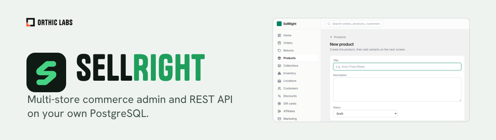

<picture><source media="(prefers-color-scheme: dark)" srcset=".github/banner-dark.svg"></picture>

# SellRight

A self-hosted, multi-store commerce backend with a REST API, a browser-based admin and a generic storefront.

SellRight keeps catalog, carts, checkout, payments and order operations in one PostgreSQL-backed system. The included Qwik storefront resolves the store per request host and is still being migrated onto the REST path (see [features](docs/FEATURES.md)); other storefronts consume the API independently.

> **Try it:** a synthetic demo shop runs at [demo.sellright.cc](https://demo.sellright.cc).
> **Status:** pre-1.0. Suitable for development and evaluation; production adoption requires gateway acceptance, migration rehearsal, backups and rollback verification.
> **License:** source-available under the Business Source License 1.1, free for organizations with up to 25 Covered Persons; each version converts to Apache-2.0 on its Change Date.

## What you get

| Area | Included |
|---|---|
| Catalog | Products, variants, collections, inventory, promotions, shipping, tax |
| Checkout | Persistent carts separate from orders; server-authoritative prices |
| Payments | Stripe, NMI and Sezzle adapters; reconciliation; refunds. Implemented adapters are not a claim that every merchant deployment has passed acceptance |
| Operations | Customer accounts, orders, returns, fulfillment, transactional email |
| Multi-store | Staff permissions; PostgreSQL row-level security |
| Integration | REST/OpenAPI, static catalog exports, Vendure importer, software licensing |
| Storefront | Generic Qwik storefront, store resolved per request host; typed REST client generated from the OpenAPI contract |
| Mobile | [SellRight Admin for iOS](ios/README.md): dashboard KPIs, orders with search, filter, detail and fulfillment with tracking, products, multi-store switching, TOTP login, push (needs an APNs key) and a Live Activity that follows an order from paid to delivered. Android: coming soon |

See [architecture](docs/ARCHITECTURE.md) for boundaries and [features](docs/FEATURES.md) for detail.

## Run it

Use a host with Docker Compose and ports 80/443 available. For an existing reverse proxy, adapt the edge routing rather than taking over those ports.

The supported single-instance path is the installer from the [operations runbook](docs/runbooks/production-compose.md). It installs Docker and cosign, writes `deploy/.env` with generated secrets, pulls pinned, cosign-verified images from GHCR and installs the `sellright` management command:

```sh
curl -fsSL https://raw.githubusercontent.com/Orthic-Labs/sellright/main/deploy/install.sh | sudo sh
```

To run the stack by hand instead:

1. Clone this repository and enter its directory.
2. Copy `deploy/.env.example` to `deploy/.env`. Set the domain, store details and independently generated passwords/secrets, and add `SELLRIGHT_MASTER_KEY` (a long random secret, for example `openssl rand -hex 32`); `deploy/compose.yaml` refuses to start without it.
3. Create `deploy/gateway-accounts.json` containing `[]` until configuring NMI or Sezzle. Never commit merchant keys. The profile format is defined in `packages/api/src/payments/gateway-account.ts`.
4. Point the configured hostname at the host, then run:

```sh
docker compose --env-file deploy/.env -f deploy/compose.yaml up -d
```

`deploy/compose.yaml` pulls pinned images from GHCR and has no build contexts. To build from source instead, add `-f deploy/compose.build.yaml` and `--build`.

The stack includes PostgreSQL, the API, admin, the storefront and the Caddy TLS proxy; the storefront is published only when `SELLRIGHT_STOREFRONT_DOMAIN` is set in `deploy/.env`. Migrations/bootstrap use the database owner; HTTP requests use a separate non-owner role. Bootstrap is create-only and does not reset existing passwords on restart.

Read the [operations and restore runbook](docs/runbooks/production-compose.md) before relying on the deployment.

## Develop

Use Node.js 24 and the exact pnpm version in `package.json`. PostgreSQL 17 is the integration-test target.

```sh
pnpm install --frozen-lockfile
pnpm --dir packages/admin install --frozen-lockfile
```

Copy the package-local `.env.example` files to `packages/api/.env` and `packages/admin/.env`. Configure a development database and a non-owner runtime role using the [database-role runbook](docs/runbooks/postgres-app-role.md). Use the schema owner only for migrations/bootstrap.

```sh
pnpm --filter @sellright/shared build
pnpm --filter @sellright/api build
DATABASE_URL='<schema-owner-url>' pnpm --filter @sellright/api db:migrate:runtime
pnpm --filter @sellright/api dev
```

Replace the migration URL placeholder with your development schema-owner connection. Keep the API's package-local `DATABASE_URL` on the runtime role. Run the admin in another terminal with `pnpm --dir packages/admin dev`. The API contract is at `http://localhost:3300/v1/openapi.json`. First-store bootstrap requires `BOOTSTRAP_STORE_SLUG`, `ADMIN_EMAIL` and `ADMIN_PASSWORD` (at least 12 characters); with those configured, run `pnpm --filter @sellright/api bootstrap:runtime` using the schema-owner connection. See the [deployment example](deploy/.env.example).

## Verify

```sh
pnpm verify:static
pnpm --dir packages/admin test
pnpm deps:audit
```

Database tests require a dedicated disposable `*_test` database. They can truncate fixture tables: never point them at a development clone or production. After provisioning/migrating that test database, run `pnpm --filter @sellright/api test:db` and `pnpm verify:db`. Provider-enabled tests have additional opt-in guards.

## Documentation

- [Architecture](docs/ARCHITECTURE.md)
- [Email delivery](docs/EMAIL.md)
- [Migrations](docs/runbooks/migrations.md)
- [Deployment, backup and restore](docs/runbooks/production-compose.md)
- [Isolated synthetic demo](deploy/demo/README.md)
- [Contributing](CONTRIBUTING.md)
- [Security reporting](SECURITY.md)
- [Changelog](CHANGELOG.md)

## License

SellRight is source-available under the **Business Source License 1.1**, not an OSI Open Source license before its Change Date. Production use is free for organizations with no more than **25 Covered Persons**, as defined in [LICENSE](LICENSE); larger organizations require a commercial license. Each version converts to Apache-2.0 on its Change Date. The license text is authoritative.

---

<picture><source media="(prefers-color-scheme: dark)" srcset=".github/orthic-labs-mark.svg"></picture> **[Orthic Labs](https://orthiclabs.com)** · [github.com/Orthic-Labs](https://github.com/Orthic-Labs) · More: [Legion](https://github.com/Orthic-Labs/legion) · [Ember](https://github.com/Orthic-Labs/ember) · [SwiftRight](https://github.com/Orthic-Labs/swiftright) · [Pulse](https://github.com/Orthic-Labs/pulse) · [RightKit](https://github.com/Orthic-Labs/rightkit) · [RustRight](https://github.com/Orthic-Labs/rustright)
