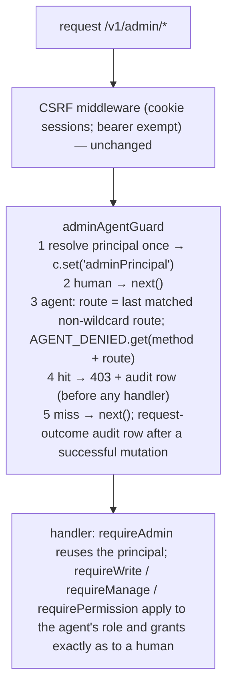

> Historical (2026-10-10). Current state: docs/ADMIN-AGENTS.md.

# Agent seats + API-token login for the SellRight admin — implementation plan (v5.1, self-contained)

**v5.1, 2026-10-10.** Astra round 5 on v5 (`gpt-6-astra`, high; raw JSON beside this file: `…astra-review-v5.json`): **reject/13**. Every finding verified against the code and folded here (§7). The four critical ones were deny-set gaps under the owner's own rule — refund via return approval and order-edit settlement, credential writes via SheerID/Listmonk/preview-token/Google settings, reconciliation re-drives, and a public-route exemption that skipped the deny check — not objections to the trust model. **Supersedes v5 and v4.1** (`2026-10-10-agent-role.md`, kept for history). v1–v4 were built on an assumption the owner has now overturned: that the agent is untrusted and must be unable to touch money or prices even if it tries. Adrian's decision (chat, 2026-10-10): **an agent is a staff seat.** It gets a role and per-action permissions exactly like a human, and the only agent-specific limit is a hard block on *irreversible* actions — the backend equivalent of "you can `pg_dump` without sudo, you cannot drop a database." Disabling a product is fine; deleting it needs a human. Creating a draft order, exporting orders, approving a review, changing a price: all fine if the role allows it.

Astra's four prior rounds remain useful for the *mechanics* they corrected (body handling, route identity, token binding, race handling, fixtures, inventory gate). Their *scope* findings no longer apply. v5 is self-contained; no section refers to an earlier version except §6.

**Goal:** a store owner creates an agent seat, assigns it a role and permissions, and hands the agent an `sra_` token. The agent operates the admin API and the admin UI as that seat, without password, e-mail or 2FA. Whatever its role or grants, it can never perform an irreversible action (hard delete, cancel, purge, refund, payout, licence issue/revoke, release publish), manage identities or credentials, or run system operations. Every request is attributed to the agent in the audit log; tokens rotate and revoke instantly.

**Architecture:** `admin_user.kind = 'agent'` marks the identity (no new role; agents hold an ordinary `staff` / `manager` / `read_only` grant with the existing `permissions` jsonb). An RLS-exempt `admin_api_token` registry holds hashed tokens. `session.api_token_id` binds an agent's browser session to the token that minted it (unique partial index: one live session per token). One middleware on `/v1/admin/*` resolves the principal once and, for agents, looks up the matched route in `AGENT_DENIED`; a hit is a 403 with an audit row, a miss falls through to the ordinary role/permission guards. No body inspection. A CI script proves the deny set covers every registered `DELETE` route and every route whose path names an irreversible verb, so new routes cannot slip past it.

**Tech stack:** existing only — Hono 4.13.8 (`hono/route` `matchedRoutes` helper), `@hono/zod-openapi`, Drizzle (hand-written journaled SQL), Node `crypto`, React admin (TanStack Query), Vitest `unit`/`db` projects, Playwright admin e2e. No new dependencies. `pnpm exec`, never `npx`.



| | human staff | **agent (same role + grants)** |
|---|---|---|
| Reads | by role | **by role** (billing address stripped from order detail) |
| Additive / reversible writes: create, edit, disable, publish, stock, unpaid drafts, fulfil paid orders, trash/restore, approve/reject/reply, discounts/gift cards/loyalty/webhooks if granted, settings if manager | by role + grants | **by role + grants** |
| Irreversible: hard delete (16 routes), cancel, bulk-cancel, bulk-purge, refund (incl. return approval, edit `refund_now`), affiliate settle, settlement re-drives, draft → paid (`markPaid`), licence issue/revoke, reservation override, SheerID revoke/clear, release publish | by role + grants | **never** |
| Identity + credentials: staff/agents management, 2FA, step-up, password, payment + e-mail credentials, system ops | by role | **never** |

---

## 0. ADR

- **Product outcome.** Success: an agent with a `staff` seat on Rotten creates a product, disables it, prepares a draft order, fulfils a paid order, approves a review and exports orders; the same agent gets a 403 with an audit row on `DELETE /products/{id}`, `POST /orders/{code}/cancel`, `POST /orders/{code}/refund`, `POST /draft-orders` with `markPaid`, and `POST /staff`, even after an owner grants it `refunds: true`. Non-goals: storefront/customer-side agents; OAuth; per-agent custom scopes beyond the existing permission matrix.
- **Context.** SellRight already has the role model e-commerce needs (`owner` / `manager` / `staff` / `read_only` + per-action grants `refunds`, `cancel_orders`, `giftcards`, `licenses`, `loyalty`, `affiliate_payouts`, `releases`, `webhooks`). What it lacks is a non-interactive identity: no API-token login, and every admin is assumed to have a password and possibly TOTP. The owner's threat model is "the agent is trusted like a staff member; protect against the irreversible, not the additive." The residual risk the owner accepts knowingly: an agent reads customer-written text (reviews, notes, contact messages) and could be steered by it; mitigation is the deny set plus full audit attribution.
- **Decision.** Agent = `admin_user.kind='agent'` + ordinary grant. One deny set keyed by exact registered route, enforced once in middleware before any handler, winning over every grant. Token-bound single browser sessions. Immutable identity across every provisioning path. Completeness by a CI invariant (every `DELETE` route and every irreversible-verb route must be in the set).
- **Alternatives.** (a) v4.1 positive capability table with body-key lists — rejected by the owner as the wrong trust model; it also could not express "create a draft order" without re-deriving half the API. (b) A new `agent` enum role — rejected: it would duplicate the permission matrix and every guard; `kind` + existing roles reuse it. (c) Settings-only (give the agent a staff login) — rejected: no token login, no immutable identity, no hard block.
- **Riskiest assumption.** A future irreversible route is added without a `DELETE` method or an irreversible verb in its path, so the invariant script does not catch it. Mitigation: `agent-policy.ts` under CODEOWNERS; the invariant regex is reviewed with every route addition; the deny set is the first thing a reviewer reads.
- **Blast radius.** `requireAdmin`, one middleware, `session` (+1 column, +1 index), `admin_user` (+1 column), `/v1/admin/me`, staff routes (agent-identity refusals), order detail (billing strip), the Staff page. No storefront, payment, settlement or stock-architecture code. No existing handler changes its guard.
- **Reversibility.** Tokens revoke instantly and their sessions die; removing an agent drops its grant; DOWN in the migration.
- **Hidden coupling.** `@sellright/api/schema` re-exports the Drizzle namespace, so `adminApiToken` becomes reachable (additive; exports-contract totals pinned at 174 are unchanged by receipt). Storefront-client OpenAPI contract covers admin routes and is regenerated. `assert-force-rls.ts` EXEMPT list; `assert-no-partial-index-drop.mjs` protects the new partial index; `route-inventory.golden.json` gains five routes; ESLint forbids `unsafeUnscopedDb` in `routes/**` (the middleware and lifecycle live in `auth/`, which is allowed). Revocation is linearised at request start: a request whose principal resolved before a rotation commits completes; the next request is refused.

Owner approval of the trust model and the deny set: chat, 2026-10-10 ("disabling is not destructive; deleting is… similarly on the backend level, this is what I expect").

## 1. Owner decisions (defaults applied; change before execution)

| # | Question | Default |
|---|---|---|
| D1 | What is hard-blocked for agents | The `AGENT_DENIED` set in §3.3b: every `DELETE` route; cancel / bulk-cancel / bulk-purge; refund / edit-refund / affiliate settle; licence issue+revoke, reservation override-release, SheerID revoke, verification clear; release publish; staff + agents management; 2FA, step-up; payment + e-mail credential settings and verify; system checklist + canary. **Trash/restore, disable, unpublish, test-send e-mail, cache purge, IndexNow are allowed** (reversible or harmless). |
| D2 | Roles an agent may hold | `staff`, `manager`, `read_only`. **Never `owner`** (billing, store deletion, owner-level staff changes). Enforced at creation, at re-role, and at token resolution. |
| D3 | Browser session | ≤12 h, capped at token expiry, one live session per token (DB-enforced). |
| D4 | Token expiry | None by default; optional; rotation preserves it. |
| D5 | Who creates / rotates / removes agents | `owner` or `manager` (`requireManage`). Re-role and permissions: the normal Staff-page path with its existing owner rules. |
| D6 | Customer PII | Billing address stripped from `GET /orders/{code}` for agents (owner: "if it makes you feel better, strip it"). Shipping address, e-mail and phone stay — fulfilment and notifications need them. |
| D7 | Grants vs deny set | Deny set wins. `refunds: true` on an agent is accepted by the staff route (so the matrix works uniformly) but the refund route still 403s. |
| D8 | Delivery | Commit to `main` on the server checkout per `agent-rules.md` after Task 11 is green locally; push `origin/main`. (Owner voided the no-commit rule 2026-10-10.) |
| D9 | `revoke-sessions` on an agent | 400 "use /agents/{id}/rotate". |
| D10 | Draft orders and payment truth | **An agent may never be the source of truth that money arrived.** `POST /v1/admin/draft-orders` is allowed with `markPaid: false`: the order lands as `PendingPayment`, no payment is recorded, no paid-order effects run, the fulfilment queue and every fulfil route ignore it (they admit only `Paid`). From there two things can make it `Paid`: **(a) the customer pays** through the storefront (`POST /v1/shop/orders/{code}/pay`, payment-intent + gateway verify, or a Stripe webhook) — provider-verified, moves automatically, no human and no agent involved; **(b) a human marks it paid** (`markPaid: true`, which writes a `manual` tender — an assertion of money the system cannot verify). The agent cannot do (b): `requireHuman` on that branch (Adrian, 2026-10-10: "if the agent creates a fake payment or a credit, it has to be physically converted by a human"; a paid order is a fulfilment request, and with a fulfilment centre attached a physical product ships). This is the only admin path that creates a paid order without a gateway payment (`admin-order-ops.ts:105-134`). A future admin "send payment link" route is additive and would be allowed. |
| D10a | Manual payment on an order edit | `POST /orders/{code}/edit/commit` with `settlement.type = 'record_payment'` writes a manual, unverified tender and can turn an unpaid order Paid. Human-only, same rule as D10 (found by the Astra review of PR 181). |
| D12 | Credit (gift cards, loyalty points) | **An agent may never put spendable credit into a customer's hands.** Gift cards: the agent may *create* one, but it is created **disabled** (`enabled = false`, forced in the handler for agents whatever the body says) — a human enables it from the existing gift-card list. `PATCH /gift-cards/{id}` with `enabled: true` or a balance `adjust` requires a human; `enabled: false` (disabling) stays allowed. Loyalty: `POST /customers/{id}/loyalty/adjust` and `POST /loyalty/ledger/{id}/reverse` are denied outright (`credit` group) — the admin's per-customer points ledger with manual up/down adjustment (`components/CustomerLoyalty.tsx`) is human-only. Loyalty *settings* (earn rate) stay by role. (Adrian, 2026-10-10.) |
| D11 | Mixed routes | Five allowed routes carry a human-only branch that the route key cannot express, each enforced inside the handler on that branch only: `POST /draft-orders` with `markPaid: true` (D10); `POST /orders/{code}/edit/commit` with `settlement.type = 'refund_now'`; `POST /gift-cards` (agents' cards are forced disabled, D12); `PATCH /gift-cards/{id}` with `enabled: true` or `adjust` (D12). `POST /returns/{id}/approve` is denied outright (`money_out`) because it always reserves a refund. Ordinary drafts, ordinary order edits, and disabling a gift card stay allowed. |

## 2. File map and budget

| File | Responsibility |
|---|---|
| `packages/api/drizzle/0094_agent_seats.sql` *(new)*, `drizzle/meta/_journal.json`, `src/db/assert-hand-written-migrations.ts`, `docs/runbooks/migrations.md` | schema + registration |
| `packages/api/src/db/assert-force-rls.ts`, `packages/api/scripts/assert-no-partial-index-drop.mjs` | EXEMPT list; protect `session_api_token_unique` |
| `packages/api/src/db/schema-core.ts` | `adminUser.kind`, `adminApiToken`, `session.apiTokenId` |
| `packages/api/src/auth/admin-session.ts` | principal fields; token-bound resolution with owner/store binding; `createAdminSessionTx` |
| `packages/api/src/auth/admin-api-token.ts` *(new)* + `.test.ts` | token format/hash; tx-aware mint/revoke/list; resolve with real role + grants |
| `packages/api/src/auth/agent-policy.ts` *(new)* + `.test.ts` | `AGENT_DENIED`, `agentDenied()` |
| `packages/api/src/auth/agent-lifecycle.ts` *(new)* | transactional create / rotate / remove / bootstrap |
| `packages/api/src/auth/admin-staff.ts` | `listStoreStaff` returns `kind`; `adminKindByEmail`, `adminKindById` |
| `packages/api/src/routes/admin-helpers.ts` + `.test.ts` *(append)* | principal reuse (typed); `requireHuman`; kind checks in `requireInstallationAdmin` / `requireStepUp` |
| `packages/api/src/routes/admin-agent-guard.ts` *(new)* | middleware + `ContextVariableMap` augmentation |
| `packages/api/src/routes/admin-agents.ts` *(new)*, `admin-agents.db.test.ts` *(new)* | `/v1/admin/agents` CRUD + `browser-session`; boundary tests |
| `packages/api/src/routes/admin.ts` | `/me` returns `kind`,`auth`; order detail billing strip; `requireHuman` on step-up |
| `packages/api/src/routes/admin-settings.ts`, `admin-system.ts`, `admin-order-edit.ts`, `admin-order-ops.ts`, `admin-marketing.ts` | `requireHuman` on 2FA routes and step-up; mixed-route branches: order-edit `refund_now` (D11), draft `markPaid` (D10), gift-card create-disabled / enable / adjust (D12) |
| `packages/api/src/db/rls-tables.test.ts`, `src/scripts/bootstrap.ts`, `src/scripts/seed-admin.ts` | EXEMPT registry copy; scripts refuse agent identities |
| `packages/api/src/routes/admin-settings-advanced.ts` | staff list `kind`; POST/invites/accept refuse agent e-mails; PATCH refuses `owner` for agents; revoke-sessions → 400; DELETE revokes tokens |
| `packages/api/src/app.ts` | mount middleware + `adminAgents` |
| `packages/api/src/sdk/route-inventory.golden.json`, `packages/storefront-client/openapi.json`, `packages/storefront-client/src/generated/schema.d.ts` | +5 agent routes; regenerated contract |
| `packages/api/scripts/assert-agent-boundary.mjs` *(new)*, `packages/api/package.json`, root `package.json` | deny-set invariants; wired into root `verify:static` |
| `packages/api/src/scripts/agent-token.ts` *(new)* | owner script |
| `packages/admin/src/api.ts`, `pages/staff-permissions.tsx`, `pages/Staff.tsx`, `pages/AgentAccess.tsx` *(new)*, `e2e/agents.spec.ts` *(new)* | UI + e2e |
| `docs/ADMIN-AGENTS.md` *(new)*, `CHANGELOG.md`, `.github/CODEOWNERS` *(new file)* | docs; policy ownership |

**Execution packet.** `total_minutes: 400` (one elapsed clock). Inputs: ~1,050 new/changed source lines (schema 50 · auth 300 · routes/middleware 170 · tests 370 · UI 110 · script/docs 50) + ~200 generated (contract, golden) + existing-test literal edits; `code_rate_lines_per_hour: 300`. Lanes (minutes): L1 schema+auth T1–T2 0–70 · L2 policy+middleware+guards+inventory T3 50–140 · L3 lifecycle+routes+script T4–T6 120–200 · L4 DB tests T7 160–270 · L5 UI+e2e+docs T8–T10 200–320 · L6 gate+generated artifacts+commit T11 320–360. Ceilings: `max_files: 44`, `max_changed_lines: 1,450`, `variance_threshold: ±10 %` per lane — stop and report with a variance receipt at any ceiling.

## 3. Tasks

Conventions: API commands from `packages/api`; DB tests on the repo's `*_test` database (`postgres://sellright@127.0.0.1:5433/sellright_test`, the name used by every existing `*.db.test.ts`), migrated first. **Receipts before any change** into `docs/plans/receipts/2026-10-10-agent-seats-baseline.txt`: `pnpm -s test:db` failing test names on `main`; the pinned totals printed by `pnpm exec vitest run src/sdk/exports-contract.test.ts`.

### Task 1 — migration 0094 and schema

**1a. `packages/api/drizzle/0094_agent_seats.sql`:**

```sql
-- HAND-WRITTEN: see docs/runbooks/migrations.md — do NOT regenerate via drizzle-kit.
-- 0094: automation agent seats (docs/plans/2026-10-10-agent-role-v5.md).
--  (1) admin_user.kind marks agent identities: no password, TOTP, invite or magic link, ever.
--      Agents hold an ORDINARY admin_user_store role (staff/manager/read_only — never owner); the only
--      agent-specific limit is the deny set in src/auth/agent-policy.ts, enforced by middleware.
--  (2) admin_api_token: long-lived hashed credentials resolved by requireAdmin for 'sra_' bearers.
--      Registry table like session / admin_user_store: resolved before any store context, so it is
--      deliberately RLS-EXEMPT (src/db/assert-force-rls.ts); isolation is the 256-bit hash joined to
--      its single (admin_user_id, store_id) grant on every request.
--  (3) session.api_token_id binds an agent's browser session to the token that minted it; the unique
--      partial index makes "one live browser session per token" a database invariant
--      (protected from spurious drops by scripts/assert-no-partial-index-drop.mjs).
ALTER TABLE "admin_user" ADD COLUMN IF NOT EXISTS "kind" text NOT NULL DEFAULT 'human';--> statement-breakpoint
ALTER TABLE "admin_user" DROP CONSTRAINT IF EXISTS "admin_user_kind_check";--> statement-breakpoint
ALTER TABLE "admin_user" ADD CONSTRAINT "admin_user_kind_check" CHECK ("kind" IN ('human', 'agent'));--> statement-breakpoint
CREATE TABLE IF NOT EXISTS "admin_api_token" (
	"id" uuid PRIMARY KEY DEFAULT gen_random_uuid() NOT NULL,
	"admin_user_id" uuid NOT NULL REFERENCES "admin_user"("id") ON DELETE cascade,
	"store_id" uuid NOT NULL REFERENCES "store"("id") ON DELETE cascade,
	"name" text NOT NULL,
	"token_hash" text NOT NULL UNIQUE,
	"created_by" text,
	"last_used_at" timestamp with time zone,
	"expires_at" timestamp with time zone,
	"revoked_at" timestamp with time zone,
	"created_at" timestamp with time zone DEFAULT now() NOT NULL
);--> statement-breakpoint
CREATE INDEX IF NOT EXISTS "admin_api_token_user_store_idx" ON "admin_api_token" ("admin_user_id", "store_id");--> statement-breakpoint
ALTER TABLE "session" ADD COLUMN IF NOT EXISTS "api_token_id" uuid REFERENCES "admin_api_token"("id") ON DELETE cascade;--> statement-breakpoint
CREATE UNIQUE INDEX IF NOT EXISTS "session_api_token_unique" ON "session" ("api_token_id") WHERE "api_token_id" IS NOT NULL;

-- DOWN (manual):
-- ALTER TABLE "session" DROP COLUMN "api_token_id";
-- DROP TABLE "admin_api_token";
-- ALTER TABLE "admin_user" DROP CONSTRAINT "admin_user_kind_check"; ALTER TABLE "admin_user" DROP COLUMN "kind";
```

**1b.** Journal: `{ "idx": 85, "version": "7", "when": 1790000013100, "tag": "0094_agent_seats", "breakpoints": true }`.

**1c.** `HAND_WRITTEN` += `'0094_agent_seats.sql'`. Runbook row: `| \`0094_agent_seats.sql\` | Agent seats: \`admin_user.kind\`, RLS-exempt \`admin_api_token\`, \`session.api_token_id\` with a unique partial index (drizzle-kit does not model partial indexes; guarded like \`license_activation_token_hash\`). Same drift reason as \`0072\`-\`0093\`. |`

**1d.** `src/db/assert-force-rls.ts` EXEMPT += `'admin_api_token'` **and** `src/db/rls-tables.test.ts` EXEMPT (line 37, a separate copy that discovers every `store_id` table) += `'admin_api_token'`, with the comment `// admin_api_token: registry resolved before store context (0094); isolation = token hash ⋈ single grant, tested in routes/admin-agents.db.test.ts`. `scripts/assert-no-partial-index-drop.mjs`: `const BAD = /drop\s+index[^;]*(license_activation_token_hash|session_api_token_unique)/i;` and the message names both.

**1e. `src/db/schema-core.ts`** (no change to `adminRole`):

```ts
// adminUser, after name:
  kind: text().notNull().default('human'), // 'agent' = API-token identity (docs/plans/2026-10-10-agent-role-v5.md)
// before session:
export const adminApiToken = pgTable('admin_api_token', {
  id: uuid().primaryKey().defaultRandom(),
  adminUserId: uuid().notNull().references(() => adminUser.id, { onDelete: 'cascade' }),
  storeId: uuid().notNull().references(() => store.id, { onDelete: 'cascade' }),
  name: text().notNull(),
  tokenHash: text().notNull().unique(),
  createdBy: text(),
  lastUsedAt: timestamp({ withTimezone: true }),
  expiresAt: timestamp({ withTimezone: true }),
  revokedAt: timestamp({ withTimezone: true }),
  createdAt: ts(),
});
// session, after stepUpAt:
  apiTokenId: uuid().references(() => adminApiToken.id, { onDelete: 'cascade' }),
```

**1f. Verify:** `pnpm -s build && pnpm db:assert-hand-written && pnpm db:assert-rls && node scripts/assert-no-partial-index-drop.mjs && DATABASE_URL=postgres://sellright@127.0.0.1:5433/sellright_test node dist/scripts/migrate.js` → asserts `ok`; `[migrate] applying ... 0094_agent_seats`.

### Task 2 — token module and principal

**2a. `src/auth/admin-api-token.test.ts`:**

```ts
import { describe, expect, it } from 'vitest';
import { AGENT_TOKEN_PREFIX, hashAgentToken, isAgentToken, newAgentToken } from './admin-api-token.js';
describe('agent API tokens', () => {
  it('mints sra_-prefixed 256-bit base64url tokens that differ', () => {
    const a = newAgentToken(), b = newAgentToken();
    expect(a.startsWith(AGENT_TOKEN_PREFIX)).toBe(true); expect(a).toHaveLength(AGENT_TOKEN_PREFIX.length + 43); expect(a).not.toBe(b);
  });
  it('recognises only prefixed tokens (session tokens are 64 hex chars)', () => {
    expect(isAgentToken('sra_abc')).toBe(true); expect(isAgentToken('a'.repeat(64))).toBe(false); expect(isAgentToken(undefined)).toBe(false);
  });
  it('hashes with sha256 hex', () => { expect(hashAgentToken('sra_x')).toMatch(/^[0-9a-f]{64}$/); expect(hashAgentToken('sra_x')).toBe(hashAgentToken('sra_x')); });
});
```

**2b. `src/auth/admin-api-token.ts`:**

```ts
import { createHash, randomBytes } from 'node:crypto';
import { and, eq, isNull, lt, or, sql } from 'drizzle-orm';
import { unsafeUnscopedDb as db, type Tx } from '../db/client.js';
import * as s from '../db/schema.js';
import type { AdminPrincipal, AdminStoreAccess } from './admin-session.js';

export const AGENT_TOKEN_PREFIX = 'sra_';
export const AGENT_ROLES = new Set<AdminStoreAccess['role']>(['staff', 'manager', 'read_only']); // never owner (D2)
export function newAgentToken(): string { return AGENT_TOKEN_PREFIX + randomBytes(32).toString('base64url'); }
export function isAgentToken(t: string | undefined | null): t is string { return typeof t === 'string' && t.startsWith(AGENT_TOKEN_PREFIX); }
export function hashAgentToken(t: string): string { return createHash('sha256').update(t).digest('hex'); }

export async function mintAgentToken(tx: Tx, i: { adminUserId: string; storeId: string; name: string; createdBy: string | null; expiresAt: Date | null }): Promise<{ id: string; token: string }> {
  const token = newAgentToken();
  const [row] = await tx.insert(s.adminApiToken).values({ ...i, tokenHash: hashAgentToken(token) }).returning({ id: s.adminApiToken.id });
  return { id: row!.id, token };
}

/** Revoke every live token of one agent in one store; bound sessions are deleted in the same tx. */
export async function revokeAgentTokens(tx: Tx, adminUserId: string, storeId: string): Promise<{ revoked: number; expiresAt: Date | null }> {
  const rows = await tx.update(s.adminApiToken).set({ revokedAt: new Date() })
    .where(and(eq(s.adminApiToken.adminUserId, adminUserId), eq(s.adminApiToken.storeId, storeId), isNull(s.adminApiToken.revokedAt)))
    .returning({ id: s.adminApiToken.id, expiresAt: s.adminApiToken.expiresAt });
  for (const r of rows) await tx.delete(s.session).where(eq(s.session.apiTokenId, r.id));
  return { revoked: rows.length, expiresAt: rows[0]?.expiresAt ?? null };
}

export interface AgentSeat { tokenId: string; adminUserId: string; name: string; email: string; role: string; createdBy: string | null; lastUsedAt: Date | null; expiresAt: Date | null; createdAt: Date }
export async function listAgentSeats(tx: Tx, storeId: string): Promise<AgentSeat[]> {
  return tx.select({ tokenId: s.adminApiToken.id, adminUserId: s.adminApiToken.adminUserId, name: s.adminApiToken.name, email: s.adminUser.email, role: s.adminUserStore.role, createdBy: s.adminApiToken.createdBy, lastUsedAt: s.adminApiToken.lastUsedAt, expiresAt: s.adminApiToken.expiresAt, createdAt: s.adminApiToken.createdAt })
    .from(s.adminApiToken).innerJoin(s.adminUser, eq(s.adminUser.id, s.adminApiToken.adminUserId))
    .innerJoin(s.adminUserStore, and(eq(s.adminUserStore.adminUserId, s.adminApiToken.adminUserId), eq(s.adminUserStore.storeId, s.adminApiToken.storeId)))
    .where(and(eq(s.adminApiToken.storeId, storeId), isNull(s.adminApiToken.revokedAt)));
}

/** Registry read. Unknown / revoked / expired / not an agent / owner grant → null. The agent's REAL role and grants are returned. */
export async function resolveAgentByToken(token: string): Promise<AdminPrincipal | null> {
  const [r] = await db.select({
      tokenId: s.adminApiToken.id, expiresAt: s.adminApiToken.expiresAt, id: s.adminUser.id, email: s.adminUser.email, kind: s.adminUser.kind,
      storeId: s.store.id, slug: s.store.slug, name: s.store.name, currency: s.store.currency, taxRate: s.store.taxRate, shippingTaxable: s.store.shippingTaxable,
      role: s.adminUserStore.role, permissions: s.adminUserStore.permissions,
    }).from(s.adminApiToken)
    .innerJoin(s.adminUser, eq(s.adminUser.id, s.adminApiToken.adminUserId))
    .innerJoin(s.adminUserStore, and(eq(s.adminUserStore.adminUserId, s.adminApiToken.adminUserId), eq(s.adminUserStore.storeId, s.adminApiToken.storeId)))
    .innerJoin(s.store, eq(s.store.id, s.adminApiToken.storeId))
    .where(and(eq(s.adminApiToken.tokenHash, hashAgentToken(token)), isNull(s.adminApiToken.revokedAt))).limit(1);
  if (!r || (r.expiresAt && r.expiresAt.getTime() <= Date.now()) || r.kind !== 'agent' || !AGENT_ROLES.has(r.role)) return null;
  await db.update(s.adminApiToken).set({ lastUsedAt: new Date() })
    .where(and(eq(s.adminApiToken.id, r.tokenId), or(isNull(s.adminApiToken.lastUsedAt), lt(s.adminApiToken.lastUsedAt, sql`now() - interval '5 minutes'`))));
  return { id: r.id, email: r.email, kind: 'agent', auth: 'api_token', apiTokenId: r.tokenId, isInstallationAdmin: false, stepUpAt: null,
    stores: [{ storeId: r.storeId, slug: r.slug, name: r.name, currency: r.currency, taxRate: r.taxRate ?? 0, shippingTaxable: r.shippingTaxable ?? false, role: r.role, permissions: (r.permissions as Record<string, boolean> | null) ?? null }] };
}
```

**2c. `src/auth/admin-session.ts`:** `AdminPrincipal` gains `kind: 'human' | 'agent'`, `auth: 'session' | 'api_token'`, `apiTokenId: string | null`. `AdminStoreAccess.role` unchanged. Add:

```ts
export async function createAdminSessionTx(tx: Tx, adminUserId: string, ttlMs: number, apiTokenId: string | null): Promise<string> {
  const token = randomBytes(32).toString('hex');
  await tx.insert(s.session).values({ adminUserId, tokenHash: hashToken(token), expiresAt: new Date(Date.now() + ttlMs), apiTokenId });
  return token;
}
```
`resolveAdmin`: select adds `kind: s.adminUser.kind, apiTokenId: s.session.apiTokenId, tokenAdminUserId: s.adminApiToken.adminUserId, tokenStoreId: s.adminApiToken.storeId, tokenRevokedAt: s.adminApiToken.revokedAt, tokenExpiresAt: s.adminApiToken.expiresAt`; add `.leftJoin(s.adminApiToken, eq(s.adminApiToken.id, s.session.apiTokenId))`; after building `stores`:

```ts
  const kind = first.kind === 'agent' ? 'agent' : 'human';
  if (first.apiTokenId) {
    // Token-bound session: the token must be live AND belong to this admin on this single store.
    if (first.tokenRevokedAt || (first.tokenExpiresAt && first.tokenExpiresAt.getTime() <= Date.now())) return null;
    if (first.tokenAdminUserId !== first.id || stores.length !== 1 || first.tokenStoreId !== stores[0]!.storeId) return null;
  }
  // Token-bound sessions belong to agents only; agents only ever hold token-bound sessions, on exactly one store, never as owner (D2).
  if (first.apiTokenId && kind !== 'agent') return null; // invalid state (Astra v5 F12): a human must never inherit a token binding
  if (kind === 'agent' && (!first.apiTokenId || stores.length !== 1 || stores[0]!.role === 'owner')) return null;
  return { id: first.id, email: first.email, kind, auth: 'session', apiTokenId: first.apiTokenId, isInstallationAdmin: first.isInstallationAdmin, stepUpAt: first.stepUpAt, stores };
```
`findAdminByEmail` selects `kind`; the login route refuses `kind === 'agent'` with the generic 401 (agents have no password anyway; this closes the path explicitly).

**2d. Verify:** unit 3 passed; `pnpm exec tsc --noEmit -p .` after adding `kind: 'human', auth: 'session', apiTokenId: null` to `AdminPrincipal` literals in existing tests (grep `isInstallationAdmin:` in `src/**/*.test.ts`).

### Task 3 — deny set, middleware, guards, inventory

**3a. `src/auth/agent-policy.test.ts`:**

```ts
import { describe, expect, it } from 'vitest';
import { AGENT_DENIED, IRREVERSIBLE_PATH, agentDenied } from './agent-policy.js';
describe('agent deny set', () => {
  it('reads are never denied', () => {
    expect(agentDenied('GET', '/v1/admin/customers')).toBeNull();
    expect(agentDenied('GET', '/v1/admin/payments/settings')).toBeNull();
  });
  it('additive and reversible writes fall through to role guards', () => {
    for (const [m, p] of [['POST', '/v1/admin/products'], ['PATCH', '/v1/admin/products/:id'], ['PATCH', '/v1/admin/variants/:id'], ['POST', '/v1/admin/draft-orders'], ['POST', '/v1/admin/orders/:code/fulfill'], ['POST', '/v1/admin/orders/bulk-soft-delete'], ['POST', '/v1/admin/orders/bulk-restore'], ['POST', '/v1/admin/reviews/:id/approve'], ['POST', '/v1/admin/discounts'], ['PATCH', '/v1/admin/settings/store'], ['POST', '/v1/admin/email/settings/test-send'], ['POST', '/v1/admin/cache/purge'], ['POST', '/v1/admin/agents/browser-session']] as const) {
      expect([m, p, agentDenied(m, p)]).toEqual([m, p, null]);
    }
  });
  it('irreversible, identity, credential and system routes are denied with a group', () => {
    expect(agentDenied('DELETE', '/v1/admin/products/:id')).toBe('delete');
    expect(agentDenied('POST', '/v1/admin/orders/:code/cancel')).toBe('irreversible_order');
    expect(agentDenied('POST', '/v1/admin/orders/bulk-purge')).toBe('irreversible_order');
    expect(agentDenied('POST', '/v1/admin/orders/:code/refund')).toBe('money_out');
    expect(agentDenied('POST', '/v1/admin/affiliates/:id/settle')).toBe('money_out');
    expect(agentDenied('POST', '/v1/admin/returns/:id/approve')).toBe('money_out');
    expect(agentDenied('POST', '/v1/admin/payment-reconciliation/effects/:id/retry')).toBe('settlement');
    expect(agentDenied('PATCH', '/v1/admin/sheerid/config')).toBe('credentials');
    expect(agentDenied('POST', '/v1/admin/settings/preview-token')).toBe('credentials');
    expect(agentDenied('PATCH', '/v1/admin/settings/payments/stripe-mode')).toBe('credentials');
    expect(agentDenied('POST', '/v1/admin/customers/:id/loyalty/adjust')).toBe('credit');
    expect(agentDenied('POST', '/v1/admin/loyalty/ledger/:id/reverse')).toBe('credit');
    expect(agentDenied('POST', '/v1/admin/licenses')).toBe('entitlement');
    expect(agentDenied('POST', '/v1/admin/apps/releases')).toBe('release');
    expect(agentDenied('POST', '/v1/admin/staff')).toBe('identity');
    expect(agentDenied('PUT', '/v1/admin/staff/:adminUserId/permissions')).toBe('identity');
    expect(agentDenied('POST', '/v1/admin/agents')).toBe('identity');
    expect(agentDenied('POST', '/v1/admin/2fa/setup')).toBe('credentials');
    expect(agentDenied('PUT', '/v1/admin/payments/settings/:provider/:mode')).toBe('credentials');
    expect(agentDenied('POST', '/v1/admin/system/canary')).toBe('system');
  });
  it('every key is well-formed', () => {
    for (const k of AGENT_DENIED.keys()) expect(k).toMatch(/^(POST|PUT|PATCH|DELETE) \/v1\/admin\/[^ ]+$/);
  });
  it('the invariant regex catches bulk and hyphenated irreversible paths (so the CI gate would notice their removal)', () => {
    for (const p of ['/v1/admin/orders/bulk-cancel', '/v1/admin/orders/bulk-purge', '/v1/admin/orders/:code/cancel', '/v1/admin/settings/payments/stripe-mode', '/v1/admin/settings/preview-token', '/v1/admin/returns/:id/approve', '/v1/admin/payment-reconciliation/effects/:id/retry', '/v1/admin/customers/:id/loyalty/adjust', '/v1/admin/loyalty/ledger/:id/reverse']) expect([p, IRREVERSIBLE_PATH.test(p)]).toEqual([p, true]);
    for (const p of ['/v1/admin/products', '/v1/admin/orders/bulk-soft-delete', '/v1/admin/orders/bulk-restore', '/v1/admin/draft-orders', '/v1/admin/settings/store', '/v1/admin/gift-cards']) expect([p, IRREVERSIBLE_PATH.test(p)]).toEqual([p, false]);
  });
});
```

**3a′. Append to `src/routes/admin-helpers.test.ts`** (file exists; do not overwrite):

```ts
describe('agent kind guards', () => {
  const agent = { id: 'a', email: 'a@agents.invalid', kind: 'agent', auth: 'api_token', apiTokenId: 't', isInstallationAdmin: false, stepUpAt: new Date(), stores: [] } as const;
  it('requireHuman refuses agents', () => { expect(() => requireHuman(agent as never)).toThrow(); });
  it('requireStepUp refuses agents even with a fresh stepUpAt', () => { expect(() => requireStepUp(agent as never)).toThrow(); });
  it('requireInstallationAdmin refuses agents', () => { expect(() => requireInstallationAdmin({ ...agent, isInstallationAdmin: true } as never)).toThrow(); });
  it('hasPermission applies grants to agents like humans (the deny set, not the matrix, blocks irreversible routes)', () => {
    const st = { storeId: 's', slug: 's', name: 's', currency: 'USD', taxRate: 0, shippingTaxable: false, role: 'staff', permissions: { webhooks: true } } as const;
    expect(hasPermission(st as never, 'webhooks')).toBe(true); expect(hasPermission(st as never, 'refunds')).toBe(false);
  });
});
```
(extend the file's import line with `hasPermission, requireHuman`.)

**3b. `src/auth/agent-policy.ts`** — the single reviewable source of truth (CODEOWNERS):

```ts
/**
 * Hard block for admin users of kind 'agent' (docs/plans/2026-10-10-agent-role-v5.md, D1).
 * Keys are exact registered routes as Hono matches them ('METHOD /v1/admin/...' with ':param' segments).
 * Anything NOT here falls through to the ordinary role/permission guards, which treat an agent like
 * the human role it holds. This set wins over any permission grant (D7).
 *
 * Owner's rule: reversible is allowed, irreversible needs a human. "Disable a product" is fine;
 * "delete a product" is not. scripts/assert-agent-boundary.mjs proves every registered DELETE route and
 * every route whose path names an irreversible verb is in this set, so new routes cannot slip past it.
 */
export type DenyGroup = 'delete' | 'irreversible_order' | 'money_out' | 'settlement' | 'credit' | 'entitlement' | 'release' | 'identity' | 'credentials' | 'system';

const D = (group: DenyGroup, ...keys: string[]): [string, DenyGroup][] => keys.map((k) => [k, group]);

export const AGENT_DENIED: ReadonlyMap<string, DenyGroup> = new Map<string, DenyGroup>([
  // every hard delete (the inventory script asserts this list == all registered DELETE /v1/admin routes)
  ...D('delete',
    'DELETE /v1/admin/assets/:id', 'DELETE /v1/admin/blog/:id', 'DELETE /v1/admin/collections/:id', 'DELETE /v1/admin/collections/:id/products/:productId',
    'DELETE /v1/admin/devices/:token', 'DELETE /v1/admin/discounts/:id', 'DELETE /v1/admin/products/:id', 'DELETE /v1/admin/products/:id/assets/:assetId',
    'DELETE /v1/admin/promotions/:id', 'DELETE /v1/admin/reviews/:id', 'DELETE /v1/admin/shipping-methods/:id', 'DELETE /v1/admin/staff/:adminUserId',
    'DELETE /v1/admin/tax-zones/:id', 'DELETE /v1/admin/variants/:id', 'DELETE /v1/admin/webhooks/:id', 'DELETE /v1/admin/agents/:adminUserId'),
  // orders: cancel + purge are terminal; trash/restore (bulk-soft-delete / bulk-restore) are reversible and allowed
  ...D('irreversible_order', 'POST /v1/admin/orders/:code/cancel', 'POST /v1/admin/orders/bulk-cancel', 'POST /v1/admin/orders/bulk-purge'),
  // money leaving the store
  ...D('money_out', 'POST /v1/admin/orders/:code/refund', 'POST /v1/admin/orders/:code/edit/:editId/refund', 'POST /v1/admin/affiliates/:id/settle',
    'POST /v1/admin/returns/:id/approve'), // approval reserves + requests the refund (admin-orders.ts) — D11; reject stays allowed
  // settlement reconciliation: re-drives money and entitlement effects (effects/events retry, stripe-reconcile, verify)
  ...D('settlement', 'POST /v1/admin/payment-reconciliation/:id/verify', 'POST /v1/admin/payment-reconciliation/effects/:id/retry',
    'POST /v1/admin/payment-reconciliation/events/:id/retry', 'POST /v1/admin/payment-reconciliation/orders/:code/stripe-reconcile'),
  // credit out of thin air (D12): loyalty points are redeemable at checkout; gift cards are handled as a mixed route (created disabled)
  ...D('credit', 'POST /v1/admin/customers/:id/loyalty/adjust', 'POST /v1/admin/loyalty/ledger/:id/reverse'),
  // entitlements: issue/revoke licences, release held reservations, revoke/clear verifications
  ...D('entitlement', 'POST /v1/admin/licenses', 'POST /v1/admin/payment-reconciliation/reservations/:id/override-release', 'POST /v1/admin/sheerid/revoke', 'POST /v1/admin/customers/:id/verification/clear'),
  // publishing a software release to customers
  ...D('release', 'POST /v1/admin/apps/releases'),
  // identities: staff and agents are managed by humans only
  ...D('identity', 'POST /v1/admin/staff', 'POST /v1/admin/staff/invites', 'POST /v1/admin/staff/accept', 'PATCH /v1/admin/staff/:adminUserId',
    'PUT /v1/admin/staff/:adminUserId/permissions', 'POST /v1/admin/staff/:adminUserId/revoke-sessions', 'POST /v1/admin/agents', 'POST /v1/admin/agents/:adminUserId/rotate'),
  // credentials: 2FA, step-up, payment + e-mail secrets (test-send is allowed: it only sends)
  ...D('credentials', 'POST /v1/admin/2fa/setup', 'POST /v1/admin/2fa/enable', 'POST /v1/admin/2fa/disable', 'POST /v1/admin/step-up',
    'PUT /v1/admin/payments/settings/:provider/:mode', 'POST /v1/admin/payments/settings/:provider/:mode/verify', 'POST /v1/admin/payments/settings/stripe/:mode/webhook', 'PUT /v1/admin/email/settings',
    // secrets hiding in settings routes (Astra v5 F3): SheerID client/webhook secrets, Listmonk API token, preview-token rotation, Google OAuth client id, Stripe live/test switch
    'PATCH /v1/admin/sheerid/config', 'PATCH /v1/admin/marketing/config', 'POST /v1/admin/settings/preview-token', 'PATCH /v1/admin/settings/google', 'PATCH /v1/admin/settings/payments/stripe-mode'),
  // installation / system operations
  ...D('system', 'PATCH /v1/admin/system/checklist/offsite-backup-confirmed', 'POST /v1/admin/system/canary'),
]);

/** Routes the invariant regex would flag but that are deliberately allowed. Keep this list short and justified. */
export const AGENT_DENY_EXCEPTIONS: ReadonlySet<string> = new Set([
  'POST /v1/admin/agents/browser-session', // the agent's own token→cookie exchange
  'POST /v1/admin/email/settings/test-send', // sends one e-mail; changes nothing
  'POST /v1/admin/cache/purge', // CDN cache purge: harmless, re-fills on the next request
  'POST /v1/admin/reviews/:id/approve', // review approval: reversible (reject later); the loyalty bonus is additive
  'POST /v1/admin/variants/:id/stock/adjust', // stock delta with a reason: ordinary inventory work, reversible
]);

/** Path fragments that mark a mutation as irreversible / money / entitlement / identity / credential / system.
 *  Delimiter is `/` OR `-` so `bulk-cancel`, `bulk-purge`, `stripe-mode`, `preview-token` are caught. Used by scripts/assert-agent-boundary.mjs. */
export const IRREVERSIBLE_PATH = /[/-](cancel|purge|refund|revoke|settle|releases|licenses|staff|agents|2fa|step-up|override-release|approve|retry|reconcile|verify|secret|token|mode|google|adjust|reverse)(\/|$)|\/payments\/settings|\/email\/settings|\/system\/|\/payment-reconciliation\/|\/sheerid\/config|\/marketing\/config|verification\/clear/;

export function agentDenied(method: string, matchedRoutePath: string): DenyGroup | null {
  const m = method.toUpperCase();
  if (m === 'GET' || m === 'HEAD' || m === 'OPTIONS') return null;
  return AGENT_DENIED.get(`${m} ${matchedRoutePath}`) ?? null;
}
```

**3c. `src/routes/admin-agent-guard.ts`:**

```ts
import type { MiddlewareHandler } from 'hono';
import { matchedRoutes } from 'hono/route';
import { bearer } from '../auth/session.js';
import { cookie, SESSION_COOKIE } from '../auth/cookies.js';
import { resolveAdmin, type AdminPrincipal } from '../auth/admin-session.js';
import { isAgentToken, resolveAgentByToken } from '../auth/admin-api-token.js';
import { agentDenied } from '../auth/agent-policy.js';
import { withStore } from '../db/client.js';
import * as s from '../db/schema.js';
import { errJson } from '../lib/api-error.js';
import { eq } from 'drizzle-orm';

declare module 'hono' { interface ContextVariableMap { adminPrincipal: AdminPrincipal } }

const PUBLIC = new Set(['/v1/admin/login', '/v1/admin/logout']); // NOT staff/accept: it is public for the unauthenticated invitee, but an agent credential on it must still hit the deny set (Astra v5 F4)
const MUTATING = new Set(['POST', 'PUT', 'PATCH', 'DELETE']);
const MESSAGE: Record<string, string> = {
  delete: 'agents cannot delete — disable or trash instead; deletion needs a human',
  irreversible_order: 'agents cannot cancel or purge orders — trash is reversible, this is not',
  money_out: 'agents cannot move money out of the store',
  settlement: 'agents cannot re-drive settlement or reconciliation',
  credit: 'agents cannot issue or adjust customer credit — a human does that',
  entitlement: 'agents cannot issue, revoke or release entitlements',
  release: 'agents cannot publish releases',
  identity: 'agents cannot manage staff or agents',
  credentials: 'agents cannot change credentials or payment/e-mail secrets',
  system: 'agents cannot run system operations',
};

/**
 * Resolves the admin principal once per /v1/admin request (reused by requireAdmin) and applies the
 * agent deny set (auth/agent-policy.ts). Route identity = the last matched route whose path has no '*'
 * (OpenAPI routes never use wildcards; middleware does). The request body is never read here.
 * Denials are audited in their own transaction before any handler runs. For allowed MUTATIONS an
 * attribution row (action 'request') is written durably BEFORE the handler runs — so every agent mutation
 * attempt is attributed even if the handler has no entity audit of its own — and its status is filled in
 * afterwards on a best-effort basis (entity-level audit rows remain the handlers' job).
 */
export const adminAgentGuard: MiddlewareHandler = async (c, next) => {
  const path = c.req.path;
  if (PUBLIC.has(path)) return next();
  const token = bearer(c.req.header('authorization')) ?? cookie(c, SESSION_COOKIE);
  if (!token) return next();
  const admin = isAgentToken(token) ? await resolveAgentByToken(token) : await resolveAdmin(token);
  if (!admin) return next();
  c.set('adminPrincipal', admin);
  if (admin.kind !== 'agent') return next();
  const method = c.req.method.toUpperCase();
  const route = [...matchedRoutes(c)].reverse().find((r) => !r.path.includes('*'))?.path ?? path;
  const st = admin.stores[0]!;
  const group = agentDenied(method, route);
  if (group) {
    await withStore(st.storeId, (tx) => tx.insert(s.auditLog).values({ storeId: st.storeId, actor: admin.email, entity: 'agent', entityId: admin.id, action: 'denied', data: { method, path, route, group } }));
    return errJson(c, 403, 'AGENT_NOT_ALLOWED', MESSAGE[group]!);
  }
  let requestRowId: string | null = null;
  if (MUTATING.has(method)) {
    const [row] = await withStore(st.storeId, (tx) => tx.insert(s.auditLog).values({ storeId: st.storeId, actor: admin.email, entity: 'agent', entityId: admin.id, action: 'request', data: { method, path, route } }).returning({ id: s.auditLog.id }));
    requestRowId = row!.id;
  }
  await next();
  if (requestRowId) {
    try { await withStore(st.storeId, (tx) => tx.update(s.auditLog).set({ data: { method, path, route, status: c.res.status } }).where(eq(s.auditLog.id, requestRowId!))); } catch { /* status fill-in is best-effort; the attribution row already exists */ }
  }
};
```
Mount in `app.ts` right after the admin CSRF middleware: `app.use('/v1/admin/*', adminAgentGuard);`.

**3d. `src/routes/admin-helpers.ts`:**

```ts
import { isAgentToken, resolveAgentByToken } from '../auth/admin-api-token.js';
export type ReqCtx = { req: { header: (k: string) => string | undefined }; get?: (k: 'adminPrincipal') => AdminPrincipal | undefined };

export async function requireAdmin(c: ReqCtx): Promise<{ admin: AdminPrincipal; token: string }> {
  const token = bearer(c.req.header('authorization')) ?? cookie(c, SESSION_COOKIE);
  if (!token) throw new HttpError(401, 'not authenticated');
  const admin = c.get?.('adminPrincipal') ?? (isAgentToken(token) ? await resolveAgentByToken(token) : await resolveAdmin(token));
  if (!admin) throw new HttpError(401, 'invalid or expired session');
  return { admin, token };
}
export function requireHuman(admin: AdminPrincipal): void { if (admin.kind !== 'human') throw new HttpError(403, 'agents cannot perform this action'); }
export function requireInstallationAdmin(admin: AdminPrincipal): void { if (admin.kind !== 'human' || !admin.isInstallationAdmin) throw new HttpError(403, 'requires installation administrator'); }
export function requireStepUp(admin: AdminPrincipal): void { if (admin.kind !== 'human' || !admin.stepUpAt || Date.now() - admin.stepUpAt.getTime() > STEP_UP_WINDOW_MS) throw new HttpError(403, STEP_UP_REQUIRED_MESSAGE); }
```
`requireWrite`, `requireManage`, `requireOwner`, `requirePermission`, `hasPermission` are **unchanged** — an agent's role and grants are evaluated exactly as a human's. Hono's `Context.get` is typed through `ContextVariableMap`, so a `Context` satisfies the narrowed `ReqCtx`; test doubles that pass `{ req }` only still compile.

**3e. Human-only handlers, the mixed route, and the billing strip.** Add `requireHuman(admin)` after `requireAdmin` in the three 2FA mutation handlers (`admin-settings.ts` setup/enable/disable) and `/v1/admin/step-up` (`admin-system.ts`) — belt and braces behind the deny set. **Mixed routes (D10, D11):** in `admin-order-ops.ts` draft-orders handler, right after `requireWrite(st)`: `if (body.markPaid) requireHuman(admin); // D10: an agent prepares the draft, a human marks it paid`. In `admin-order-edit.ts` commit handler, the existing line `if (body.settlement?.type === 'refund_now') requirePermission(st, 'refunds');` becomes `if (body.settlement?.type === 'refund_now') { requirePermission(st, 'refunds'); requireHuman(admin); }`. **Gift cards (D12)** in `admin-marketing.ts`: the POST handler's insert becomes `enabled: admin.kind !== 'agent'` (schema default is `true`; agents' cards start disabled) and the audit `data` gains `enabled`; the PATCH handler gets, after `requirePermission(st, 'giftcards')`: `if (b.enabled === true || b.adjust) requireHuman(admin); // D12: enabling or changing balance is a human act`. These four lines are the only places an agent's request is refused or altered by body content, because the route key cannot express the branch; replayed edits go through the same handler and the same line. In `admin.ts` order detail (`GET /v1/admin/orders/{code}`): `billingAddress: admin.kind === 'agent' ? null : (o.billingAddress ?? null)` (D6). `/v1/admin/me`: schema gains `kind: z.enum(['human','agent']), auth: z.enum(['session','api_token'])`; return both.

**3f. `scripts/assert-agent-boundary.mjs`:**

```js
#!/usr/bin/env node
// Agent deny-set invariants (docs/plans/2026-10-10-agent-role-v5.md):
//  (1) every AGENT_DENIED key is a registered non-wildcard /v1/admin route (a renamed route cannot silently leave the block);
//  (2) every registered DELETE /v1/admin route is in AGENT_DENIED;
//  (3) every registered mutation whose path matches IRREVERSIBLE_PATH is in AGENT_DENIED or AGENT_DENY_EXCEPTIONS.
// @hono/zod-openapi registers validator entries AND the terminal handler under the same method+path: dedupe with a Set.
import { buildHttpApp } from '../dist/app.js';
import { AGENT_DENIED, AGENT_DENY_EXCEPTIONS, IRREVERSIBLE_PATH } from '../dist/auth/agent-policy.js';
const app = buildHttpApp();
const real = new Set(app.routes.filter((r) => r.path.startsWith('/v1/admin/') && !r.path.includes('*')).map((r) => `${r.method} ${r.path}`));
const fail = [];
for (const k of AGENT_DENIED.keys()) if (!real.has(k)) fail.push(`not a registered route: ${k}`);
for (const k of real) {
  const [m, p] = k.split(' ');
  if (m === 'GET' || m === 'HEAD') continue;
  if (m === 'DELETE' && !AGENT_DENIED.has(k)) fail.push(`DELETE route missing from AGENT_DENIED: ${k}`);
  if (IRREVERSIBLE_PATH.test(p) && !AGENT_DENIED.has(k) && !AGENT_DENY_EXCEPTIONS.has(k)) fail.push(`irreversible-looking route neither denied nor excepted: ${k}`);
}
for (const k of AGENT_DENY_EXCEPTIONS) { if (!real.has(k)) fail.push(`exception is not a registered route: ${k}`); if (AGENT_DENIED.has(k)) fail.push(`route is both denied and excepted: ${k}`); }
// (4) self-test: the gate must notice the removal of any single denied entry that the regex covers.
for (const k of AGENT_DENIED.keys()) { const [m, p] = k.split(' '); if (m !== 'DELETE' && !IRREVERSIBLE_PATH.test(p)) fail.push(`denied route not covered by IRREVERSIBLE_PATH (its removal would go unnoticed): ${k}`); }
if (fail.length) { console.error('[agent-boundary] FAIL\n  ' + fail.join('\n  ')); process.exit(1); }
console.log(`[agent-boundary] ok (${AGENT_DENIED.size} denied of ${[...real].filter((k) => !k.startsWith('GET')).length} admin mutations; ${AGENT_DENY_EXCEPTIONS.size} exceptions)`);
```
Wire: `packages/api/package.json` `"assert:agent-boundary": "node scripts/assert-agent-boundary.mjs"`; root `package.json` `verify:static` += `&& pnpm --filter @sellright/api assert:agent-boundary` after `pnpm --filter @sellright/api test`.

**3g. Verify:** `pnpm -s build && pnpm exec vitest run src/auth/agent-policy.test.ts src/routes/admin-helpers.test.ts && pnpm assert:agent-boundary` → all passed; `[agent-boundary] ok …`. If (3) flags a route not listed in §3.3b, classify it: irreversible → add to the set; harmless → add to exceptions with a one-line reason. Do not loosen the regex.

### Task 4 — lifecycle module (`src/auth/agent-lifecycle.ts`)

```ts
import { and, eq } from 'drizzle-orm';
import { randomBytes } from 'node:crypto';
import { withStore, type Tx } from '../db/client.js';
import * as s from '../db/schema.js';
import { AGENT_ROLES, mintAgentToken, revokeAgentTokens } from './admin-api-token.js';
import { createAdminSessionTx, type AdminStoreAccess } from './admin-session.js';

export const AGENT_BROWSER_SESSION_TTL_MS = 12 * 60 * 60 * 1000; // D3
export type AgentRole = 'staff' | 'manager' | 'read_only';
export class AgentNotFound extends Error { constructor() { super('agent not found in this store'); } }
export class AgentTokenInvalid extends Error { constructor() { super('agent token revoked or expired'); } }
export function agentEmail(storeSlug: string): string { return `${storeSlug}-agent-${randomBytes(4).toString('hex')}@agents.invalid`; }

/** FOR UPDATE on the grant row serializes rotate / remove / bootstrap for one agent. Identity is the user's kind, not its role. */
async function lockAgentGrant(tx: Tx, adminUserId: string, storeId: string): Promise<{ name: string | null }> {
  const [m] = await tx.select({ kind: s.adminUser.kind, name: s.adminUser.name }).from(s.adminUserStore)
    .innerJoin(s.adminUser, eq(s.adminUser.id, s.adminUserStore.adminUserId))
    .where(and(eq(s.adminUserStore.adminUserId, adminUserId), eq(s.adminUserStore.storeId, storeId))).for('update', { of: s.adminUserStore }).limit(1);
  if (!m || m.kind !== 'agent') throw new AgentNotFound();
  return { name: m.name };
}

export async function createAgentSeat(i: { storeId: string; storeSlug: string; name: string; role: AgentRole; actor: string; expiresAt: Date | null }) {
  if (!AGENT_ROLES.has(i.role as AdminStoreAccess['role'])) throw new Error('agents cannot be owners');
  return withStore(i.storeId, async (tx) => {
    const email = agentEmail(i.storeSlug);
    const [u] = await tx.insert(s.adminUser).values({ email, passwordHash: null, name: `Agent: ${i.name}`, kind: 'agent' }).returning({ id: s.adminUser.id });
    const adminUserId = u!.id;
    await tx.insert(s.adminUserStore).values({ adminUserId, storeId: i.storeId, role: i.role });
    const minted = await mintAgentToken(tx, { adminUserId, storeId: i.storeId, name: i.name, createdBy: i.actor, expiresAt: i.expiresAt });
    await tx.insert(s.auditLog).values({ storeId: i.storeId, actor: i.actor, entity: 'agent', entityId: adminUserId, action: 'create', data: { name: i.name, email, role: i.role, tokenId: minted.id } });
    return { adminUserId, email, tokenId: minted.id, token: minted.token };
  });
}

export async function rotateAgentSeat(i: { storeId: string; adminUserId: string; actor: string }) {
  return withStore(i.storeId, async (tx) => {
    const g = await lockAgentGrant(tx, i.adminUserId, i.storeId);
    const r = await revokeAgentTokens(tx, i.adminUserId, i.storeId);
    const minted = await mintAgentToken(tx, { adminUserId: i.adminUserId, storeId: i.storeId, name: (g.name ?? 'Agent').replace(/^Agent: /, ''), createdBy: i.actor, expiresAt: r.expiresAt });
    await tx.insert(s.auditLog).values({ storeId: i.storeId, actor: i.actor, entity: 'agent', entityId: i.adminUserId, action: 'rotate', data: { revoked: r.revoked, tokenId: minted.id } });
    return { tokenId: minted.id, token: minted.token, revoked: r.revoked };
  });
}

export async function removeAgentSeat(i: { storeId: string; adminUserId: string; actor: string }) {
  return withStore(i.storeId, async (tx) => {
    await lockAgentGrant(tx, i.adminUserId, i.storeId);
    const r = await revokeAgentTokens(tx, i.adminUserId, i.storeId);
    await tx.delete(s.session).where(eq(s.session.adminUserId, i.adminUserId));
    await tx.delete(s.adminUserStore).where(and(eq(s.adminUserStore.adminUserId, i.adminUserId), eq(s.adminUserStore.storeId, i.storeId)));
    await tx.insert(s.auditLog).values({ storeId: i.storeId, actor: i.actor, entity: 'agent', entityId: i.adminUserId, action: 'remove', data: { revoked: r.revoked } });
    return { revoked: r.revoked }; // admin_user row stays (kind 'agent', no grants) so audit actors resolve
  });
}

/** Atomic token→cookie bootstrap: lock the grant, re-check the token's owner/store/liveness, replace the single live session. */
export async function bootstrapAgentSession(i: { storeId: string; adminUserId: string; apiTokenId: string; actor: string }): Promise<{ sessionToken: string; ttlMs: number }> {
  return withStore(i.storeId, async (tx) => {
    await lockAgentGrant(tx, i.adminUserId, i.storeId);
    const [t] = await tx.select({ revokedAt: s.adminApiToken.revokedAt, expiresAt: s.adminApiToken.expiresAt }).from(s.adminApiToken)
      .where(and(eq(s.adminApiToken.id, i.apiTokenId), eq(s.adminApiToken.adminUserId, i.adminUserId), eq(s.adminApiToken.storeId, i.storeId))).for('update').limit(1);
    if (!t || t.revokedAt) throw new AgentTokenInvalid();
    const ttlMs = Math.min(AGENT_BROWSER_SESSION_TTL_MS, t.expiresAt ? t.expiresAt.getTime() - Date.now() : AGENT_BROWSER_SESSION_TTL_MS);
    if (ttlMs <= 0) throw new AgentTokenInvalid();
    await tx.delete(s.session).where(eq(s.session.apiTokenId, i.apiTokenId)); // plus the unique partial index
    const sessionToken = await createAdminSessionTx(tx, i.adminUserId, ttlMs, i.apiTokenId);
    await tx.insert(s.auditLog).values({ storeId: i.storeId, actor: i.actor, entity: 'agent', entityId: i.adminUserId, action: 'browser_session', data: { ttlMs } });
    return { sessionToken, ttlMs };
  });
}
```

### Task 5 — agent routes and staff-route changes

**5a. `src/routes/admin-agents.ts`:**

```ts
import { OpenAPIHono, createRoute, z } from '@hono/zod-openapi';
import { withStore } from '../db/client.js';
import { listAgentSeats } from '../auth/admin-api-token.js';
import { AgentNotFound, AgentTokenInvalid, bootstrapAgentSession, createAgentSeat, removeAgentSeat, rotateAgentSeat } from '../auth/agent-lifecycle.js';
import { newCsrf, setAuthCookies } from '../auth/cookies.js';
import { attemptRetryAfter, clientIp } from '../auth/rate-limit.js';
import { HttpError, J, errBody, guard, requireAdmin, requireManage, requireStore } from './admin-helpers.js';

export const adminAgents = new OpenAPIHono();
const AgentRoleIn = z.enum(['staff', 'manager', 'read_only']);
const AgentOut = z.object({ id: z.string(), adminUserId: z.string(), name: z.string(), email: z.string(), role: z.string(), createdBy: z.string().nullable(), createdAt: z.string(), lastUsedAt: z.string().nullable(), expiresAt: z.string().nullable() });
const mapErr = (e: unknown): never => { if (e instanceof AgentNotFound) throw new HttpError(404, e.message); if (e instanceof AgentTokenInvalid) throw new HttpError(401, e.message); throw e; };

adminAgents.openapi(
  createRoute({ method: 'get', path: '/v1/admin/agents', summary: 'List agent seats for this store',
    responses: { 200: { description: 'OK', content: J(z.object({ items: z.array(AgentOut) })) }, 401: { description: 'Unauthorized', ...errBody } } }),
  async (c) => guard(c, async () => {
    const { admin } = await requireAdmin(c); const st = requireStore(admin, c); requireManage(st);
    const rows = await withStore(st.storeId, (tx) => listAgentSeats(tx, st.storeId));
    return c.json({ items: rows.map((r) => ({ id: r.tokenId, adminUserId: r.adminUserId, name: r.name, email: r.email, role: r.role, createdBy: r.createdBy, createdAt: r.createdAt.toISOString(), lastUsedAt: r.lastUsedAt?.toISOString() ?? null, expiresAt: r.expiresAt?.toISOString() ?? null })) }, 200);
  }),
);
adminAgents.openapi(
  createRoute({ method: 'post', path: '/v1/admin/agents', summary: 'Create an agent seat with a role; returns its API token exactly once',
    request: { body: { content: J(z.object({ name: z.string().trim().min(1).max(80), role: AgentRoleIn.default('staff'), expiresAt: z.string().datetime({ offset: true }).optional() })) } },
    responses: { 200: { description: 'OK', content: J(z.object({ id: z.string(), adminUserId: z.string(), email: z.string(), role: z.string(), token: z.string() })) }, 400: { description: 'Bad expiry', ...errBody }, 401: { description: 'Unauthorized', ...errBody } } }),
  async (c) => guard(c, async () => {
    const { admin } = await requireAdmin(c); const st = requireStore(admin, c); requireManage(st);
    const { name, role, expiresAt } = c.req.valid('json');
    const exp = expiresAt ? new Date(expiresAt) : null;
    if (exp && exp.getTime() <= Date.now()) throw new HttpError(400, 'expiresAt must be in the future');
    const r = await createAgentSeat({ storeId: st.storeId, storeSlug: st.slug, name, role, actor: admin.email, expiresAt: exp });
    return c.json({ id: r.tokenId, adminUserId: r.adminUserId, email: r.email, role, token: r.token }, 200);
  }),
);
adminAgents.openapi(
  createRoute({ method: 'post', path: '/v1/admin/agents/{adminUserId}/rotate', summary: 'Revoke live tokens (and their sessions) and issue a new token; expiry preserved',
    request: { params: z.object({ adminUserId: z.string().uuid() }) },
    responses: { 200: { description: 'OK', content: J(z.object({ id: z.string(), token: z.string(), revoked: z.number().int() })) }, 404: { description: 'Not found', ...errBody }, 401: { description: 'Unauthorized', ...errBody } } }),
  async (c) => guard(c, async () => {
    const { admin } = await requireAdmin(c); const st = requireStore(admin, c); requireManage(st);
    const r = await rotateAgentSeat({ storeId: st.storeId, adminUserId: c.req.valid('param').adminUserId, actor: admin.email }).catch(mapErr);
    return c.json({ id: r.tokenId, token: r.token, revoked: r.revoked }, 200);
  }),
);
adminAgents.openapi(
  createRoute({ method: 'delete', path: '/v1/admin/agents/{adminUserId}', summary: 'Remove an agent seat: revoke tokens, drop sessions and the store grant',
    request: { params: z.object({ adminUserId: z.string().uuid() }) },
    responses: { 200: { description: 'OK', content: J(z.object({ ok: z.boolean(), revoked: z.number().int() })) }, 404: { description: 'Not found', ...errBody }, 401: { description: 'Unauthorized', ...errBody } } }),
  async (c) => guard(c, async () => {
    const { admin } = await requireAdmin(c); const st = requireStore(admin, c); requireManage(st);
    const r = await removeAgentSeat({ storeId: st.storeId, adminUserId: c.req.valid('param').adminUserId, actor: admin.email }).catch(mapErr);
    return c.json({ ok: true, revoked: r.revoked }, 200);
  }),
);
adminAgents.openapi(
  createRoute({ method: 'post', path: '/v1/admin/agents/browser-session', summary: 'Exchange an agent API token (bearer) for a cookie session bound to that token (≤12 h; one live session per token)',
    responses: { 200: { description: 'OK', content: J(z.object({ ok: z.boolean(), csrfToken: z.string(), expiresInSeconds: z.number().int() })) }, 401: { description: 'Unauthorized', ...errBody }, 403: { description: 'Not an agent token', ...errBody }, 429: { description: 'Too many attempts', ...errBody } } }),
  async (c) => guard(c, async () => {
    const { admin } = await requireAdmin(c);
    if (admin.auth !== 'api_token' || !admin.apiTokenId) throw new HttpError(403, 'browser-session requires an agent API token bearer');
    const retry = await attemptRetryAfter(clientIp(c), `agent-session:${admin.apiTokenId}`);
    if (retry > 0) throw new HttpError(429, `too many attempts — try again in ${retry}s`);
    const st = admin.stores[0]!;
    const r = await bootstrapAgentSession({ storeId: st.storeId, adminUserId: admin.id, apiTokenId: admin.apiTokenId, actor: admin.email }).catch(mapErr);
    const csrf = newCsrf();
    setAuthCookies(c, r.sessionToken, csrf);
    return c.json({ ok: true, csrfToken: csrf, expiresInSeconds: Math.floor(r.ttlMs / 1000) }, 200);
  }),
);
```
Mount: `app.route('/', adminAgents)` in `app.ts`. No `unsafeUnscopedDb` import (ESLint).

**5b. `auth/admin-staff.ts`:** `listStoreStaff` return type gains `kind: string`, select adds `kind: s.adminUser.kind`. Add:

```ts
export async function adminKindByEmail(email: string): Promise<'human' | 'agent' | null> {
  const [u] = await db.select({ kind: s.adminUser.kind }).from(s.adminUser).where(eq(s.adminUser.email, email)).limit(1);
  return u ? (u.kind === 'agent' ? 'agent' : 'human') : null;
}
export async function adminKindById(id: string): Promise<'human' | 'agent' | null> {
  const [u] = await db.select({ kind: s.adminUser.kind }).from(s.adminUser).where(eq(s.adminUser.id, id)).limit(1);
  return u ? (u.kind === 'agent' ? 'agent' : 'human') : null;
}
```

**5c. `routes/admin-settings-advanced.ts`** (agents are listed and scoped through the normal staff UI; only identity-creating paths refuse them):
- `GET /v1/admin/staff`: map adds `kind: i.kind`.
- `POST /v1/admin/staff`: after `const email = normalizeEmail(rawEmail);` → `if ((await adminKindByEmail(email)) === 'agent') throw new HttpError(400, 'agents are created under Agent access');`
- `POST /v1/admin/staff/invites`: same check on the normalised invite e-mail before inserting.
- `POST /v1/admin/staff/accept`: after loading the invite → `if ((await adminKindByEmail(inv.email)) === 'agent') throw new HttpError(400, 'agents cannot accept invites');`
- `PATCH /v1/admin/staff/{adminUserId}` (re-role): **allowed for agents** except `if (role === 'owner' && (await adminKindById(adminUserId)) === 'agent') throw new HttpError(400, 'agents cannot be owners');` (D2).
- `PUT /v1/admin/staff/{adminUserId}/permissions`: **unchanged** — grants apply to agents (D7).
- `POST /v1/admin/staff/{adminUserId}/revoke-sessions`: after the enrolment check, `if ((await adminKindById(adminUserId)) === 'agent') throw new HttpError(400, 'use /v1/admin/agents/{id}/rotate for agents');` (D9).
- `DELETE /v1/admin/staff/{adminUserId}`: inside its transaction after the grant delete → `await revokeAgentTokens(tx, adminUserId, st.storeId);`

**5c′. Provisioning scripts (Astra v5 F5).** `src/scripts/bootstrap.ts` (selects the admin by e-mail at :82, sets a password at :88-93, upserts owner) and `src/scripts/seed-admin.ts` (:22-41, overwrites the password and grants owner on every store): both select `kind` alongside `passwordHash` and, if the existing row is `kind === 'agent'`, log `[script] refusing to touch agent identity <email>` and `process.exit(3)` before any write. Agent e-mails end in `@agents.invalid`, so this only triggers when an operator passes one deliberately.

**5d. Verify:** `pnpm exec tsc --noEmit -p . && pnpm exec eslint src/routes/admin-agents.ts src/routes/admin-agent-guard.ts`.

### Task 6 — owner script (`src/scripts/agent-token.ts`)

```ts
/**
 * Create (or rotate) an agent seat for one store and print its API token ONCE to stdout.
 * Usage: node dist/scripts/agent-token.js <store-slug> <name> [staff|manager|read_only]
 * Shares the transactional lifecycle with the admin route. Messages go to stderr so `TOKEN=$(node …)` captures only the token.
 */
import { and, eq } from 'drizzle-orm';
import { unsafeUnscopedDb as db, pool, withStore } from '../db/client.js';
import * as s from '../db/schema.js';
import { createAgentSeat, rotateAgentSeat, type AgentRole } from '../auth/agent-lifecycle.js';

async function main() {
  const [slug, name, roleArg] = [process.argv[2], process.argv[3], process.argv[4] ?? 'staff'];
  if (!slug || !name || !['staff', 'manager', 'read_only'].includes(roleArg)) { console.error('usage: node dist/scripts/agent-token.js <store-slug> <name> [staff|manager|read_only]'); process.exit(1); }
  const [st] = await db.select({ id: s.store.id }).from(s.store).where(eq(s.store.slug, slug)).limit(1);
  if (!st) { console.error(`[agent-token] no store with slug ${slug}`); process.exit(2); }
  const existing = await withStore(st.id, (tx) => tx.select({ id: s.adminUser.id }).from(s.adminUser)
    .innerJoin(s.adminUserStore, and(eq(s.adminUserStore.adminUserId, s.adminUser.id), eq(s.adminUserStore.storeId, st.id)))
    .where(and(eq(s.adminUser.kind, 'agent'), eq(s.adminUser.name, `Agent: ${name}`))).limit(1));
  const actor = 'agent-token script';
  const token = existing[0]
    ? (await rotateAgentSeat({ storeId: st.id, adminUserId: existing[0].id, actor })).token
    : (await createAgentSeat({ storeId: st.id, storeSlug: slug, name, role: roleArg as AgentRole, actor, expiresAt: null })).token;
  console.error(`[agent-token] ${existing[0] ? 'rotated' : 'created'} "${name}" on ${slug}${existing[0] ? '' : ` as ${roleArg}`}`);
  process.stdout.write(token + '\n');
  await pool.end();
}
main().catch((e) => { console.error(e); process.exit(1); });
```
Verify: `pnpm -s build && ls dist/scripts/agent-token.js`.

### Task 7 — route-level DB tests (`src/routes/admin-agents.db.test.ts`)

Full app, two stores, real fixtures. Proves: a staff-role agent can do the additive things the owner named; the deny set 403s regardless of grants; grants otherwise apply; identity is immutable; tenancy; billing strip; lifecycle; browser session; races.

```ts
import { afterAll, beforeEach, describe, expect, it } from 'vitest';
import { sql } from 'drizzle-orm';
import { Pool } from 'pg';
import { _resetPoolsForTest, initPools, pool, withStore, assertRuntimeRoleUnprivileged } from '../db/client.js';
import { env } from '../env.js';
import { createAdminSession } from '../auth/admin-session.js';
import { hashAgentToken } from '../auth/admin-api-token.js';
import { AGENT_DENIED } from '../auth/agent-policy.js';
import { buildHttpApp } from '../app.js';

const DB = process.env.DATABASE_URL ?? env.DATABASE_URL;
if (!/_test(\b|$|\?)/.test(DB)) throw new Error('agent tests truncate data — use a *_test database');
// Astra v5 F8: CI's DATABASE_URL is the superuser (bypasses RLS). Run the APP (buildHttpApp + withStore) on the
// unprivileged role when DATABASE_URL_NONOWNER is set, exactly like payments/tenant-resolution.db.test.ts; keep a
// separate OWNER pool for TRUNCATE/wipe. Single-role dev fallback: the foreign-id tenancy case is skipped (as there).
const NONOWNER = env.DATABASE_URL_NONOWNER;
const ownerPool = new Pool({ connectionString: DB });
_resetPoolsForTest(); initPools({ ...env, DATABASE_URL: NONOWNER ?? DB });

const A = 'aaaaaaaa-aaaa-4aaa-8aaa-aaaaaaaaaaa1', B = 'bbbbbbbb-bbbb-4bbb-8bbb-bbbbbbbbbbb1';
const OWNER = 'aaaaaaaa-aaaa-4aaa-8aaa-00000000000a', MANAGER = 'aaaaaaaa-aaaa-4aaa-8aaa-00000000000b', STAFF = 'aaaaaaaa-aaaa-4aaa-8aaa-00000000000c';
const PA = 'aaaaaaaa-aaaa-4aaa-8aaa-0000000000a1', VA = 'aaaaaaaa-aaaa-4aaa-8aaa-0000000000a2', RA = 'aaaaaaaa-aaaa-4aaa-8aaa-0000000000a3';
const PB = 'bbbbbbbb-bbbb-4bbb-8bbb-0000000000b1';
const ORDER_FULL = 'AGT-A-FULL', ORDER_TRASH = 'AGT-A-TRASH', ORDER_PENDING = 'AGT-A-PENDING', ORDER_EDIT = 'AGT-A-EDIT';
const CUST = 'aaaaaaaa-aaaa-4aaa-8aaa-0000000000c1', RET = 'aaaaaaaa-aaaa-4aaa-8aaa-0000000000d1';
const app = buildHttpApp();
let ownerToken = '', managerToken = '', staffToken = '';
const H = (token: string, slug = 'store-a', extra: Record<string, string> = {}) => ({ authorization: `Bearer ${token}`, 'x-store-slug': slug, ...extra });
const req = (method: string, path: string, token: string, body?: unknown, slug = 'store-a') =>
  app.request(path, { method, headers: H(token, slug, body === undefined ? {} : { 'content-type': 'application/json' }), body: body === undefined ? undefined : JSON.stringify(body) });

async function wipe() { await ownerPool.query('TRUNCATE store CASCADE'); await ownerPool.query('DELETE FROM "session"'); await ownerPool.query('DELETE FROM admin_api_token'); await ownerPool.query('DELETE FROM admin_user'); }
async function seed() {
  await withStore(A, async (tx) => {
    await tx.execute(sql`INSERT INTO store (id, slug, name) VALUES (${A}, 'store-a', 'A'), (${B}, 'store-b', 'B')`);
    await tx.execute(sql`INSERT INTO admin_user (id, email, password_hash) VALUES (${OWNER}, 'owner@agent.test', 'x'), (${MANAGER}, 'manager@agent.test', 'x'), (${STAFF}, 'staff@agent.test', 'x')`);
    await tx.execute(sql`INSERT INTO admin_user_store (admin_user_id, store_id, role) VALUES (${OWNER}, ${A}, 'owner'), (${OWNER}, ${B}, 'owner'), (${MANAGER}, ${A}, 'manager'), (${STAFF}, ${A}, 'staff')`);
    await tx.execute(sql`INSERT INTO product (id, store_id, slug, name, status) VALUES (${PA}, ${A}, 'pa', 'PA', 'active')`);
    await tx.execute(sql`INSERT INTO product_variant (id, store_id, product_id, sku, name, price) VALUES (${VA}, ${A}, ${PA}, 'SKU-A', 'VA', 1000)`);
    await tx.execute(sql`INSERT INTO stock (variant_id, store_id, on_hand, allocated) VALUES (${VA}, ${A}, 10, 0)`);
    await tx.execute(sql`INSERT INTO product_review (id, store_id, product_id, author_name, author_email, rating, body, status) VALUES (${RA}, ${A}, ${PA}, 'Rev', 'rev@agent.test', 5, 'nice', 'pending')`);
    await tx.execute(sql`INSERT INTO customer (id, store_id, email, first_name, last_name) VALUES (${CUST}, ${A}, 'buyer@agent.test', 'Ada', 'Buyer')`);
    for (const code of [ORDER_FULL, ORDER_TRASH, ORDER_PENDING, ORDER_EDIT]) {
      const state = code === ORDER_PENDING ? 'PendingPayment' : 'Paid';
      await tx.execute(sql`INSERT INTO "order" (id, store_id, code, state, currency, grand_total, customer_id, shipping_address, billing_address) VALUES (gen_random_uuid(), ${A}, ${code}, ${state}::order_state, 'USD', 1000, ${CUST}, '{"line1":"1 Ship St"}'::jsonb, '{"line1":"1 Bill St"}'::jsonb)`);
      await tx.execute(sql`INSERT INTO order_line (id, store_id, order_id, variant_id, variant_sku, variant_name, quantity, unit_price, line_subtotal, line_total, fulfilled_qty)
        SELECT gen_random_uuid(), ${A}, id, ${VA}, 'SKU-A', 'VA', 2, 1000, 2000, 2000, 0 FROM "order" WHERE code = ${code}`);
    }
  });
    await tx.execute(sql`INSERT INTO return_request (id, store_id, order_id, status) SELECT ${RET}, ${A}, id, 'requested' FROM "order" WHERE code = ${ORDER_FULL}`);
  });
  await withStore(B, async (tx) => { await tx.execute(sql`INSERT INTO product (id, store_id, slug, name, status) VALUES (${PB}, ${B}, 'pb', 'PB', 'active')`); });
  ownerToken = await createAdminSession(OWNER); managerToken = await createAdminSession(MANAGER); staffToken = await createAdminSession(STAFF);
}
async function createAgent(by = managerToken, extra: Record<string, unknown> = {}) { const r = await req('POST', '/v1/admin/agents', by, { name: 'Ops bot', ...extra }); expect(r.status).toBe(200); return (await r.json()) as { adminUserId: string; token: string; email: string; id: string; role: string }; }
async function agentAudit(storeId: string, action: string) { return withStore(storeId, async (tx) => (await tx.execute(sql`SELECT actor, data FROM audit_log WHERE entity = 'agent' AND action = ${action} ORDER BY at`)).rows as { actor: string; data: Record<string, unknown> }[]); }
const count = (storeId: string, table: string) => withStore(storeId, async (tx) => Number((await tx.execute(sql.raw(`SELECT count(*)::int AS n FROM ${table}`))).rows[0]!['n']));
const ok2xx = (r: Response) => r.status >= 200 && r.status < 300;

beforeEach(async () => { await wipe(); await seed(); });
afterAll(async () => { await wipe(); await pool.end(); await ownerPool.end(); });

/** What the owner named as "operate the store": each must be 2xx for a staff-role agent. Executed in order. */
const ALLOWED: { method: string; path: string; body?: unknown; label: string }[] = [
  { label: 'create product', method: 'POST', path: '/v1/admin/products', body: { name: 'Agent made', status: 'draft' } },
  { label: 'disable product', method: 'PATCH', path: `/v1/admin/products/${PA}`, body: { status: 'draft' } },
  { label: 'change a price', method: 'PATCH', path: `/v1/admin/variants/${VA}`, body: { price: 1500 } },
  { label: 'add a variant', method: 'POST', path: `/v1/admin/products/${PA}/variants`, body: { sku: 'SKU-A2', name: 'VA2', price: 900 } },
  { label: 'tag a product', method: 'PATCH', path: `/v1/admin/products/${PA}`, body: { tags: ['sale'] } },
  { label: 'set stock', method: 'PATCH', path: `/v1/admin/variants/${VA}/stock`, body: { onHand: 12 } },
  { label: 'create collection', method: 'POST', path: '/v1/admin/collections', body: { name: 'Agent picks' } },
  { label: 'create draft order (unpaid — D10)', method: 'POST', path: '/v1/admin/draft-orders', body: { items: [{ sku: 'SKU-A', quantity: 1 }] } }, // markPaid defaults to false → PendingPayment
  { label: 'fulfil', method: 'POST', path: `/v1/admin/orders/${ORDER_FULL}/fulfill`, body: { state: 'Shipped', trackingCode: 'T1' } },
  { label: 'order note', method: 'POST', path: `/v1/admin/orders/${ORDER_FULL}/notes`, body: { note: 'agent note' } },
  { label: 'approve review', method: 'POST', path: `/v1/admin/reviews/${RA}/approve` },
  { label: 'trash order', method: 'POST', path: '/v1/admin/orders/bulk-soft-delete', body: { codes: [ORDER_TRASH] } },
  { label: 'restore order', method: 'POST', path: '/v1/admin/orders/bulk-restore', body: { codes: [ORDER_TRASH] } },
  { label: 'reject a return', method: 'POST', path: `/v1/admin/returns/${RET}/reject` },
  { label: 'ordinary order edit (no refund_now)', method: 'POST', path: `/v1/admin/orders/${ORDER_EDIT}/edit/commit`, body: { ops: [], idempotencyKey: 'agent-edit-1', notifyCustomer: false } },
  { label: 'list customers', method: 'GET', path: '/v1/admin/customers' },
  { label: 'export orders', method: 'GET', path: '/v1/admin/export/orders' },
];
/** Hard-blocked for the agent (403 + audit row) even with every grant set; the owner control proves each request is otherwise valid. */
const DENIED: { method: string; path: string; body?: unknown; table?: string; group: string; control?: false }[] = [
  { method: 'DELETE', path: `/v1/admin/products/${PA}`, table: 'product', group: 'delete' },
  { method: 'DELETE', path: `/v1/admin/variants/${VA}`, table: 'product_variant', group: 'delete' },
  { method: 'DELETE', path: `/v1/admin/reviews/${RA}`, table: 'product_review', group: 'delete' },
  { method: 'POST', path: `/v1/admin/orders/${ORDER_PENDING}/cancel`, body: {}, group: 'irreversible_order' }, // cancel only admits PendingPayment (admin.ts)
  { method: 'POST', path: '/v1/admin/orders/bulk-cancel', body: { codes: [ORDER_PENDING] }, group: 'irreversible_order', control: false }, // bulk returns 200 with per-item outcomes; single-cancel control covers the path
  { method: 'POST', path: '/v1/admin/orders/bulk-purge', body: { codes: [ORDER_TRASH] }, group: 'irreversible_order', control: false },
  { method: 'POST', path: `/v1/admin/orders/${ORDER_FULL}/refund`, body: { amount: 1 }, group: 'money_out', control: false },
  { method: 'POST', path: `/v1/admin/returns/${RET}/approve`, body: {}, group: 'money_out', control: false }, // D11
  { method: 'POST', path: '/v1/admin/payment-reconciliation/effects/00000000-0000-4000-8000-000000000000/retry', body: {}, group: 'settlement', control: false },
  { method: 'POST', path: '/v1/admin/licenses', body: {}, group: 'entitlement', control: false },
  { method: 'POST', path: '/v1/admin/apps/releases', body: {}, group: 'release', control: false },
  { method: 'POST', path: '/v1/admin/staff', body: { email: 'new@agent.test', role: 'staff', password: 'password123' }, table: 'admin_user', group: 'identity' },
  { method: 'PATCH', path: `/v1/admin/staff/${STAFF}`, body: { role: 'manager' }, group: 'identity' },
  { method: 'POST', path: '/v1/admin/agents', body: { name: 'self-replicate' }, table: 'admin_api_token', group: 'identity' },
  { method: 'POST', path: '/v1/admin/2fa/setup', body: {}, group: 'credentials' },
  { method: 'POST', path: '/v1/admin/step-up', body: { password: 'x' }, group: 'credentials', control: false },
  { method: 'PUT', path: '/v1/admin/email/settings', body: {}, group: 'credentials', control: false },
  { method: 'PATCH', path: '/v1/admin/sheerid/config', body: { clientSecret: 'x' }, group: 'credentials', control: false },
  { method: 'POST', path: '/v1/admin/settings/preview-token', body: {}, group: 'credentials' },
  { method: 'PATCH', path: '/v1/admin/settings/payments/stripe-mode', body: { mode: 'test' }, group: 'credentials', control: false },
  { method: 'POST', path: '/v1/admin/staff/accept', body: { token: 'not-a-real-invite', password: 'password123' }, group: 'identity', control: false },
  { method: 'POST', path: `/v1/admin/customers/${CUST}/loyalty/adjust`, body: { points: 100, reason: 'agent test' }, group: 'credit', control: false }, // body shape per admin-loyalty.ts:116; the owner control needs the loyalty program enabled — mark feasible once the fixture has it // public route, but an agent credential on it is still denied (F4)
  { method: 'POST', path: '/v1/admin/system/canary', body: {}, group: 'system', control: false },
];

describe('agent seats', () => {
  it('creation needs manage; role defaults to staff and never owner; /me reports kind=agent with real role; audited', async () => {
    expect((await req('POST', '/v1/admin/agents', staffToken, { name: 'x' })).status).toBe(403);
    expect((await req('POST', '/v1/admin/agents', managerToken, { name: 'x', role: 'owner' })).status).toBe(400);
    expect((await req('POST', '/v1/admin/agents', managerToken, { name: 'x', expiresAt: '2000-01-01T00:00:00Z' })).status).toBe(400);
    const a = await createAgent();
    expect(await (await req('GET', '/v1/admin/me', a.token)).json()).toMatchObject({ kind: 'agent', auth: 'api_token', stores: [{ role: 'staff' }] });
    expect((await agentAudit(A, 'create'))[0]).toMatchObject({ actor: 'manager@agent.test', data: { role: 'staff' } });
  });

  it('a staff-role agent operates the store: every ALLOWED request is 2xx and persists', async () => {
    const a = await createAgent();
    for (const x of ALLOWED) {
      const r = await req(x.method, x.path, a.token, x.body);
      expect([x.label, ok2xx(r) ? 'ok' : `${r.status} ${await r.text()}`]).toEqual([x.label, 'ok']);
    }
    const v = await withStore(A, async (tx) => (await tx.execute(sql`SELECT price FROM product_variant WHERE id = ${VA}`)).rows[0] as { price: number });
    expect(v.price).toBe(1500);
    expect(((await withStore(A, async (tx) => (await tx.execute(sql`SELECT status FROM product_review WHERE id = ${RA}`)).rows[0])) as { status: string }).status).toBe('approved');
    expect(((await withStore(A, async (tx) => (await tx.execute(sql`SELECT deleted_at FROM "order" WHERE code = ${ORDER_TRASH}`)).rows[0])) as { deleted_at: string | null }).deleted_at).toBeNull();
    const reqRows = await agentAudit(A, 'request');
    expect(reqRows.length).toBe(ALLOWED.filter((x) => x.method !== 'GET').length);
    for (const r of reqRows) expect([r.data.route, typeof r.data.status]).toEqual([r.data.route, 'number']); // pre-handler row, status filled in after
    const prod = await withStore(A, async (tx) => (await tx.execute(sql`SELECT actor FROM audit_log WHERE entity = 'product' AND action = 'create' ORDER BY at DESC LIMIT 1`)).rows[0] as { actor: string });
    expect(prod.actor).toBe(a.email);
  });

  it('denied: 403 with the deny group, audited, rows unchanged — even with every permission granted', async () => {
    const a = await createAgent();
    expect((await req('PUT', `/v1/admin/staff/${a.adminUserId}/permissions`, ownerToken, { permissions: { refunds: true, cancel_orders: true, giftcards: true, releases: true, licenses: true, webhooks: true, loyalty: true, affiliate_payouts: true } })).status).toBe(200);
    for (const d of DENIED) {
      const before = d.table ? await count(A, d.table) : null;
      const r = await req(d.method, d.path, a.token, d.body);
      expect([d.method, d.path, r.status]).toEqual([d.method, d.path, 403]);
      if (d.table) expect([d.path, await count(A, d.table)]).toEqual([d.path, before]);
    }
    const denied = (await agentAudit(A, 'denied')).filter((x) => x.actor === a.email);
    expect(denied.map((x) => x.data.group)).toEqual(DENIED.map((d) => d.group));
  });

  it('grants otherwise apply: giftcards granted → create 2xx but DISABLED (D12); enabling/adjusting is human-only; a delete stays 403 whatever is granted', async () => {
    const a = await createAgent();
    const g = { balance: 1000, code: 'AGENT-GC-1' };
    expect((await req('POST', '/v1/admin/gift-cards', a.token, g)).status).toBe(403); // no grant yet
    expect((await req('PUT', `/v1/admin/staff/${a.adminUserId}/permissions`, ownerToken, { permissions: { giftcards: true } })).status).toBe(200);
    const gc = await req('POST', '/v1/admin/gift-cards', a.token, g);
    expect(ok2xx(gc)).toBe(true);
    const gcId = ((await gc.json()) as { id: string }).id;
    expect(((await withStore(A, async (tx) => (await tx.execute(sql`SELECT enabled FROM gift_card WHERE id = ${gcId}`)).rows[0])) as { enabled: boolean }).enabled).toBe(false);
    expect((await req('PATCH', `/v1/admin/gift-cards/${gcId}`, a.token, { enabled: true })).status).toBe(403);
    expect((await req('PATCH', `/v1/admin/gift-cards/${gcId}`, a.token, { adjust: 500 })).status).toBe(403);
    expect((await req('PATCH', `/v1/admin/gift-cards/${gcId}`, a.token, { enabled: false })).status).toBe(200); // disabling is reversible → allowed
    expect((await req('PATCH', `/v1/admin/gift-cards/${gcId}`, ownerToken, { enabled: true })).status).toBe(200);
    expect(((await withStore(A, async (tx) => (await tx.execute(sql`SELECT enabled, balance FROM gift_card WHERE id = ${gcId}`)).rows[0])) as { enabled: boolean; balance: number })).toEqual({ enabled: true, balance: 1000 });
    const d = (await (await req('POST', '/v1/admin/discounts', ownerToken, { code: 'AGENT10', type: 'percentage', value: 10 })).json()) as { id: string };
    expect((await req('DELETE', `/v1/admin/discounts/${d.id}`, a.token)).status).toBe(403);
    expect((await req('DELETE', `/v1/admin/discounts/${d.id}`, ownerToken)).status).toBe(200);
  });

  it('mixed route (D10): a draft with markPaid is refused for an agent and no order is created; the same body succeeds for the owner', async () => {
    const a = await createAgent();
    const before = await count(A, '"order"');
    const r = await req('POST', '/v1/admin/draft-orders', a.token, { items: [{ sku: 'SKU-A', quantity: 1 }], markPaid: true });
    expect([r.status, ((await r.json()) as { error?: string }).error]).toEqual([403, expect.stringMatching(/agents cannot/)]);
    expect(await count(A, '"order"')).toBe(before);
    const d = await req('POST', '/v1/admin/draft-orders', a.token, { items: [{ sku: 'SKU-A', quantity: 1 }] });
    expect(((await d.json()) as { state: string }).state).toBe('PendingPayment');
    const h = await req('POST', '/v1/admin/draft-orders', ownerToken, { items: [{ sku: 'SKU-A', quantity: 1 }], markPaid: true });
    expect(((await h.json()) as { state: string }).state).toBe('Paid');
  });

  it('mixed route (D11): an order edit with settlement refund_now is refused for an agent even with the refunds grant', async () => {
    const a = await createAgent();
    expect((await req('PUT', `/v1/admin/staff/${a.adminUserId}/permissions`, ownerToken, { permissions: { refunds: true } })).status).toBe(200);
    const r = await req('POST', `/v1/admin/orders/${ORDER_EDIT}/edit/commit`, a.token, { ops: [], idempotencyKey: 'agent-edit-refund', notifyCustomer: false, settlement: { type: 'refund_now' } });
    expect([r.status, ((await r.json()) as { error?: string }).error]).toEqual([403, expect.stringMatching(/agents cannot/)]);
  });

  it('a human session can never carry a token binding (seeded invalid state is refused at resolution)', async () => {
    const a = await createAgent();
    const tok = (await ownerPool.query('SELECT id FROM admin_api_token LIMIT 1')).rows[0].id as string;
    const human = await createAdminSession(STAFF);
    await ownerPool.query('UPDATE "session" SET api_token_id = $1 WHERE admin_user_id = $2', [tok, STAFF]);
    expect((await req('GET', '/v1/admin/me', human)).status).toBe(401);
    expect((await req('GET', '/v1/admin/me', a.token)).status).toBe(200);
  });

  it('manager-role agent may change settings; re-role via the staff route works; owner is refused', async () => {
    const a = await createAgent(managerToken, { role: 'manager' });
    expect((await req('PATCH', '/v1/admin/settings/store', a.token, { name: 'Renamed by agent' })).status).toBe(200);
    expect((await req('PATCH', `/v1/admin/staff/${a.adminUserId}`, ownerToken, { role: 'staff' })).status).toBe(200);
    expect((await req('PATCH', '/v1/admin/settings/store', a.token, { name: 'again' })).status).toBe(403); // staff cannot manage
    expect((await req('PATCH', `/v1/admin/staff/${a.adminUserId}`, ownerToken, { role: 'owner' })).status).toBe(400);
  });

  it('owner controls: every denied request with a control succeeds for the owner on a fresh seed', async () => {
    for (const d of DENIED.filter((x) => x.control !== false)) {
      await wipe(); await seed();
      const r = await req(d.method, d.path, ownerToken, d.body);
      expect([d.method, d.path, ok2xx(r) ? 'ok' : `${r.status} ${await r.text()}`]).toEqual([d.method, d.path, 'ok']);
    }
  });

  it('billing address is stripped for agents on order detail; shipping stays', async () => {
    const a = await createAgent();
    const o = (await (await req('GET', `/v1/admin/orders/${ORDER_FULL}`, a.token)).json()) as { billingAddress: unknown; shippingAddress: unknown };
    expect(o.billingAddress).toBeNull(); expect(o.shippingAddress).toEqual({ line1: '1 Ship St' });
    const h = (await (await req('GET', `/v1/admin/orders/${ORDER_FULL}`, ownerToken)).json()) as { billingAddress: unknown };
    expect(h.billingAddress).toEqual({ line1: '1 Bill St' });
  });

  it('tenancy: store B is unreachable by slug and by foreign id, for bearer and for the bound cookie', async () => {
    const a = await createAgent();
    expect((await req('GET', '/v1/admin/orders', a.token, undefined, 'store-b')).status).toBe(403);
    if (NONOWNER) { // the foreign-id case is an RLS property; it is only meaningful on the unprivileged role (see tenant-resolution.db.test.ts)
      await expect(assertRuntimeRoleUnprivileged(pool)).resolves.toBeUndefined();
      expect((await req('PATCH', `/v1/admin/products/${PB}`, a.token, { name: 'stolen' })).status).toBe(404);
      expect(((await withStore(B, async (tx) => (await tx.execute(sql`SELECT name FROM product WHERE id = ${PB}`)).rows[0])) as { name: string }).name).toBe('PB');
    }
    const bs = await req('POST', '/v1/admin/agents/browser-session', a.token);
    const sr = /sr_admin=([^;]+)/.exec(bs.headers.get('set-cookie') ?? '')?.[1];
    expect((await app.request('/v1/admin/orders', { headers: { cookie: `sr_admin=${sr}`, 'x-store-slug': 'store-b' } })).status).toBe(403);
  });

  it('identity is immutable: no password login, invite, accept or revoke-sessions; SQL-forced owner is refused at resolution', async () => {
    const a = await createAgent();
    expect((await req('POST', '/v1/admin/login', a.token, { email: a.email, password: 'anything' })).status).toBe(401);
    expect((await req('POST', '/v1/admin/staff', ownerToken, { email: a.email, role: 'manager', password: 'password123' })).status).toBe(400);
    expect((await req('POST', '/v1/admin/staff/invites', ownerToken, { email: a.email, role: 'manager' })).status).toBe(400);
    expect((await req('POST', `/v1/admin/staff/${a.adminUserId}/revoke-sessions`, ownerToken)).status).toBe(400);
    await pool.query(`UPDATE admin_user_store SET role = 'owner' WHERE admin_user_id = $1`, [a.adminUserId]);
    expect((await req('GET', '/v1/admin/me', a.token)).status).toBe(401);
  });

  it('browser session: CSRF applies; allowed and denied mutations; exactly one live session survives a race; dies on rotate; expiry respected', async () => {
    const a = await createAgent(managerToken, { expiresAt: new Date(Date.now() + 3_600_000).toISOString() });
    const [r1, r2] = await Promise.all([req('POST', '/v1/admin/agents/browser-session', a.token), req('POST', '/v1/admin/agents/browser-session', a.token)]);
    expect([r1.status, r2.status]).toEqual([200, 200]);
    expect(Number((await pool.query('SELECT count(*)::int AS n FROM "session" WHERE api_token_id IS NOT NULL')).rows[0].n)).toBe(1);
    const cookiesOf = (r: Response) => ({ sr: /sr_admin=([^;]+)/.exec(r.headers.get('set-cookie') ?? '')?.[1], csrf: /sr_csrf=([^;]+)/.exec(r.headers.get('set-cookie') ?? '')?.[1] });
    const alive = [];
    for (const r of [r1, r2]) { const { sr } = cookiesOf(r); if ((await app.request('/v1/admin/me', { headers: { cookie: `sr_admin=${sr}`, 'x-store-slug': 'store-a' } })).status === 200) alive.push(r); }
    expect(alive).toHaveLength(1);
    const { sr, csrf } = cookiesOf(alive[0]!);
    expect(((await alive[0]!.clone().json()) as { expiresInSeconds: number }).expiresInSeconds).toBeLessThanOrEqual(3600);
    const ck = (withCsrf: boolean) => ({ cookie: `sr_admin=${sr}; sr_csrf=${csrf}`, ...(withCsrf ? { 'x-csrf-token': csrf! } : {}), 'x-store-slug': 'store-a', 'content-type': 'application/json' });
    expect((await app.request('/v1/admin/products', { method: 'POST', headers: ck(false), body: JSON.stringify({ name: 'x' }) })).status).toBe(403); // CSRF
    expect((await app.request('/v1/admin/products', { method: 'POST', headers: ck(true), body: JSON.stringify({ name: 'x' }) })).status).toBe(200);
    expect((await app.request(`/v1/admin/products/${PA}`, { method: 'DELETE', headers: ck(true) })).status).toBe(403);
    const rot = (await (await req('POST', `/v1/admin/agents/${a.adminUserId}/rotate`, ownerToken)).json()) as { token: string; revoked: number };
    expect(rot.revoked).toBe(1);
    expect((await app.request('/v1/admin/me', { headers: { cookie: `sr_admin=${sr}`, 'x-store-slug': 'store-a' } })).status).toBe(401);
    expect((await req('GET', '/v1/admin/me', a.token)).status).toBe(401);
    expect((await pool.query('SELECT expires_at FROM admin_api_token WHERE token_hash = $1', [hashAgentToken(rot.token)])).rows[0].expires_at).not.toBeNull(); // D4
    const bs2 = await req('POST', '/v1/admin/agents/browser-session', rot.token);
    const sr2 = cookiesOf(bs2).sr;
    await pool.query(`UPDATE "session" SET expires_at = now() - interval '1 minute' WHERE api_token_id IS NOT NULL`);
    expect((await app.request('/v1/admin/me', { headers: { cookie: `sr_admin=${sr2}`, 'x-store-slug': 'store-a' } })).status).toBe(401);
    await pool.query(`UPDATE admin_api_token SET expires_at = now() - interval '1 minute' WHERE token_hash = $1`, [hashAgentToken(rot.token)]);
    expect((await req('GET', '/v1/admin/me', rot.token)).status).toBe(401);
    expect((await req('POST', '/v1/admin/agents/browser-session', rot.token)).status).toBe(401);
    expect((await req('DELETE', `/v1/admin/agents/${a.adminUserId}`, ownerToken)).status).toBe(200);
    expect((await req('DELETE', `/v1/admin/agents/${a.adminUserId}`, ownerToken)).status).toBe(404);
    expect((await req('POST', '/v1/admin/agents/browser-session', ownerToken)).status).toBe(403);
  });

  it('bootstrap racing a rotate or a remove never leaves a session bound to a dead token', async () => {
    for (const op of ['rotate', 'remove'] as const) {
      await wipe(); await seed();
      const a = await createAgent();
      const [bs, lc] = await Promise.all([
        req('POST', '/v1/admin/agents/browser-session', a.token),
        op === 'rotate' ? req('POST', `/v1/admin/agents/${a.adminUserId}/rotate`, ownerToken) : req('DELETE', `/v1/admin/agents/${a.adminUserId}`, ownerToken),
      ]);
      expect([op, lc.status]).toEqual([op, 200]);
      expect([op, bs.status, [200, 401].includes(bs.status)]).toEqual([op, bs.status, true]); // bootstrap either won the lock (200, then dies) or lost it (401); never 5xx
      const sr = /sr_admin=([^;]+)/.exec(bs.headers.get('set-cookie') ?? '')?.[1];
      if (sr) expect((await app.request('/v1/admin/me', { headers: { cookie: `sr_admin=${sr}`, 'x-store-slug': 'store-a' } })).status).toBe(401);
      const stale = await pool.query(`SELECT count(*)::int AS n FROM "session" s JOIN admin_api_token t ON t.id = s.api_token_id WHERE t.revoked_at IS NOT NULL`);
      expect([op, Number(stale.rows[0].n)]).toEqual([op, 0]);
      expect((await req('GET', '/v1/admin/me', a.token)).status).toBe(401);
    }
    // and the human-side removal path: staff DELETE on an agent also revokes its tokens
    await wipe(); await seed();
    const b = await createAgent();
    expect((await req('DELETE', `/v1/admin/staff/${b.adminUserId}`, ownerToken)).status).toBe(200);
    expect((await req('GET', '/v1/admin/me', b.token)).status).toBe(401);
  });

  it('the DENIED fixture covers every deny group', () => {
    const groups = new Set([...AGENT_DENIED.values()]);
    for (const g of groups) expect([g, DENIED.some((d) => d.group === g)]).toEqual([g, true]);
  });
});
```
Fixture columns follow `schema-core.ts`, `schema-reviews.ts`, `schema-orders.ts`, `schema-content.ts`; if an insert or an ALLOWED body fails on a column or field, correct it against the route's zod schema — never drop the case. Route paths for draft orders, collections, variants, export, webhooks: confirm against `route-inventory.golden.json` (e.g. the export path) before running. Run:

```bash
DATABASE_URL=postgres://sellright@127.0.0.1:5433/sellright_test pnpm exec vitest run --project db src/routes/admin-agents.db.test.ts
```
Expected: `Tests 16 passed (16)`. Deterministic lock-ordering (both interleavings of bootstrap vs rotate) is covered by the `FOR UPDATE` on the grant row plus the unique partial index; the race test proves the observable invariant (no session bound to a dead token, no 5xx) rather than forcing each ordering with barriers.

**Route-inventory golden and generated contract.** `src/sdk/create-app.db.test.ts` compares `routeInventory(app)` with `src/sdk/route-inventory.golden.json`: add the five agent routes (`GET/POST /v1/admin/agents`, `POST /v1/admin/agents/{adminUserId}/rotate`, `DELETE /v1/admin/agents/{adminUserId}`, `POST /v1/admin/agents/browser-session`) in sorted position and bump `count`; the diff must show only those additions. Run `pnpm --filter @sellright/storefront-client generate` and commit the regenerated `packages/storefront-client/openapi.json` and `src/generated/schema.d.ts` (new routes + `/me` fields); `generate:check` in `verify:static` fails otherwise.

### Task 8 — admin UI

**8a. `src/api.ts`:**

```ts
export interface Me { email: string; kind: 'human' | 'agent'; auth: 'session' | 'api_token'; isInstallationAdmin: boolean; stores: StoreAccess[]; }
export interface AgentRow { id: string; adminUserId: string; name: string; email: string; role: string; createdBy: string | null; createdAt: string; lastUsedAt: string | null; expiresAt: string | null; }
```

**8b. `pages/staff-permissions.tsx`:** `StaffMember` gains `kind?: 'human' | 'agent'`. `ROLES` / `ROLE_LABELS` / `ROLE_DESC` unchanged (agents use the same roles). Add `export const AGENT_ROLES: Role[] = ['staff', 'manager', 'read_only'];`. `PermissionsMatrix` unchanged — it works for agents; add one line of hint text above the matrix when `member.kind === 'agent'`: `Grants apply, but agents can never delete, cancel, refund, or manage staff — see Agent access.`

**8c. `pages/Staff.tsx`:** in the member row: after the e-mail, `{m.kind === 'agent' && <Badge value="agent" tone="info" label="Agent" />}`; the role `<select>` maps `(m.kind === 'agent' ? AGENT_ROLES : ROLES)`; hide the "Force logout" button for agents (rotate lives in the card); the Remove button for agents calls `api.del(\`/agents/${m.adminUserId}\`)` instead of `/staff/…` (same confirm dialog, label "Remove agent"). `invalidate` also invalidates `['agents', store?.slug]`. Render `<AgentAccess />` after the invites card (`import AgentAccess from './AgentAccess'`).

**8d. `pages/AgentAccess.tsx`:**

```tsx
import { useState } from 'react';
import { useMutation, useQuery, useQueryClient } from '@tanstack/react-query';
import { Bot, KeyRound, RefreshCw } from 'lucide-react';
import { api, type AgentRow } from '../api';
import { useAuth } from '../auth';
import { EmptyState, ErrorNote, Loading, Spinner } from '../components/ui';
import { AGENT_ROLES, ROLE_LABELS, type Role } from './staff-permissions';

const fmt = (iso: string | null) => (iso ? new Date(iso).toLocaleString() : '—');

export default function AgentAccess() {
  const { store } = useAuth();
  const qc = useQueryClient();
  const canManage = store?.role === 'owner' || store?.role === 'manager';
  const key = ['agents', store?.slug];
  const q = useQuery({ queryKey: key, queryFn: () => api.get<{ items: AgentRow[] }>('/agents'), enabled: canManage });
  const [name, setName] = useState('');
  const [role, setRole] = useState<Role>('staff');
  const [issued, setIssued] = useState<{ name: string; token: string } | null>(null);
  const invalidate = () => { for (const k of [key, ['staff', store?.slug]]) void qc.invalidateQueries({ queryKey: k }); };
  const create = useMutation({ mutationFn: () => api.post<{ token: string }>('/agents', { name, role }), onSuccess: (r) => { setIssued({ name, token: r.token }); setName(''); invalidate(); } });
  const rotate = useMutation({ mutationFn: (a: AgentRow) => api.post<{ token: string }>(`/agents/${a.adminUserId}/rotate`), onSuccess: (r, a) => { setIssued({ name: a.name, token: r.token }); invalidate(); } });
  if (!canManage) return null;
  const items = q.data?.items ?? [];
  const err = (q.error ?? create.error ?? rotate.error) as Error | null;
  return (
    <div className="card overflow-hidden mb-5">
      <div className="px-5 py-3 border-b border-gray-100 flex items-center justify-between">
        <h2 className="text-sm font-semibold flex items-center gap-2"><Bot size={15} /> Agent access</h2>
        <span className="text-xs text-gray-400">API tokens for automation. Same roles and grants as staff; never delete, cancel, refund or manage staff. Edit role and grants in the staff list above.</span>
      </div>
      {issued && (
        <div className="m-4 p-3 rounded-lg border border-amber-200 bg-amber-50 text-sm" role="status">
          <p className="font-medium mb-1">Token for “{issued.name}” — shown once. Copy it now.</p>
          <code className="block break-all text-xs bg-white border border-amber-200 rounded p-2 select-all" data-testid="agent-token">{issued.token}</code>
          <button className="btn-ghost btn-sm mt-2" onClick={() => setIssued(null)}>Done</button>
        </div>
      )}
      <div className="p-4 flex gap-2 items-center border-b border-gray-100">
        <input className="input max-w-xs" placeholder="Agent name (e.g. Ops bot)" aria-label="Agent name" value={name} onChange={(e) => setName(e.target.value)} />
        <select className="input w-auto" aria-label="Agent role" value={role} onChange={(e) => setRole(e.target.value as Role)}>{AGENT_ROLES.map((r) => <option key={r} value={r}>{ROLE_LABELS[r]}</option>)}</select>
        <button className="btn-primary btn-sm" disabled={!name.trim() || create.isPending} onClick={() => create.mutate()}>{create.isPending ? <Spinner className="text-white" /> : <><KeyRound size={14} /> Create agent</>}</button>
      </div>
      {err && <div className="p-4"><ErrorNote message={err.message} /></div>}
      {q.isLoading ? <Loading /> : items.length === 0 ? <EmptyState title="No agents" hint="Create one to get an API token." /> : (
        <table className="w-full">
          <thead><tr><th className="th">Agent</th><th className="th">Identity</th><th className="th">Role</th><th className="th">Last used</th><th className="th">Created</th><th className="th" /></tr></thead>
          <tbody>{items.map((a) => (
            <tr key={a.id}>
              <td className="td font-medium">{a.name}</td>
              <td className="td text-xs text-gray-500">{a.email}</td>
              <td className="td text-xs">{ROLE_LABELS[a.role as Role] ?? a.role}</td>
              <td className="td text-xs">{fmt(a.lastUsedAt)}</td>
              <td className="td text-xs">{fmt(a.createdAt)}{a.createdBy ? ` by ${a.createdBy}` : ''}</td>
              <td className="td text-right whitespace-nowrap">
                <button className="btn-ghost btn-sm" disabled={rotate.isPending} onClick={() => rotate.mutate(a)} title="Revoke the current token and issue a new one"><RefreshCw size={13} /> Rotate</button>
              </td>
            </tr>))}</tbody>
        </table>
      )}
    </div>
  );
}
```
Removal lives in the staff list row (8c), so there is one place to remove any seat.

**8e. Verify:** `cd packages/admin && pnpm exec tsc --noEmit -p . && pnpm build`.

### Task 9 — admin e2e (`packages/admin/e2e/agents.spec.ts`)

```ts
import { expect, field, test } from './fixtures';
import { AdminApi, uniq } from './support/api';
import { API_URL } from './support/env.mjs';

test.describe('agent access', () => {
	test('owner creates a staff-role agent; the admin UI runs as the agent (edit allowed, delete refused); remove revokes', async ({ page, browser, api }) => {
		const slug = uniq('agent-prod');
		const created = await (api as AdminApi).post<{ id: string }>('/products', { name: 'Agent fixture', slug, status: 'draft' });

		await page.goto('/staff');
		await page.getByLabel('Agent name').fill(uniq('E2E bot '));
		await page.getByLabel('Agent role').selectOption('staff');
		await page.getByRole('button', { name: 'Create agent' }).click();
		const token = (await page.getByTestId('agent-token').textContent())?.trim() ?? '';
		expect(token.startsWith('sra_')).toBe(true);
		await page.getByRole('button', { name: 'Done' }).click();

		const me = await fetch(`${API_URL}/v1/admin/me`, { headers: { authorization: `Bearer ${token}` } });
		const meBody = (await me.json()) as { email: string };
		expect(meBody).toMatchObject({ kind: 'agent', auth: 'api_token', stores: [{ role: 'staff' }] });
		// the Staff list row shows the synthetic e-mail (not the name) plus the Agent badge; the AgentAccess card row shows the name
		const staffRow = page.getByRole('row', { name: new RegExp(meBody.email.replace(/[.*+?^${}()|[\]\\]/g, '\\$&')) });
		await expect(staffRow.getByText('Agent')).toBeVisible();
		await expect(page.getByRole('row', { name: /E2E bot /, exact: false }).first().getByRole('button', { name: 'Rotate' })).toBeVisible();
		expect((await fetch(`${API_URL}/v1/admin/products/${created.id}`, { method: 'DELETE', headers: { authorization: `Bearer ${token}` } })).status).toBe(403);

		const ctx = await browser.newContext({ storageState: { cookies: [], origins: [] } });
		const agentPage = await ctx.newPage();
		await agentPage.goto('/login');
		expect(await agentPage.evaluate(async (t) => (await fetch('/v1/admin/agents/browser-session', { method: 'POST', headers: { authorization: `Bearer ${t}` } })).status, token)).toBe(200);
		await agentPage.goto(`/products/${created.id}`);
		await field(agentPage, 'Description').fill('edited by the agent');
		await agentPage.getByRole('button', { name: /^Save/ }).click();
		await expect.poll(async () => ((await (api as AdminApi).get<{ description: string | null }>(`/products/${created.id}`)).description)).toBe('edited by the agent');
		await ctx.close();

		await staffRow.getByRole('button', { name: 'Remove' }).click();
		await page.getByRole('alertdialog').getByRole('button', { name: /Remove/ }).click();
		await expect(staffRow).toHaveCount(0);
		await expect(page.getByRole('row', { name: /E2E bot/ })).toHaveCount(0);
		expect((await fetch(`${API_URL}/v1/admin/me`, { headers: { authorization: `Bearer ${token}` } })).status).toBe(401);
	});
});
```
Run with the repo's admin e2e command (CI job "Admin e2e (Playwright)"). Expected: `1 passed`.

### Task 10 — docs, CODEOWNERS, changelog

**10a.** Create `.github/CODEOWNERS` with `packages/api/src/auth/agent-policy.ts @adrdsouza`. `CHANGELOG.md` unreleased: `- Admin: **agent seats** — API-token login for automation (\`kind=agent\`), same roles and grants as staff, hard block on irreversible/identity/credential/system routes (\`auth/agent-policy.ts\`), token-bound browser sessions, \`assert:agent-boundary\` gate, \`agent-token\` owner script (docs/ADMIN-AGENTS.md).`

**10b. `docs/ADMIN-AGENTS.md`:**

```md
# Agent access (automation seats)

An **agent** is an admin identity for scripts and AI operators. It has no password, 2FA or e-mail; it authenticates with an API token. It holds an ordinary role (staff, manager or read-only — never owner) and the same per-action grants as any staff member. The one agent-specific rule: **reversible is allowed, irreversible needs a human.** Disabling a product is fine; deleting it is not.

## Create
- Admin → Staff → **Agent access** → name + role → **Create agent**. The `sra_…` token is shown once. Change its role and grants in the staff list like anyone else.
- Server (owner connection): `node dist/scripts/agent-token.js <store-slug> "<name>" [staff|manager|read_only]` prints the token to stdout; re-running rotates it.

## Use from a script
`curl -H "authorization: Bearer $SRA_TOKEN" -H "x-store-slug: <slug>" https://<store>/v1/admin/orders` — bearer requests are CSRF-exempt; `GET /v1/admin/me` reports `kind: "agent"` and the real role.

## Use from a headless browser
1. Open `https://<store>/admin/login`.
2. From the page: `fetch('/v1/admin/agents/browser-session', { method: 'POST', headers: { authorization: 'Bearer ' + token } })` — sets `sr_admin`/`sr_csrf`. The session lasts ≤12 h, is bound to the token (rotation/revocation ends it), and only one browser session per token is live.
3. Reload; the admin SPA runs as the agent.

## Behind Cloudflare Access
Create a **service token** (Zero Trust → Access → Service Auth) and send `CF-Access-Client-Id` / `CF-Access-Client-Secret` on every request. Revoking it cuts the agent off at the edge.

## What an agent can never do (403, audited, whatever its role or grants)
- **Delete** anything (products, variants, collections, assets, posts, reviews, discounts, promotions, shipping methods, tax zones, webhooks, devices, staff, agents). Disable, unpublish or trash instead.
- **Cancel or purge** orders. Trash and restore are fine.
- **Move money out**: refunds, order-edit refunds (including `settlement: refund_now` on an otherwise ordinary edit), return approval (it reserves a refund — rejecting a return is fine), affiliate payouts.
- **Re-drive settlement**: payment-reconciliation verify / retry / reconcile.
- **Turn a draft into a paid order** (`markPaid`): that is a fulfilment request and, for licensed products, a licence. The agent prepares; a human approves. A customer paying through the storefront moves it automatically.
- **Issue credit**: adjust or reverse loyalty points; enable a gift card or change its balance. An agent may *create* a gift card, but it starts disabled until a human enables it.
- **Entitlements**: issue or revoke licences, release held reservations, revoke or clear verifications.
- **Publish** a software release.
- **Manage identities**: create, invite, re-role, grant, force-logout or remove staff or agents.
- **Credentials**: 2FA, step-up, payment or e-mail secrets, SheerID or Listmonk secrets, preview-token rotation, Google OAuth client, Stripe live/test switch.
- **System** operations.
The exact list is `packages/api/src/auth/agent-policy.ts`; CI (`assert:agent-boundary`) proves every `DELETE` route and every irreversible-looking route is in it.

## Everything else follows the role
Create and edit products, variants, prices, stock, collections, tags, posts, assets; prepare draft orders (unpaid — marking one paid is the owner's click); fulfil paid orders; add notes; approve, reject or reply to reviews; export orders and customers; discounts, gift cards, loyalty and webhooks if granted; store settings if manager.

## Guarantees
- Denials are audited before any handler runs. Every allowed mutation is attributed to the agent by an audit row written *before* the handler runs (its HTTP status is filled in afterwards), in addition to whatever entity audit the handler itself writes.
- Billing addresses are not shown to agents on order detail.
- Revocation applies to the next request; a request already authenticated when a rotation commits completes.
- Agents are immutable identities: never given a password, invited, or made owner.
```

### Task 11 — full gate, commit, push

```bash
cd packages/api && pnpm -s build && pnpm exec tsc --noEmit -p . && pnpm -s test && pnpm assert:agent-boundary && pnpm db:assert-rls && pnpm db:assert-hand-written && node scripts/assert-no-partial-index-drop.mjs && pnpm exec vitest run src/sdk/exports-contract.test.ts
DATABASE_URL=postgres://sellright@127.0.0.1:5433/sellright_test pnpm -s test:db 2>&1 | tee /tmp/agent-seats-testdb.log
cd ../admin && pnpm -s test && pnpm build
cd ../.. && pnpm verify
```
Expected: green; `test:db` failing names equal the baseline receipt exactly; exports-contract totals equal the receipt exactly. Then (D8): `git add` only the files in §2, commit with the attribution footer from the session reminder written to a file and passed with `-F`, `git push origin main`.

## 4. Rollout (after push)

1. Demo: fast-forward, build, `node deploy/demo/run.mjs --migrate` (0094), restart.
2. Damned staged + Rotten: `ops/sellright-release.sh <sha>`, `pg_dump` backups, `scratchpad/migrate-brand.sh <db> <sha>`, switch, restart, health.
3. Seats: `node ~/releases/sellright/<sha>/packages/api/dist/scripts/agent-token.js rottenhand "Claude ops" staff > ~/sites/ops/agent-admin.rottenhand.env` (file pre-created mode 0600; token never echoed); same for `damned`.
4. Owner: Cloudflare Zero Trust service token per domain; ids/secrets appended to the same env files.
5. Proof to Adrian: `agent-browser` bootstrap on Rotten, screenshot of the orders page as the agent, a product edit and a draft order, then a 403 on a product delete and on a refund, with the audit rows.
6. RightSites: arrives with the next engine sync (engine-side only).

## 5. Self-review

- **Spec coverage:** staff-seat model with real roles + grants (T2b, T3d unchanged guards, T5c, T8); hard block on irreversible/identity/credential/system with CI invariants (T3b, T3f); token login + token-bound single browser session (T1, T2, T4, T5a); provisioning UI + script on one transactional path (T4–T6, T8); audit of denials and outcomes (T3c); immutable identity, never owner (T2b, T2c, T4, T5c, T7); billing strip (T3e, T7); all sites via engine release (§4).
- **Placeholders:** none; every ALLOWED case has a concrete body, every DENIED case a group and (where feasible) an owner control.
- **Type consistency:** `agentDenied(method, route)` (T3b) ↔ T3c; `createAgentSeat({…role})` (T4) ↔ T5a/T6; `AgentSeat.role` (T2b) ↔ `AgentOut.role` (T5a) ↔ `AgentRow.role` (T8a); `adminKindById` (T5b) ↔ T5c.
- **Visual:** the five middleware steps are the whole mechanism; there is no body inspection to get wrong.

## 6. What changed from v4.1 and why

| v4.1 | v5 | Reason |
|---|---|---|
| `agent` enum role, no grants | `kind='agent'` + ordinary role + grants | Owner: "an agent is a staff seat" |
| Positive capability table (21 writes, 24 reads) with body-key lists | Deny set (≈45 routes) + CI invariants; no body inspection | Trust model inverted: block the irreversible, allow the additive |
| 40 handler guard swaps (`requireAgentOrWrite`) | zero guard changes | Agents pass the same guards as their role |
| `hasPermission` hard-blocks agents | unchanged | Grants are how the owner scopes an agent |
| Drafts, prices, tags, collections, approve, exports, customers denied | allowed by role | Reversible / additive |
| Refund, cancel, purge, delete, licences, releases, staff, credentials denied | still denied | Irreversible or identity |
| `search` excluded for PII | by role; billing stripped on order detail | Owner: strip billing, keep the rest |
| `admin-helpers.test.ts` as a new file; CODEOWNERS "add a line"; `c.req.matchedRoutes`; `defork_checkouthook_test` | append; create file; `hono/route` helper; `sellright_test` | Validation findings 2026-10-10 |

## 7. Astra v5 findings: disposition (v5.1)

| ID | Sev | Disposition |
|---|---|---|
| F01 | critical | Accepted — `POST /returns/:id/approve` denied (`money_out`); order-edit commit gets `requireHuman` on the `refund_now` branch (D11, T3e); both tested (T7). |
| F02 | critical | Accepted — reconciliation re-drives (effects/events retry, stripe-reconcile, verify) denied as `settlement`; draft `markPaid: true` requires a human (D10, mixed route), so an agent cannot create a paid order or a licence by any admin path; tested with an order-count assertion. Owner extended the same rule to credit (D12): loyalty adjust/reverse denied, gift cards created disabled. |
| F03 | critical | Accepted — SheerID config, Listmonk config, preview-token, Google client, Stripe live/test switch denied (`credentials`); regex covers them. |
| F04 | critical | Accepted — `staff/accept` removed from the middleware's PUBLIC set; an agent credential on it is denied and audited; tested. |
| F05 | high | Accepted — `bootstrap.ts` and `seed-admin.ts` refuse `kind='agent'` rows before any write (T5c′). |
| F06 | high | Accepted — delimiter `[/-]`, `cache/purge` and `reviews/:id/approve` excepted, self-test (4) in the gate, unit test for the regex. |
| F07 | high | Accepted — `rls-tables.test.ts` EXEMPT updated (T1d). |
| F08 | high | Accepted — app on `DATABASE_URL_NONOWNER` via `initPools`, owner pool for wipe, role asserted, foreign-id case gated like `tenant-resolution.db.test.ts`. |
| F09 | medium | Accepted — `/export/orders`; grants demo via gift cards + a discount delete (no outbound DNS); cancel control on a `PendingPayment` fixture; bulk-cancel marked `control: false` (per-item 200). |
| F10 | medium | Accepted — Staff row located by the returned e-mail; AgentAccess row by name; unique name. |
| F11 | high | Accepted — attribution row written durably before the handler; status filled in after; docs reworded. |
| F12 | high | Accepted — `resolveAdmin` refuses any token-bound session whose user is not an agent; seeded-state test. |
| F13 | medium | Accepted in part — lifecycle status asserted, bootstrap status ∈ {200, 401}, staff-DELETE path added; barrier-forced interleavings not added (invariant is enforced by `FOR UPDATE` + the unique index, which the test observes). |
| Missing tasks | — | Mixed-route enforcement (D11); denied cases now cover every group and both principals via the cookie test; route-identity overlap check exists (none among 215 routes, validated 2026-10-10) and the gate asserts registered keys; provisioning/invalid-binding tests added; RLS registry + privileged/unprivileged split added; file map and ceilings updated. |

### Critical Files for Implementation
- packages/api/src/auth/agent-policy.ts
- packages/api/src/routes/admin-agent-guard.ts
- packages/api/scripts/assert-agent-boundary.mjs
- packages/api/src/auth/admin-session.ts
- packages/api/src/routes/admin-agents.db.test.ts
