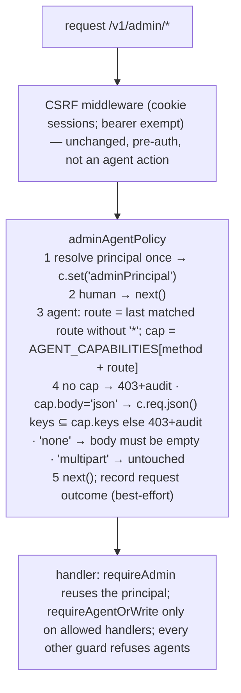

# Agent role + API-token login for the SellRight admin — implementation plan (v4.1, self-contained)

**v4.1, 2026-10-10.** Four Astra adversarial rounds (Codex `gpt-6-astra`, high): v1 reject/21, v2 reject/14, v3 reject/16, **v4 revise/13** (raw JSON beside this file: `…astra-review.json`, `…-v2.json`, `…-v3.json`, `…-v4.json`). The v4 round confirmed the architecture ("does not require redesign"), that all 21 write keys and 25 read keys are real registered routes, and that no money, entitlement or cross-tenant bypass remains in the allowed keys; v4.1 folds its 13 execution-level corrections (§8). Each round cut deeper into the capability surface rather than the mechanism, so v4 does two things: **(1) narrows the agent's write surface to what can be shown free of money, entitlement, promotion and cross-tenant effects, and (2) fixes the mechanics the reviews proved wrong** (body handling, route selection, typing, fixtures, audit guarantee, route-inventory golden file). v4 is self-contained: no section refers to an earlier version. §7 disposes of every v3 finding.

**Goal:** an automation agent gets a code-enforced `agent` role and a revocable API token, so it can operate a store's admin without password, e-mail or 2FA, and can never move money, change what customers pay or receive, change settings, manage identities, or publish releases, whatever grants exist.

**Architecture:** `admin_role` gains `agent`; `admin_user.kind` marks agent identities; an RLS-exempt `admin_api_token` registry holds hashed tokens; `session.api_token_id` binds browser sessions to the token that minted them (unique partial index: one live session per token). One middleware on `/v1/admin/*` resolves the principal once and, for agents, looks up the **matched non-wildcard route** in an exact capability table; JSON capabilities get their body read through Hono's cached parser and checked against a positive key list; multipart and no-body capabilities are never touched. Everything else is a 403 with an audit row. Human guards (`requireWrite`, `requireManage`, `requirePermission`, `requireOwner`, `requireInstallationAdmin`, `requireStepUp`, `requireHuman`) refuse agents independently, so each allowed handler must also opt in with `requireAgentOrWrite`. Provisioning is a Staff-page card and an owner script sharing one transactional lifecycle module.

**Visual plan:** enforcement chain (below).

**Tech stack:** existing only — Hono 4.13.8, `@hono/zod-openapi`, Drizzle (hand-written journaled SQL), Node `crypto`, React admin (TanStack Query), Vitest `unit`/`db` projects, Playwright admin e2e. No new dependencies. `pnpm exec`, never `npx`.



| Capability | owner/manager | staff | **agent** |
|---|---|---|---|
| Read: dashboard, orders (list/detail/packing slip), fulfilment queue, products, product options, inventory, stock history/locations/movements, locations, assets, blog, reviews, returns, reports, shipping methods, recent tracking imports | yes | yes | **yes (exact list §3.3b)** |
| Read: customers, global search, invoices, exports, staff, agents, system, 2FA, any settings, payment/e-mail config, webhooks, licences, reconciliation, affiliates, marketing, gift cards, loyalty, subscribers, activity, currency rates, tax zones | role-dependent | role-dependent | **no** |
| Write: product text fields (no tags/metafields/featured asset), variant non-price fields, stock set/adjust/bulk, blog posts (no featured asset), asset upload/delete, order notes, fulfil/partial/bulk fulfil (no location), trash/restore, review reject/delete/reply, return reject | yes | yes | **yes (exact list §3.3b)** |
| Everything else (see D12 for permitted consequences): collections, tags, draft orders, line edits, order-edit commit, review approve, affiliates, discounts, gift cards, loyalty, refunds, cancellations, return approve, webhooks, licences, revocation, payouts, releases, e-mail test-send, SEO config/sitemaps, customers, option groups, locations, stock transfers, settings, staff, agents, password/2FA/step-up/system | role-dependent | role/grant | **never** |

---

## 0. ADR

- **Product outcome.** Store owners hand an AI or script agent a scoped seat. Success: an agent drives Rotten's admin with a token (reads orders, edits a product description, uploads an asset, fulfils an order, replies to a review), while a price change, a refund, a draft order, a collection change, a settings change and a staff change are each a 403 with an audit row naming the agent. Non-goals: storefront/customer-side agents; per-agent custom grants; OAuth; collections/draft-orders/locations for agents (deferred until their effects are fenced).
- **Context.** Money, promotion and entitlement effects hide behind ordinary-looking keys: `draft-orders` defaults shipping to zero and `markPaid` issues licences; `product.tags` and collection membership feed promotion eligibility (`money/coupon-context.ts`); `product.metafields.softwareAccount` drives provisioning; `location-stock`/`transfer` accept foreign location ids; `sitemaps/refresh` can trigger IndexNow. No API-token login exists. `/admin` on our stores is also behind Cloudflare Access.
- **Decision.** Exact-route capabilities with typed body handling and positive key lists, enforced once in middleware; a narrowed surface that excludes every promotion/money/entitlement/foreign-reference path; token-bound single browser sessions; immutable agent identity across every provisioning path; completeness by construction plus an inventory that pins capability keys to registered routes.
- **Alternatives.** Staff account (settings-enforced), v1 deny-list, v2 pattern+deny-fields, v3 wide allow-list — all rejected by review for leaking at least one money/entitlement path. A separate machine-user table adds a parallel guard path for no safety gain.
- **Riskiest assumption.** An allowed key acquires a money/promotion effect later (e.g. `vendor` joins promotion rules). Mitigation: positive key lists; `agent-policy.ts` under CODEOWNERS; Task 7 pins per-capability behaviour and side-effect snapshots; a unit test asserts no product/variant capability key is in the promotion-relevant field list (Task 3a), which must be updated when `money/coupon-context.ts` changes.
- **Blast radius.** `requireAdmin`, one middleware, `admin_role`, `session` (+1 column, +1 index), `/v1/admin/me`, staff routes (refusals), the allowed handlers' guard call, the route-inventory golden file, the Staff page. No storefront, payment, settlement or stock-architecture code.
- **Reversibility.** Tokens revoke instantly and their sessions die; removing an agent drops its grant; DOWN in the migration (enum label stays, inert).
- **Hidden coupling.** `@sellright/api/schema` re-exports the whole Drizzle schema namespace, so `adminApiToken` becomes publicly reachable (additive; noted in the PR; the exports-contract barrel totals — currently pinned at 174 on `main` — are unchanged by receipt). The storefront-client OpenAPI contract includes admin routes and is regenerated. `assert-force-rls.ts` EXEMPT list; `assert-no-partial-index-drop.mjs` protects the new partial index; `src/sdk/route-inventory.golden.json` must gain the five new routes; ESLint forbids `unsafeUnscopedDb` in `routes/**`. Revocation is linearised at request start: a request whose principal was resolved before a rotation commits completes; the next request is refused (documented guarantee).

Owner approval of the shape: chat, 2026-10-10. v4 narrows scope; it does not change the shape.

## 1. Owner decisions (defaults applied; change before execution)

| # | Question | Default |
|---|---|---|
| D1 | Draft orders | **Not allowed** (zero-shipping default, method eligibility unchecked, `markPaid`). Revisit after the route validates shipping server-side. |
| D2 | Collections, product tags, featured assets, gallery attach | **Not allowed** (promotion eligibility; foreign asset references). |
| D3 | Browser session | ≤12 h, capped at token expiry, one live session per token (DB-enforced). |
| D4 | Token expiry | None by default; optional; rotation preserves it. |
| D5 | Who creates agents | owner or manager. |
| D6 | Reviews | reject / delete / reply allowed; approve never (loyalty bonus). |
| D7 | Fulfilment | allowed without `locationId` (foreign-id risk); partial, full and bulk. |
| D8 | Stock | set / adjust / bulk allowed (variant looked up inside the store transaction); per-location and transfers not allowed. |
| D9 | Reads | exact route list; no customers, search (returns customer identities), invoices, exports, settings. Order detail still shows the buyer's e-mail, phone, shipping **and billing** address — accepted, since fulfilment needs it. |
| D10 | Delivery | **Default: commit to `main` on the server checkout** per `agent-rules.md`, in the task order below, after Task 11 is green locally. A PR branch (`feat/admin-agent-role`, as #174–#180 shipped) only if Adrian explicitly authorises it. |
| D11 | `revoke-sessions` on an agent | returns 400 "use /agents/{id}/rotate". |
| D12 | Permitted consequences of allowed writes | Fulfilment sends the customer's shipping notification (same as for staff); catalog edits fire the store's configured catalog hooks (cache purge, IndexNow if enabled). Both are intended; the agent cannot call the e-mail test-send or sitemap routes directly. |

## 2. File map and budget

| File | Responsibility |
|---|---|
| `packages/api/drizzle/0094_agent_role.sql` *(new)*, `drizzle/meta/_journal.json`, `src/db/assert-hand-written-migrations.ts`, `docs/runbooks/migrations.md` | schema + registration |
| `packages/api/src/db/assert-force-rls.ts`, `packages/api/scripts/assert-no-partial-index-drop.mjs` | EXEMPT list; protect `session_api_token_unique` |
| `packages/api/src/db/schema-core.ts` | enum, `adminUser.kind`, `adminApiToken`, `session.apiTokenId` |
| `packages/api/src/auth/admin-session.ts` | principal fields; token-bound resolution with owner/store binding; `createAdminSessionTx` |
| `packages/api/src/auth/admin-api-token.ts` *(new)* + `.test.ts` | token format/hash; tx-aware mint/revoke/list; resolve; conditional last-used |
| `packages/api/src/auth/agent-policy.ts` *(new)* + `.test.ts` | `AGENT_READS`, `AGENT_CAPABILITIES`, `agentDecision()` |
| `packages/api/src/auth/agent-lifecycle.ts` *(new)* | transactional create / rotate / remove / bootstrap |
| `packages/api/src/auth/admin-staff.ts` | `listStoreStaff` returns `kind`; `adminKindByEmail` |
| `packages/api/src/routes/admin-helpers.ts` | principal reuse (typed); `requireWrite` refuses agents; `requireAgentOrWrite`; `requireHuman`; kind checks in `requireInstallationAdmin`/`requireStepUp`; `hasPermission` hard block |
| `packages/api/src/routes/admin-agent-policy-middleware.ts` *(new)* | middleware + `ContextVariableMap` augmentation |
| `packages/api/src/routes/admin-agents.ts` *(new)*, `admin-agents.db.test.ts` *(new)* | `/v1/admin/agents` CRUD + `browser-session`; boundary tests |
| `packages/api/src/routes/admin.ts` | `/me` returns `kind`,`auth`; `requireAgentOrWrite` on notes/fulfill/fulfillments/bulk-fulfill |
| `packages/api/src/routes/admin-settings.ts`, `admin-system.ts` | `requireHuman` on 2FA and step-up |
| `packages/api/src/routes/admin-settings-advanced.ts` | staff list `kind`; POST/invites/accept/PATCH/PUT/revoke-sessions refuse agent identities; DELETE revokes tokens |
| `packages/api/src/routes/admin-catalog.ts`, `admin-products.ts`, `admin-content.ts`, `admin-assets.ts`, `admin-reviews.ts`, `admin-orders.ts`, `admin-order-ops.ts` | `requireWrite(st)` → `requireAgentOrWrite(st)` on exactly the §3.3b handlers |
| `packages/api/src/app.ts` | mount middleware + `adminAgents` |
| `packages/api/src/sdk/route-inventory.golden.json`, `packages/storefront-client/openapi.json`, `packages/storefront-client/src/generated/schema.d.ts` | +5 agent routes; regenerated contract |
| `packages/api/scripts/assert-agent-boundary.mjs` *(new)*, `packages/api/package.json`, root `package.json` | inventory; wired into root `verify:static` |
| `packages/api/src/scripts/agent-token.ts` *(new)* | owner script |
| `packages/admin/src/api.ts`, `pages/staff-permissions.tsx`, `pages/Staff.tsx`, `pages/AgentAccess.tsx` *(new)*, `e2e/agents.spec.ts` *(new)* | UI + e2e |
| `docs/ADMIN-AGENTS.md` *(new)*, `CHANGELOG.md`, `.github/CODEOWNERS` | docs; policy ownership |

**Execution packet.** `total_minutes: 480` (one elapsed clock). Inputs: ~1,350 new/changed source lines (schema 60 · auth 330 · routes/middleware 260 · tests 420 · UI 180 · script/docs 100) + ~200 generated (contract, golden) + existing-test literal edits; `code_rate_lines_per_hour: 300` for typing against complete code in this plan. Lanes (minutes; components typing/inspection/test/review sum to the span): L1 schema+auth T1–T2 0–80 (30/15/25/10) · L2 policy+middleware+guards+inventory T3 60–170 (45/20/35/10) · L3 lifecycle+routes+script T4–T6 150–240 (40/15/25/10) · L4 DB tests T7 200–350 (50/20/70/10) · L5 UI+e2e+docs T8–T10 240–420 (70/20/70/20) · L6 gate+generated artifacts T11 420–480 (10/10/35/5). Ceilings: `max_files: 48` (43 named in the file map + generated artifacts + existing-test literal edits + receipt), `max_changed_lines: 1,600`, `variance_threshold: ±10 %` at each lane checkpoint — stop and report with a variance receipt at any ceiling.

## 3. Tasks

Conventions: API commands from `packages/api`; DB tests on a `*_test` database (`postgres://sellright@127.0.0.1:5433/defork_checkouthook_test`), migrated first. **Receipts before any change** into `docs/plans/receipts/2026-10-10-agent-role-baseline.txt`: `pnpm -s test:db` failing test names on `main`; the pinned totals printed by `pnpm exec vitest run src/sdk/exports-contract.test.ts`.

### Task 1 — migration 0094 and schema

**1a. `packages/api/drizzle/0094_agent_role.sql`:**

```sql
-- HAND-WRITTEN: see docs/runbooks/migrations.md — do NOT regenerate via drizzle-kit.
-- 0094: automation agents (docs/plans/2026-10-10-agent-role.md).
--  (1) 'agent' joins admin_role. It is admitted only by the exact-route capability table in
--      src/auth/agent-policy.ts; every human guard in routes/admin-helpers.ts refuses it in code.
--  (2) admin_user.kind marks agent identities: no password, TOTP, invite or magic link, ever.
--  (3) admin_api_token: long-lived hashed credentials resolved by requireAdmin for 'sra_' bearers.
--      Registry table like session / admin_user_store: resolved before any store context, so it is
--      deliberately RLS-EXEMPT (src/db/assert-force-rls.ts); isolation is the 256-bit hash joined to
--      its single (admin_user_id, store_id) grant on every request.
--  (4) session.api_token_id binds an agent's browser session to the token that minted it; the unique
--      partial index makes "one live browser session per token" a database invariant
--      (protected from spurious drops by scripts/assert-no-partial-index-drop.mjs).
-- ALTER TYPE ... ADD VALUE is legal inside a transaction since PG12 (0058 precedent); nothing here uses the label.
ALTER TYPE "public"."admin_role" ADD VALUE IF NOT EXISTS 'agent';--> statement-breakpoint
ALTER TABLE "admin_user" ADD COLUMN IF NOT EXISTS "kind" text NOT NULL DEFAULT 'human';--> statement-breakpoint
ALTER TABLE "admin_user" DROP CONSTRAINT IF EXISTS "admin_user_kind_check";--> statement-breakpoint
ALTER TABLE "admin_user" ADD CONSTRAINT "admin_user_kind_check" CHECK ("kind" IN ('human', 'agent'));--> statement-breakpoint
CREATE TABLE IF NOT EXISTS "admin_api_token" (
	"id" uuid PRIMARY KEY DEFAULT gen_random_uuid() NOT NULL,
	"admin_user_id" uuid NOT NULL REFERENCES "admin_user"("id") ON DELETE cascade,
	"store_id" uuid NOT NULL REFERENCES "store"("id") ON DELETE cascade,
	"name" text NOT NULL,
	"token_hash" text NOT NULL UNIQUE,
	"created_by" text,
	"last_used_at" timestamp with time zone,
	"expires_at" timestamp with time zone,
	"revoked_at" timestamp with time zone,
	"created_at" timestamp with time zone DEFAULT now() NOT NULL
);--> statement-breakpoint
CREATE INDEX IF NOT EXISTS "admin_api_token_user_store_idx" ON "admin_api_token" ("admin_user_id", "store_id");--> statement-breakpoint
ALTER TABLE "session" ADD COLUMN IF NOT EXISTS "api_token_id" uuid REFERENCES "admin_api_token"("id") ON DELETE cascade;--> statement-breakpoint
CREATE UNIQUE INDEX IF NOT EXISTS "session_api_token_unique" ON "session" ("api_token_id") WHERE "api_token_id" IS NOT NULL;

-- DOWN (manual):
-- ALTER TABLE "session" DROP COLUMN "api_token_id";
-- DROP TABLE "admin_api_token";
-- ALTER TABLE "admin_user" DROP CONSTRAINT "admin_user_kind_check"; ALTER TABLE "admin_user" DROP COLUMN "kind";
-- (the 'agent' enum label stays; Postgres cannot drop enum values in place — inert while unused)
```

**1b.** Journal: `{ "idx": 85, "version": "7", "when": 1790000013100, "tag": "0094_agent_role", "breakpoints": true }`.

**1c.** `HAND_WRITTEN` += `'0094_agent_role.sql'`. Runbook row: `| \`0094_agent_role.sql\` | Agent role: \`admin_role\` gains \`agent\` (ADD VALUE, as 0058), \`admin_user.kind\`, RLS-exempt \`admin_api_token\`, \`session.api_token_id\` with a unique partial index (drizzle-kit does not model partial indexes; guarded like \`license_activation_token_hash\`). Same drift reason as \`0072\`-\`0093\`. |`

**1d.** `src/db/assert-force-rls.ts` EXEMPT += `'admin_api_token'`. `scripts/assert-no-partial-index-drop.mjs`: `const BAD = /drop\s+index[^;]*(license_activation_token_hash|session_api_token_unique)/i;` and the message names both.

**1e. `src/db/schema-core.ts`:**

```ts
export const adminRole = pgEnum('admin_role', ['owner', 'manager', 'staff', 'read_only', 'agent']);
// adminUser, after name:
  kind: text().notNull().default('human'), // 'agent' = API-token identity (docs/plans/2026-10-10-agent-role.md)
// before session:
export const adminApiToken = pgTable('admin_api_token', {
  id: uuid().primaryKey().defaultRandom(),
  adminUserId: uuid().notNull().references(() => adminUser.id, { onDelete: 'cascade' }),
  storeId: uuid().notNull().references(() => store.id, { onDelete: 'cascade' }),
  name: text().notNull(),
  tokenHash: text().notNull().unique(),
  createdBy: text(),
  lastUsedAt: timestamp({ withTimezone: true }),
  expiresAt: timestamp({ withTimezone: true }),
  revokedAt: timestamp({ withTimezone: true }),
  createdAt: ts(),
});
// session, after stepUpAt:
  apiTokenId: uuid().references(() => adminApiToken.id, { onDelete: 'cascade' }),
```

**1f. Verify:** `pnpm -s build && pnpm db:assert-hand-written && pnpm db:assert-rls && node scripts/assert-no-partial-index-drop.mjs && DATABASE_URL=postgres://sellright@127.0.0.1:5433/defork_checkouthook_test node dist/scripts/migrate.js` → asserts `ok`; `[migrate] applying ... 0094_agent_role`.

### Task 2 — token module and principal

**2a. `src/auth/admin-api-token.test.ts`:**

```ts
import { describe, expect, it } from 'vitest';
import { AGENT_TOKEN_PREFIX, hashAgentToken, isAgentToken, newAgentToken } from './admin-api-token.js';
describe('agent API tokens', () => {
  it('mints sra_-prefixed 256-bit base64url tokens that differ', () => {
    const a = newAgentToken(), b = newAgentToken();
    expect(a.startsWith(AGENT_TOKEN_PREFIX)).toBe(true); expect(a).toHaveLength(AGENT_TOKEN_PREFIX.length + 43); expect(a).not.toBe(b);
  });
  it('recognises only prefixed tokens (session tokens are 64 hex chars)', () => {
    expect(isAgentToken('sra_abc')).toBe(true); expect(isAgentToken('a'.repeat(64))).toBe(false); expect(isAgentToken(undefined)).toBe(false);
  });
  it('hashes with sha256 hex', () => { expect(hashAgentToken('sra_x')).toMatch(/^[0-9a-f]{64}$/); expect(hashAgentToken('sra_x')).toBe(hashAgentToken('sra_x')); });
});
```
Run `pnpm exec vitest run src/auth/admin-api-token.test.ts` → module not found.

**2b. `src/auth/admin-api-token.ts`:**

```ts
import { createHash, randomBytes } from 'node:crypto';
import { and, eq, isNull, lt, or, sql } from 'drizzle-orm';
import { unsafeUnscopedDb as db, type Tx } from '../db/client.js';
import * as s from '../db/schema.js';
import type { AdminPrincipal } from './admin-session.js';

export const AGENT_TOKEN_PREFIX = 'sra_';
export function newAgentToken(): string { return AGENT_TOKEN_PREFIX + randomBytes(32).toString('base64url'); }
export function isAgentToken(t: string | undefined | null): t is string { return typeof t === 'string' && t.startsWith(AGENT_TOKEN_PREFIX); }
export function hashAgentToken(t: string): string { return createHash('sha256').update(t).digest('hex'); }

export async function mintAgentToken(tx: Tx, i: { adminUserId: string; storeId: string; name: string; createdBy: string | null; expiresAt: Date | null }): Promise<{ id: string; token: string }> {
  const token = newAgentToken();
  const [row] = await tx.insert(s.adminApiToken).values({ ...i, tokenHash: hashAgentToken(token) }).returning({ id: s.adminApiToken.id });
  return { id: row!.id, token };
}

/** Revoke every live token of one agent in one store; bound sessions are deleted in the same tx. */
export async function revokeAgentTokens(tx: Tx, adminUserId: string, storeId: string): Promise<{ revoked: number; expiresAt: Date | null }> {
  const rows = await tx.update(s.adminApiToken).set({ revokedAt: new Date() })
    .where(and(eq(s.adminApiToken.adminUserId, adminUserId), eq(s.adminApiToken.storeId, storeId), isNull(s.adminApiToken.revokedAt)))
    .returning({ id: s.adminApiToken.id, expiresAt: s.adminApiToken.expiresAt });
  for (const r of rows) await tx.delete(s.session).where(eq(s.session.apiTokenId, r.id));
  return { revoked: rows.length, expiresAt: rows[0]?.expiresAt ?? null };
}

export interface AgentSeat { tokenId: string; adminUserId: string; name: string; email: string; createdBy: string | null; lastUsedAt: Date | null; expiresAt: Date | null; createdAt: Date }
export async function listAgentSeats(tx: Tx, storeId: string): Promise<AgentSeat[]> {
  return tx.select({ tokenId: s.adminApiToken.id, adminUserId: s.adminApiToken.adminUserId, name: s.adminApiToken.name, email: s.adminUser.email, createdBy: s.adminApiToken.createdBy, lastUsedAt: s.adminApiToken.lastUsedAt, expiresAt: s.adminApiToken.expiresAt, createdAt: s.adminApiToken.createdAt })
    .from(s.adminApiToken).innerJoin(s.adminUser, eq(s.adminUser.id, s.adminApiToken.adminUserId))
    .where(and(eq(s.adminApiToken.storeId, storeId), isNull(s.adminApiToken.revokedAt)));
}

/** Registry read. Unknown / revoked / expired / grant not exactly 'agent' on this store → null. */
export async function resolveAgentByToken(token: string): Promise<AdminPrincipal | null> {
  const [r] = await db.select({
      tokenId: s.adminApiToken.id, expiresAt: s.adminApiToken.expiresAt, id: s.adminUser.id, email: s.adminUser.email, kind: s.adminUser.kind,
      storeId: s.store.id, slug: s.store.slug, name: s.store.name, currency: s.store.currency, taxRate: s.store.taxRate, shippingTaxable: s.store.shippingTaxable, role: s.adminUserStore.role,
    }).from(s.adminApiToken)
    .innerJoin(s.adminUser, eq(s.adminUser.id, s.adminApiToken.adminUserId))
    .innerJoin(s.adminUserStore, and(eq(s.adminUserStore.adminUserId, s.adminApiToken.adminUserId), eq(s.adminUserStore.storeId, s.adminApiToken.storeId)))
    .innerJoin(s.store, eq(s.store.id, s.adminApiToken.storeId))
    .where(and(eq(s.adminApiToken.tokenHash, hashAgentToken(token)), isNull(s.adminApiToken.revokedAt))).limit(1);
  if (!r || (r.expiresAt && r.expiresAt.getTime() <= Date.now()) || r.kind !== 'agent' || r.role !== 'agent') return null;
  await db.update(s.adminApiToken).set({ lastUsedAt: new Date() })
    .where(and(eq(s.adminApiToken.id, r.tokenId), or(isNull(s.adminApiToken.lastUsedAt), lt(s.adminApiToken.lastUsedAt, sql`now() - interval '5 minutes'`))));
  return { id: r.id, email: r.email, kind: 'agent', auth: 'api_token', apiTokenId: r.tokenId, isInstallationAdmin: false, stepUpAt: null,
    stores: [{ storeId: r.storeId, slug: r.slug, name: r.name, currency: r.currency, taxRate: r.taxRate ?? 0, shippingTaxable: r.shippingTaxable ?? false, role: 'agent', permissions: null }] };
}
```

**2c. `src/auth/admin-session.ts`:** `AdminStoreAccess.role` gains `'agent'`; `AdminPrincipal` gains `kind: 'human' | 'agent'`, `auth: 'session' | 'api_token'`, `apiTokenId: string | null`. Add:

```ts
export async function createAdminSessionTx(tx: Tx, adminUserId: string, ttlMs: number, apiTokenId: string | null): Promise<string> {
  const token = randomBytes(32).toString('hex');
  await tx.insert(s.session).values({ adminUserId, tokenHash: hashToken(token), expiresAt: new Date(Date.now() + ttlMs), apiTokenId });
  return token;
}
```
`resolveAdmin`: select adds `kind: s.adminUser.kind, apiTokenId: s.session.apiTokenId, tokenAdminUserId: s.adminApiToken.adminUserId, tokenStoreId: s.adminApiToken.storeId, tokenRevokedAt: s.adminApiToken.revokedAt, tokenExpiresAt: s.adminApiToken.expiresAt`; add `.leftJoin(s.adminApiToken, eq(s.adminApiToken.id, s.session.apiTokenId))`; after building `stores`:

```ts
  const kind = first.kind === 'agent' ? 'agent' : 'human';
  if (first.apiTokenId) {
    // Token-bound session: the token must be live AND belong to this admin on this single store.
    if (first.tokenRevokedAt || (first.tokenExpiresAt && first.tokenExpiresAt.getTime() <= Date.now())) return null;
    if (first.tokenAdminUserId !== first.id || stores.length !== 1 || first.tokenStoreId !== stores[0]!.storeId) return null;
  }
  if (kind === 'agent' && (stores.length !== 1 || stores[0]!.role !== 'agent' || !first.apiTokenId)) return null; // never widened
  if (kind === 'human' && stores.some((x) => x.role === 'agent')) return null;
  return { id: first.id, email: first.email, kind, auth: 'session', apiTokenId: first.apiTokenId, isInstallationAdmin: first.isInstallationAdmin, stepUpAt: first.stepUpAt, stores };
```
`findAdminByEmail` selects `kind`.

**2d. Verify:** unit 3 passed; `pnpm exec tsc --noEmit -p .` after adding `kind: 'human', auth: 'session', apiTokenId: null` to `AdminPrincipal` literals in existing tests (grep `isInstallationAdmin:` in `src/**/*.test.ts`).

### Task 3 — policy, middleware, guards, inventory

**3a. `src/auth/agent-policy.test.ts`:**

```ts
import { describe, expect, it } from 'vitest';
import { AGENT_CAPABILITIES, AGENT_READS, agentDecision } from './agent-policy.js';
describe('agent policy', () => {
  it('reads are an exact route set', () => {
    expect(agentDecision('GET', '/v1/admin/orders', undefined)).toEqual({ ok: true });
    expect(agentDecision('GET', '/v1/admin/orders/:code', undefined)).toEqual({ ok: true });
    expect(agentDecision('GET', '/v1/admin/orders/:code/invoice', undefined)).toMatchObject({ ok: false, reason: 'read_denied' });
    expect(agentDecision('GET', '/v1/admin/customers', undefined)).toMatchObject({ ok: false });
    expect(agentDecision('GET', '/v1/admin/search', undefined)).toMatchObject({ ok: false });
    expect(agentDecision('GET', '/v1/admin/payments/settings', undefined)).toMatchObject({ ok: false });
    expect(agentDecision('GET', '/v1/admin/staff', undefined)).toMatchObject({ ok: false });
  });
  it('json capabilities: positive key lists', () => {
    expect(agentDecision('POST', '/v1/admin/products', { name: 'x' })).toEqual({ ok: true });
    expect(agentDecision('PATCH', '/v1/admin/products/:id', { tags: ['sale'] })).toMatchObject({ ok: false, reason: 'field_denied', field: 'tags' });
    expect(agentDecision('PATCH', '/v1/admin/products/:id', { metafields: { softwareAccount: 'x' } })).toMatchObject({ ok: false, field: 'metafields' });
    expect(agentDecision('PATCH', '/v1/admin/variants/:id', { enabled: true })).toEqual({ ok: true });
    expect(agentDecision('PATCH', '/v1/admin/variants/:id', { price: 1 })).toMatchObject({ ok: false, field: 'price' });
    expect(agentDecision('POST', '/v1/admin/orders/:code/fulfillments', { lines: [], locationId: 'x' })).toMatchObject({ ok: false, field: 'locationId' });
    expect(agentDecision('PATCH', '/v1/admin/variants/:id', undefined)).toMatchObject({ ok: false, reason: 'body_unreadable' });
  });
  it('not-allowed mutations', () => {
    for (const [m, p] of [['POST', '/v1/admin/draft-orders'], ['POST', '/v1/admin/collections'], ['POST', '/v1/admin/orders/:code/edit/commit'], ['POST', '/v1/admin/reviews/:id/approve'], ['POST', '/v1/admin/seo/sitemaps/refresh'], ['PATCH', '/v1/admin/variants/:id/location-stock'], ['POST', '/v1/admin/products/:id/assets']] as const) {
      expect([m, p, agentDecision(m, p, {}).ok]).toEqual([m, p, false]);
    }
  });
  it('none/multipart capabilities never inspect JSON', () => {
    expect(agentDecision('DELETE', '/v1/admin/reviews/:id', undefined)).toEqual({ ok: true });
    expect(agentDecision('POST', '/v1/admin/assets', undefined)).toEqual({ ok: true });
  });
  it('no product/variant capability key is promotion-relevant', () => {
    // product.tags and collection membership feed money/coupon-context.ts; prices feed totals. Keep this list in sync with that file.
    const PROMOTION_RELEVANT = ['tags', 'collections', 'collectionIds', 'price', 'salePrice', 'compareAtPrice', 'preOrderPrice', 'cost', 'metafields'];
    for (const k of ['POST /v1/admin/products', 'PATCH /v1/admin/products/:id', 'PATCH /v1/admin/variants/:id']) {
      const cap = AGENT_CAPABILITIES[k]!; if (cap.body !== 'json') throw new Error(k);
      for (const f of cap.keys) expect([k, f, PROMOTION_RELEVANT.includes(f)]).toEqual([k, f, false]);
    }
  });
  it('every key is well-formed and typed', () => {
    for (const [k, v] of Object.entries(AGENT_CAPABILITIES)) { expect(k).toMatch(/^(POST|PUT|PATCH|DELETE) \/v1\/admin\/[^ ]+$/); expect(['json', 'none', 'multipart']).toContain(v.body); }
    for (const k of AGENT_READS) expect(k).toMatch(/^GET \/v1\/admin\/[^ ]+$/);
  });
});
```

**3a′. `src/routes/admin-helpers.test.ts`** (covers every `requirePermission` route, including release registration, without HTTP):

```ts
import { describe, expect, it } from 'vitest';
import { hasPermission, requireAgentOrWrite, requireWrite } from './admin-helpers.js';
const st = (role: string, permissions: Record<string, boolean> | null = null) => ({ storeId: 's', slug: 's', name: 's', currency: 'USD', taxRate: 0, shippingTaxable: false, role: role as never, permissions });
describe('agent guards', () => {
  it('hasPermission ignores grants for agents', () => {
    expect(hasPermission(st('agent', { releases: true, refunds: true, licenses: true }), 'releases')).toBe(false);
    expect(hasPermission(st('staff', { releases: true }), 'releases')).toBe(true);
  });
  it('requireWrite refuses agents; requireAgentOrWrite admits them', () => {
    expect(() => requireWrite(st('agent'))).toThrow();
    expect(() => requireAgentOrWrite(st('agent'))).not.toThrow();
    expect(() => requireAgentOrWrite(st('read_only'))).toThrow();
  });
});
```

**3b. `src/auth/agent-policy.ts`** — the single reviewable source of truth (CODEOWNERS):

```ts
/**
 * Positive capability policy for the 'agent' admin role (docs/plans/2026-10-10-agent-role.md).
 * Keys are exact registered routes as Hono matches them ('METHOD /v1/admin/...' with ':param' segments).
 * Everything not keyed is denied. Enforced by routes/admin-agent-policy-middleware.ts on the matched route;
 * scripts/assert-agent-boundary.mjs verifies every key is a registered, unique, non-wildcard route.
 *
 * Exclusions are deliberate (owner decisions D1–D9): nothing that feeds promotion eligibility (tags,
 * collections), provisioning (metafields), pricing (variant money fields, draft orders), entitlement
 * (licences, releases), foreign references (locations, assets attached by id), or outbound side effects
 * (sitemaps/IndexNow, e-mail).
 */
export type AgentCapability = { body: 'json'; keys: readonly string[] } | { body: 'none' } | { body: 'multipart' };
const json = (...keys: string[]): AgentCapability => ({ body: 'json', keys });
const NONE: AgentCapability = { body: 'none' };
const MULTIPART: AgentCapability = { body: 'multipart' };

export const AGENT_READS: ReadonlySet<string> = new Set([
  'GET /v1/admin/me', 'GET /v1/admin/dashboard',
  'GET /v1/admin/orders', 'GET /v1/admin/orders/:code', 'GET /v1/admin/orders/:code/packing-slip', 'GET /v1/admin/fulfillment/open-orders',
  'GET /v1/admin/products', 'GET /v1/admin/products/:id', 'GET /v1/admin/products/:id/options', 'GET /v1/admin/inventory',
  'GET /v1/admin/variants/:id/stock/history', 'GET /v1/admin/variants/:id/stock/locations', 'GET /v1/admin/variants/:id/movements', 'GET /v1/admin/locations',
  'GET /v1/admin/assets', 'GET /v1/admin/blog', 'GET /v1/admin/blog/:id', 'GET /v1/admin/reviews', 'GET /v1/admin/returns',
  'GET /v1/admin/reports/metrics', 'GET /v1/admin/reports/sales', 'GET /v1/admin/reports/top-products',
  'GET /v1/admin/shipping-methods', 'GET /v1/admin/import-tracking/recent',
]);

export const AGENT_CAPABILITIES: Readonly<Record<string, AgentCapability>> = {
  // products: text fields only (no tags, featuredAssetId, metafields)
  'POST /v1/admin/products': json('name', 'slug', 'description', 'status'),
  'PATCH /v1/admin/products/:id': json('name', 'description', 'status', 'vendor', 'productType', 'seoTitle', 'seoDescription'),
  'PATCH /v1/admin/variants/:id': json('shipDate', 'barcode', 'weightG', 'dimensions', 'enabled'),
  // stock (D8)
  'PATCH /v1/admin/variants/:id/stock': json('onHand'),
  'POST /v1/admin/variants/:id/stock/adjust': json('delta', 'reason'),
  'PATCH /v1/admin/variants/stock/bulk': json('items'),
  // content + assets
  'POST /v1/admin/blog': json('title', 'slug', 'excerpt', 'body', 'authorName', 'tags', 'isPublished', 'publishDate', 'seoTitle', 'seoDescription'),
  'PATCH /v1/admin/blog/:id': json('title', 'excerpt', 'body', 'authorName', 'tags', 'isPublished', 'publishDate', 'seoTitle', 'seoDescription', 'expectedRevision'),
  'DELETE /v1/admin/blog/:id': NONE,
  'POST /v1/admin/assets': MULTIPART,
  'DELETE /v1/admin/assets/:id': NONE,
  // reviews (D6)
  'POST /v1/admin/reviews/:id/reject': NONE,
  'DELETE /v1/admin/reviews/:id': NONE,
  'PUT /v1/admin/reviews/:id/reply': json('reply'),
  // orders (D7)
  'POST /v1/admin/orders/:code/notes': json('note'),
  'POST /v1/admin/orders/:code/fulfill': json('state', 'trackingCode', 'carrier'),
  'POST /v1/admin/orders/:code/fulfillments': json('lines', 'trackingCode', 'carrier', 'notifyCustomer'),
  'POST /v1/admin/orders/bulk-fulfill': json('orders'),
  'POST /v1/admin/orders/bulk-soft-delete': json('codes'),
  'POST /v1/admin/orders/bulk-restore': json('codes'),
  'POST /v1/admin/returns/:id/reject': NONE,
};

export type AgentDecision = { ok: true } | { ok: false; reason: 'read_denied' | 'mutation_not_allowed' | 'field_denied' | 'body_unreadable' | 'body_not_allowed'; field?: string };

export function capabilityOf(method: string, matchedRoutePath: string): AgentCapability | undefined {
  return AGENT_CAPABILITIES[`${method.toUpperCase()} ${matchedRoutePath}`];
}

/** Pure decision for a MATCHED route. `body`: the parsed JSON body for json capabilities (undefined if unreadable);
 *  for 'none' capabilities pass `undefined` when the request carried no body and `{}` when it did. */
export function agentDecision(method: string, matchedRoutePath: string, body: unknown): AgentDecision {
  const m = method.toUpperCase();
  if (m === 'GET' || m === 'HEAD') return AGENT_READS.has(`GET ${matchedRoutePath}`) ? { ok: true } : { ok: false, reason: 'read_denied' };
  const cap = capabilityOf(m, matchedRoutePath);
  if (!cap) return { ok: false, reason: 'mutation_not_allowed' };
  if (cap.body === 'multipart') return { ok: true };
  if (cap.body === 'none') return body === undefined ? { ok: true } : { ok: false, reason: 'body_not_allowed' };
  if (body === undefined || body === null || typeof body !== 'object' || Array.isArray(body)) return { ok: false, reason: 'body_unreadable' };
  for (const k of Object.keys(body as Record<string, unknown>)) if (!cap.keys.includes(k)) return { ok: false, reason: 'field_denied', field: k };
  return { ok: true };
}
```

**3c. `src/routes/admin-agent-policy-middleware.ts`:**

```ts
import type { MiddlewareHandler } from 'hono';
import { bearer } from '../auth/session.js';
import { cookie, SESSION_COOKIE } from '../auth/cookies.js';
import { resolveAdmin, type AdminPrincipal } from '../auth/admin-session.js';
import { isAgentToken, resolveAgentByToken } from '../auth/admin-api-token.js';
import { agentDecision, capabilityOf } from '../auth/agent-policy.js';
import { withStore } from '../db/client.js';
import * as s from '../db/schema.js';
import { errJson } from '../lib/api-error.js';

declare module 'hono' { interface ContextVariableMap { adminPrincipal: AdminPrincipal } }

const PUBLIC = new Set(['/v1/admin/login', '/v1/admin/logout', '/v1/admin/staff/accept']);
const MUTATING = new Set(['POST', 'PUT', 'PATCH', 'DELETE']);

/**
 * Resolves the admin principal once per /v1/admin request (reused by requireAdmin) and enforces
 * auth/agent-policy.ts for agents. Route identity = the last matched route whose path has no '*'
 * (OpenAPI routes never use wildcards; middleware does) — scripts/assert-agent-boundary.mjs proves each
 * capability key is a unique non-wildcard registered route. The body is touched only for 'json'
 * capabilities, via c.req.json() (Hono caches the text, so the validator reparses the same bytes);
 * multipart uploads are never read here. Policy denials are audited in their own transaction before
 * the handler runs; a best-effort request-outcome row is written after a successful mutation
 * (entity-level audit rows remain the handlers' responsibility, inside their transactions).
 */
export const adminAgentPolicy: MiddlewareHandler = async (c, next) => {
  const path = c.req.path;
  if (PUBLIC.has(path)) return next();
  const token = bearer(c.req.header('authorization')) ?? cookie(c, SESSION_COOKIE);
  if (!token) return next();
  const admin = isAgentToken(token) ? await resolveAgentByToken(token) : await resolveAdmin(token);
  if (!admin) return next();
  c.set('adminPrincipal', admin);
  if (admin.kind !== 'agent') return next();
  const method = c.req.method.toUpperCase();
  if (path === '/v1/admin/agents/browser-session' && method === 'POST') return next(); // token→cookie bootstrap; guarded in its handler
  const route = [...c.req.matchedRoutes].reverse().find((r) => !r.path.includes('*'))?.path ?? path;
  let body: unknown;
  if (MUTATING.has(method)) {
    const cap = capabilityOf(method, route);
    if (cap?.body === 'json') { try { body = await c.req.json(); } catch { body = undefined; } }
    else if (cap?.body === 'none') { const t = await c.req.text(); body = t.length > 0 ? {} : undefined; } // actual bytes, not Content-Length; text is cached and no downstream parse exists for these routes
  }
  const d = agentDecision(method, route, body);
  const st = admin.stores[0]!;
  if (!d.ok) {
    await withStore(st.storeId, (tx) => tx.insert(s.auditLog).values({ storeId: st.storeId, actor: admin.email, entity: 'agent', entityId: admin.id, action: 'denied', data: { method, path, route, reason: d.reason, ...(d.field ? { field: d.field } : {}) } }));
    return errJson(c, 403, 'AGENT_NOT_ALLOWED', d.reason === 'field_denied' ? `agents cannot set '${d.field}'` : 'agents cannot perform this action');
  }
  await next();
  if (MUTATING.has(method) && c.res.status < 400) {
    try { await withStore(st.storeId, (tx) => tx.insert(s.auditLog).values({ storeId: st.storeId, actor: admin.email, entity: 'agent', entityId: admin.id, action: 'request', data: { method, path, route, status: c.res.status } })); } catch { /* outcome row is best-effort; entity audits are in-transaction */ }
  }
};
```
Mount in `app.ts` right after the admin CSRF middleware: `app.use('/v1/admin/*', adminAgentPolicy);`.

**3d. `src/routes/admin-helpers.ts`:**

```ts
import { isAgentToken, resolveAgentByToken } from '../auth/admin-api-token.js';
export type ReqCtx = { req: { header: (k: string) => string | undefined }; get?: (k: 'adminPrincipal') => AdminPrincipal | undefined };

export async function requireAdmin(c: ReqCtx): Promise<{ admin: AdminPrincipal; token: string }> {
  const token = bearer(c.req.header('authorization')) ?? cookie(c, SESSION_COOKIE);
  if (!token) throw new HttpError(401, 'not authenticated');
  const admin = c.get?.('adminPrincipal') ?? (isAgentToken(token) ? await resolveAgentByToken(token) : await resolveAdmin(token));
  if (!admin) throw new HttpError(401, 'invalid or expired session');
  return { admin, token };
}
const WRITE_ROLES = new Set(['owner', 'manager', 'staff']); // agent refused; opt-in via requireAgentOrWrite
export function requireWrite(st: AdminStoreAccess): void { if (!WRITE_ROLES.has(st.role)) throw new HttpError(403, `role '${st.role}' is read-only`); }
export function requireAgentOrWrite(st: AdminStoreAccess): void { if (st.role === 'agent') return; requireWrite(st); }
export function requireHuman(admin: AdminPrincipal): void { if (admin.kind !== 'human') throw new HttpError(403, 'agents cannot perform this action'); }
export function requireInstallationAdmin(admin: AdminPrincipal): void { if (admin.kind !== 'human' || !admin.isInstallationAdmin) throw new HttpError(403, 'requires installation administrator'); }
export function requireStepUp(admin: AdminPrincipal): void { if (admin.kind !== 'human' || !admin.stepUpAt || Date.now() - admin.stepUpAt.getTime() > STEP_UP_WINDOW_MS) throw new HttpError(403, STEP_UP_REQUIRED_MESSAGE); }
export function hasPermission(st: AdminStoreAccess, action: string): boolean { if (st.role === 'agent') return false; return ADMIN_ROLES.has(st.role) || st.permissions?.[action] === true; }
```
Hono's `Context.get` is typed through `ContextVariableMap`, so a `Context` satisfies the narrowed `ReqCtx`; test doubles that pass `{ req }` only still compile.

**3e. Guard swaps and human-only routes.** On exactly these handlers replace `requireWrite(st)` with `requireAgentOrWrite(st)`: `admin-catalog.ts` products POST; `admin-products.ts` product PATCH, variant PATCH, stock PATCH, stock bulk, stock adjust; `admin-content.ts` POST/PATCH/DELETE; `admin-assets.ts` POST/DELETE; `admin-reviews.ts` loop (`action === 'approve' ? requireWrite(st) : requireAgentOrWrite(st)`) and the reply handler; `admin.ts` notes, fulfill, fulfillments, bulk-fulfill; `admin-order-ops.ts` bulk-soft-delete, bulk-restore; `admin-orders.ts` returns reject. Add `requireHuman(admin)` after `requireAdmin` in the four 2FA handlers (`admin-settings.ts`) and `/v1/admin/step-up` (`admin-system.ts`). **Entity audits for the allowed mutations that have none today** — inside their existing store transactions add `await tx.insert(s.auditLog).values({ storeId: st.storeId, actor: admin.email, entity, entityId, action, data })` to: `admin-assets.ts` POST (`entity: 'asset', action: 'create'`) and DELETE (`'delete'`); `admin-content.ts` PATCH (`entity: 'blog_post', action: 'update'`) and DELETE (`'delete'`). With these, every allowed mutation writes an actor-attributed row in its own transaction (products, stock, reviews, orders already do). `/v1/admin/me`: schema gains `kind: z.enum(['human','agent']), auth: z.enum(['session','api_token'])`; return both.

**3f. `scripts/assert-agent-boundary.mjs`:**

```js
#!/usr/bin/env node
// Every AGENT_CAPABILITIES / AGENT_READS key must be a registered non-wildcard /v1/admin route.
// @hono/zod-openapi registers validator entries AND the terminal handler under the same method+path, so
// app.routes legitimately repeats keys: dedupe with a Set; do not assert uniqueness here. Route identity in
// the middleware is "last matched non-wildcard route", which is the terminal handler's pattern for every
// OpenAPI route (validators and handler share it). Promotion relevance of allowed keys is a unit test
// (src/auth/agent-policy.test.ts), not a source grep.
import { buildHttpApp } from '../dist/app.js';
import { AGENT_CAPABILITIES, AGENT_READS } from '../dist/auth/agent-policy.js';
const app = buildHttpApp();
const real = new Set(app.routes.filter((r) => r.path.startsWith('/v1/admin/') && !r.path.includes('*')).map((r) => `${r.method} ${r.path}`));
const missing = [...Object.keys(AGENT_CAPABILITIES), ...AGENT_READS].filter((k) => !real.has(k));
if (missing.length) { console.error('[agent-boundary] FAIL — capability keys with no registered route:\n  ' + missing.join('\n  ')); process.exit(1); }
console.log(`[agent-boundary] ok (${Object.keys(AGENT_CAPABILITIES).length} mutations + ${AGENT_READS.size} reads allowed of ${real.size} distinct admin routes)`);
```
Wire: `packages/api/package.json` `"assert:agent-boundary": "node scripts/assert-agent-boundary.mjs"`; root `package.json` `verify:static` += `&& pnpm --filter @sellright/api assert:agent-boundary` after `pnpm --filter @sellright/api test`.

**3g. Verify:** `pnpm -s build && pnpm exec vitest run src/auth/agent-policy.test.ts src/routes/admin-helpers.test.ts && pnpm assert:agent-boundary` → 7 passed; `[agent-boundary] ok …`.

### Task 4 — lifecycle module (`src/auth/agent-lifecycle.ts`)

```ts
import { and, eq } from 'drizzle-orm';
import { randomBytes } from 'node:crypto';
import { withStore, type Tx } from '../db/client.js';
import * as s from '../db/schema.js';
import { mintAgentToken, revokeAgentTokens } from './admin-api-token.js';
import { createAdminSessionTx } from './admin-session.js';

export const AGENT_BROWSER_SESSION_TTL_MS = 12 * 60 * 60 * 1000; // D3
export class AgentNotFound extends Error { constructor() { super('agent not found in this store'); } }
export class AgentTokenInvalid extends Error { constructor() { super('agent token revoked or expired'); } }
export function agentEmail(storeSlug: string): string { return `${storeSlug}-agent-${randomBytes(4).toString('hex')}@agents.invalid`; }

/** FOR UPDATE on the grant row serializes rotate / remove / bootstrap for one agent. */
async function lockAgentGrant(tx: Tx, adminUserId: string, storeId: string): Promise<{ name: string | null }> {
  const [m] = await tx.select({ role: s.adminUserStore.role, name: s.adminUser.name }).from(s.adminUserStore)
    .innerJoin(s.adminUser, eq(s.adminUser.id, s.adminUserStore.adminUserId))
    .where(and(eq(s.adminUserStore.adminUserId, adminUserId), eq(s.adminUserStore.storeId, storeId))).for('update', { of: s.adminUserStore }).limit(1);
  if (!m || m.role !== 'agent') throw new AgentNotFound();
  return { name: m.name };
}

export async function createAgentSeat(i: { storeId: string; storeSlug: string; name: string; actor: string; expiresAt: Date | null }) {
  return withStore(i.storeId, async (tx) => {
    const email = agentEmail(i.storeSlug);
    const [u] = await tx.insert(s.adminUser).values({ email, passwordHash: null, name: `Agent: ${i.name}`, kind: 'agent' }).returning({ id: s.adminUser.id });
    const adminUserId = u!.id;
    await tx.insert(s.adminUserStore).values({ adminUserId, storeId: i.storeId, role: 'agent' });
    const minted = await mintAgentToken(tx, { adminUserId, storeId: i.storeId, name: i.name, createdBy: i.actor, expiresAt: i.expiresAt });
    await tx.insert(s.auditLog).values({ storeId: i.storeId, actor: i.actor, entity: 'agent', entityId: adminUserId, action: 'create', data: { name: i.name, email, tokenId: minted.id } });
    return { adminUserId, email, tokenId: minted.id, token: minted.token };
  });
}

export async function rotateAgentSeat(i: { storeId: string; adminUserId: string; actor: string }) {
  return withStore(i.storeId, async (tx) => {
    const g = await lockAgentGrant(tx, i.adminUserId, i.storeId);
    const r = await revokeAgentTokens(tx, i.adminUserId, i.storeId);
    const minted = await mintAgentToken(tx, { adminUserId: i.adminUserId, storeId: i.storeId, name: (g.name ?? 'Agent').replace(/^Agent: /, ''), createdBy: i.actor, expiresAt: r.expiresAt });
    await tx.insert(s.auditLog).values({ storeId: i.storeId, actor: i.actor, entity: 'agent', entityId: i.adminUserId, action: 'rotate', data: { revoked: r.revoked, tokenId: minted.id } });
    return { tokenId: minted.id, token: minted.token, revoked: r.revoked };
  });
}

export async function removeAgentSeat(i: { storeId: string; adminUserId: string; actor: string }) {
  return withStore(i.storeId, async (tx) => {
    await lockAgentGrant(tx, i.adminUserId, i.storeId);
    const r = await revokeAgentTokens(tx, i.adminUserId, i.storeId);
    await tx.delete(s.session).where(eq(s.session.adminUserId, i.adminUserId));
    await tx.delete(s.adminUserStore).where(and(eq(s.adminUserStore.adminUserId, i.adminUserId), eq(s.adminUserStore.storeId, i.storeId)));
    await tx.insert(s.auditLog).values({ storeId: i.storeId, actor: i.actor, entity: 'agent', entityId: i.adminUserId, action: 'remove', data: { revoked: r.revoked } });
    return { revoked: r.revoked }; // admin_user row stays (kind 'agent', no grants) so audit actors resolve
  });
}

/** Atomic token→cookie bootstrap: lock the grant, re-check the token's owner/store/liveness, replace the single live session. */
export async function bootstrapAgentSession(i: { storeId: string; adminUserId: string; apiTokenId: string; actor: string }): Promise<{ sessionToken: string; ttlMs: number }> {
  return withStore(i.storeId, async (tx) => {
    await lockAgentGrant(tx, i.adminUserId, i.storeId);
    const [t] = await tx.select({ revokedAt: s.adminApiToken.revokedAt, expiresAt: s.adminApiToken.expiresAt }).from(s.adminApiToken)
      .where(and(eq(s.adminApiToken.id, i.apiTokenId), eq(s.adminApiToken.adminUserId, i.adminUserId), eq(s.adminApiToken.storeId, i.storeId))).for('update').limit(1);
    if (!t || t.revokedAt) throw new AgentTokenInvalid();
    const ttlMs = Math.min(AGENT_BROWSER_SESSION_TTL_MS, t.expiresAt ? t.expiresAt.getTime() - Date.now() : AGENT_BROWSER_SESSION_TTL_MS);
    if (ttlMs <= 0) throw new AgentTokenInvalid();
    await tx.delete(s.session).where(eq(s.session.apiTokenId, i.apiTokenId)); // plus the unique partial index
    const sessionToken = await createAdminSessionTx(tx, i.adminUserId, ttlMs, i.apiTokenId);
    await tx.insert(s.auditLog).values({ storeId: i.storeId, actor: i.actor, entity: 'agent', entityId: i.adminUserId, action: 'browser_session', data: { ttlMs } });
    return { sessionToken, ttlMs };
  });
}
```

### Task 5 — agent routes and staff-route refusals

**5a. `src/routes/admin-agents.ts`:**

```ts
import { OpenAPIHono, createRoute, z } from '@hono/zod-openapi';
import { withStore } from '../db/client.js';
import { listAgentSeats } from '../auth/admin-api-token.js';
import { AgentNotFound, AgentTokenInvalid, bootstrapAgentSession, createAgentSeat, removeAgentSeat, rotateAgentSeat } from '../auth/agent-lifecycle.js';
import { newCsrf, setAuthCookies } from '../auth/cookies.js';
import { attemptRetryAfter, clientIp } from '../auth/rate-limit.js';
import { HttpError, J, errBody, guard, requireAdmin, requireManage, requireStore } from './admin-helpers.js';

export const adminAgents = new OpenAPIHono();
const AgentOut = z.object({ id: z.string(), adminUserId: z.string(), name: z.string(), email: z.string(), createdBy: z.string().nullable(), createdAt: z.string(), lastUsedAt: z.string().nullable(), expiresAt: z.string().nullable() });
const mapErr = (e: unknown): never => { if (e instanceof AgentNotFound) throw new HttpError(404, e.message); if (e instanceof AgentTokenInvalid) throw new HttpError(401, e.message); throw e; };

adminAgents.openapi(
  createRoute({ method: 'get', path: '/v1/admin/agents', summary: 'List agent seats for this store',
    responses: { 200: { description: 'OK', content: J(z.object({ items: z.array(AgentOut) })) }, 401: { description: 'Unauthorized', ...errBody } } }),
  async (c) => guard(c, async () => {
    const { admin } = await requireAdmin(c); const st = requireStore(admin, c); requireManage(st);
    const rows = await withStore(st.storeId, (tx) => listAgentSeats(tx, st.storeId));
    return c.json({ items: rows.map((r) => ({ id: r.tokenId, adminUserId: r.adminUserId, name: r.name, email: r.email, createdBy: r.createdBy, createdAt: r.createdAt.toISOString(), lastUsedAt: r.lastUsedAt?.toISOString() ?? null, expiresAt: r.expiresAt?.toISOString() ?? null })) }, 200);
  }),
);
adminAgents.openapi(
  createRoute({ method: 'post', path: '/v1/admin/agents', summary: 'Create an agent seat; returns its API token exactly once',
    request: { body: { content: J(z.object({ name: z.string().trim().min(1).max(80), expiresAt: z.string().datetime({ offset: true }).optional() })) } },
    responses: { 200: { description: 'OK', content: J(z.object({ id: z.string(), adminUserId: z.string(), email: z.string(), token: z.string() })) }, 400: { description: 'Bad expiry', ...errBody }, 401: { description: 'Unauthorized', ...errBody } } }),
  async (c) => guard(c, async () => {
    const { admin } = await requireAdmin(c); const st = requireStore(admin, c); requireManage(st);
    const { name, expiresAt } = c.req.valid('json');
    const exp = expiresAt ? new Date(expiresAt) : null;
    if (exp && exp.getTime() <= Date.now()) throw new HttpError(400, 'expiresAt must be in the future');
    const r = await createAgentSeat({ storeId: st.storeId, storeSlug: st.slug, name, actor: admin.email, expiresAt: exp });
    return c.json({ id: r.tokenId, adminUserId: r.adminUserId, email: r.email, token: r.token }, 200);
  }),
);
adminAgents.openapi(
  createRoute({ method: 'post', path: '/v1/admin/agents/{adminUserId}/rotate', summary: 'Revoke live tokens (and their sessions) and issue a new token; expiry preserved',
    request: { params: z.object({ adminUserId: z.string().uuid() }) },
    responses: { 200: { description: 'OK', content: J(z.object({ id: z.string(), token: z.string(), revoked: z.number().int() })) }, 404: { description: 'Not found', ...errBody }, 401: { description: 'Unauthorized', ...errBody } } }),
  async (c) => guard(c, async () => {
    const { admin } = await requireAdmin(c); const st = requireStore(admin, c); requireManage(st);
    const r = await rotateAgentSeat({ storeId: st.storeId, adminUserId: c.req.valid('param').adminUserId, actor: admin.email }).catch(mapErr);
    return c.json({ id: r.tokenId, token: r.token, revoked: r.revoked }, 200);
  }),
);
adminAgents.openapi(
  createRoute({ method: 'delete', path: '/v1/admin/agents/{adminUserId}', summary: 'Remove an agent seat: revoke tokens, drop sessions and the store grant',
    request: { params: z.object({ adminUserId: z.string().uuid() }) },
    responses: { 200: { description: 'OK', content: J(z.object({ ok: z.boolean(), revoked: z.number().int() })) }, 404: { description: 'Not found', ...errBody }, 401: { description: 'Unauthorized', ...errBody } } }),
  async (c) => guard(c, async () => {
    const { admin } = await requireAdmin(c); const st = requireStore(admin, c); requireManage(st);
    const r = await removeAgentSeat({ storeId: st.storeId, adminUserId: c.req.valid('param').adminUserId, actor: admin.email }).catch(mapErr);
    return c.json({ ok: true, revoked: r.revoked }, 200);
  }),
);
adminAgents.openapi(
  createRoute({ method: 'post', path: '/v1/admin/agents/browser-session', summary: 'Exchange an agent API token (bearer) for a cookie session bound to that token (≤12 h; one live session per token)',
    responses: { 200: { description: 'OK', content: J(z.object({ ok: z.boolean(), csrfToken: z.string(), expiresInSeconds: z.number().int() })) }, 401: { description: 'Unauthorized', ...errBody }, 403: { description: 'Not an agent token', ...errBody }, 429: { description: 'Too many attempts', ...errBody } } }),
  async (c) => guard(c, async () => {
    const { admin } = await requireAdmin(c);
    if (admin.auth !== 'api_token' || !admin.apiTokenId) throw new HttpError(403, 'browser-session requires an agent API token bearer');
    const retry = await attemptRetryAfter(clientIp(c), `agent-session:${admin.apiTokenId}`);
    if (retry > 0) throw new HttpError(429, `too many attempts — try again in ${retry}s`);
    const st = admin.stores[0]!;
    const r = await bootstrapAgentSession({ storeId: st.storeId, adminUserId: admin.id, apiTokenId: admin.apiTokenId, actor: admin.email }).catch(mapErr);
    const csrf = newCsrf();
    setAuthCookies(c, r.sessionToken, csrf);
    return c.json({ ok: true, csrfToken: csrf, expiresInSeconds: Math.floor(r.ttlMs / 1000) }, 200);
  }),
);
```
Mount: `app.route('/', adminAgents)` in `app.ts`. No `unsafeUnscopedDb` import (ESLint).

**5b. `auth/admin-staff.ts`:** `listStoreStaff` return type gains `kind: string`, select adds `kind: s.adminUser.kind`. Add:

```ts
export async function adminKindByEmail(email: string): Promise<'human' | 'agent' | null> {
  const [u] = await db.select({ kind: s.adminUser.kind }).from(s.adminUser).where(eq(s.adminUser.email, email)).limit(1);
  return u ? (u.kind === 'agent' ? 'agent' : 'human') : null;
}
```

**5c. `routes/admin-settings-advanced.ts`:**
- `GET /v1/admin/staff`: map adds `kind: i.kind`.
- `POST /v1/admin/staff`: after `const email = normalizeEmail(rawEmail);` → `if ((await adminKindByEmail(email)) === 'agent') throw new HttpError(400, 'agents are managed under /v1/admin/agents');`
- `POST /v1/admin/staff/invites`: same check on the normalised invite e-mail before inserting.
- `POST /v1/admin/staff/accept`: after loading the invite → `if ((await adminKindByEmail(inv.email)) === 'agent') throw new HttpError(400, 'agents cannot accept invites');`
- `PATCH /v1/admin/staff/{adminUserId}`: inside the transaction after `currentRole` → `if (currentRole === 'agent') throw new HttpError(400, 'agents are managed under /v1/admin/agents');`
- `PUT /v1/admin/staff/{adminUserId}/permissions`: select `role` alongside `permissions`; `if (cur.role === 'agent') throw new HttpError(400, 'agents cannot be granted permissions');`
- `POST /v1/admin/staff/{adminUserId}/revoke-sessions`: after the enrolment check, `if (m.role === 'agent') throw new HttpError(400, 'use /v1/admin/agents/{id}/rotate for agents');` (select `role` in that query; D11).
- `DELETE /v1/admin/staff/{adminUserId}`: inside its transaction after the grant delete → `await revokeAgentTokens(tx, adminUserId, st.storeId);`

**5d. Verify:** `pnpm exec tsc --noEmit -p . && pnpm exec eslint src/routes/admin-agents.ts src/routes/admin-agent-policy-middleware.ts`.

### Task 6 — owner script (`src/scripts/agent-token.ts`)

```ts
/**
 * Create (or rotate) an agent seat for one store and print its API token ONCE to stdout.
 * Usage: node dist/scripts/agent-token.js <store-slug> <name>
 * Shares the transactional lifecycle with the admin route (withStore; no RLS-bypass assumption).
 * Messages go to stderr so `TOKEN=$(node …)` captures only the token.
 */
import { and, eq } from 'drizzle-orm';
import { unsafeUnscopedDb as db, pool, withStore } from '../db/client.js';
import * as s from '../db/schema.js';
import { createAgentSeat, rotateAgentSeat } from '../auth/agent-lifecycle.js';

async function main() {
  const [slug, name] = [process.argv[2], process.argv[3]];
  if (!slug || !name) { console.error('usage: node dist/scripts/agent-token.js <store-slug> <name>'); process.exit(1); }
  const [st] = await db.select({ id: s.store.id }).from(s.store).where(eq(s.store.slug, slug)).limit(1);
  if (!st) { console.error(`[agent-token] no store with slug ${slug}`); process.exit(2); }
  const existing = await withStore(st.id, (tx) => tx.select({ id: s.adminUser.id }).from(s.adminUser)
    .innerJoin(s.adminUserStore, and(eq(s.adminUserStore.adminUserId, s.adminUser.id), eq(s.adminUserStore.storeId, st.id)))
    .where(and(eq(s.adminUser.kind, 'agent'), eq(s.adminUser.name, `Agent: ${name}`), eq(s.adminUserStore.role, 'agent'))).limit(1));
  const actor = 'agent-token script';
  const token = existing[0]
    ? (await rotateAgentSeat({ storeId: st.id, adminUserId: existing[0].id, actor })).token
    : (await createAgentSeat({ storeId: st.id, storeSlug: slug, name, actor, expiresAt: null })).token;
  console.error(`[agent-token] ${existing[0] ? 'rotated' : 'created'} "${name}" on ${slug}`);
  process.stdout.write(token + '\n');
  await pool.end();
}
main().catch((e) => { console.error(e); process.exit(1); });
```
(`scripts/` is outside `routes/**`; the registry read via `unsafeUnscopedDb` is allowed, as in `seed-admin.ts`.) Verify: `pnpm -s build && ls dist/scripts/agent-token.js`.

### Task 7 — route-level DB tests (`src/routes/admin-agents.db.test.ts`)

Full app, two stores, real fixtures, **exact capability→request map with required 2xx**, denials with human controls and unchanged side effects, tenancy by foreign id, identity immutability, lifecycle, bootstrap race, cookie expiry, multipart upload, browser mutations.

```ts
import { afterAll, beforeEach, describe, expect, it } from 'vitest';
import { sql } from 'drizzle-orm';
import { pool, withStore } from '../db/client.js';
import { env } from '../env.js';
import { createAdminSession } from '../auth/admin-session.js';
import { hashAgentToken } from '../auth/admin-api-token.js';
import { AGENT_CAPABILITIES } from '../auth/agent-policy.js';
import { buildHttpApp } from '../app.js';

const DB = process.env.DATABASE_URL ?? env.DATABASE_URL;
if (!/_test(\b|$|\?)/.test(DB)) throw new Error('agent tests truncate data — use a *_test database');

const A = 'aaaaaaaa-aaaa-4aaa-8aaa-aaaaaaaaaaa1', B = 'bbbbbbbb-bbbb-4bbb-8bbb-bbbbbbbbbbb1';
const OWNER = 'aaaaaaaa-aaaa-4aaa-8aaa-00000000000a', MANAGER = 'aaaaaaaa-aaaa-4aaa-8aaa-00000000000b', STAFF = 'aaaaaaaa-aaaa-4aaa-8aaa-00000000000c';
const PA = 'aaaaaaaa-aaaa-4aaa-8aaa-0000000000a1', VA = 'aaaaaaaa-aaaa-4aaa-8aaa-0000000000a2', RA = 'aaaaaaaa-aaaa-4aaa-8aaa-0000000000a3', BA = 'aaaaaaaa-aaaa-4aaa-8aaa-0000000000a4';
const PB = 'bbbbbbbb-bbbb-4bbb-8bbb-0000000000b1';
const ORDER_FULL = 'AGT-A-FULL', ORDER_PART = 'AGT-A-PART', ORDER_BULK = 'AGT-A-BULK', ORDER_TRASH = 'AGT-A-TRASH';
const LINE_PART = 'aaaaaaaa-aaaa-4aaa-8aaa-0000000000a5';
const app = buildHttpApp();
let ownerToken = '', managerToken = '', staffToken = '';
const H = (token: string, slug = 'store-a', extra: Record<string, string> = {}) => ({ authorization: `Bearer ${token}`, 'x-store-slug': slug, ...extra });
const req = (method: string, path: string, token: string, body?: unknown, slug = 'store-a') =>
  app.request(path, { method, headers: H(token, slug, body === undefined ? {} : { 'content-type': 'application/json' }), body: body === undefined ? undefined : JSON.stringify(body) });

async function wipe() { await pool.query('TRUNCATE store CASCADE'); await pool.query('DELETE FROM "session"'); await pool.query('DELETE FROM admin_api_token'); await pool.query('DELETE FROM admin_user'); }
async function seed() {
  await withStore(A, async (tx) => {
    await tx.execute(sql`INSERT INTO store (id, slug, name) VALUES (${A}, 'store-a', 'A'), (${B}, 'store-b', 'B')`);
    await tx.execute(sql`INSERT INTO admin_user (id, email, password_hash) VALUES (${OWNER}, 'owner@agent.test', 'x'), (${MANAGER}, 'manager@agent.test', 'x'), (${STAFF}, 'staff@agent.test', 'x')`);
    await tx.execute(sql`INSERT INTO admin_user_store (admin_user_id, store_id, role) VALUES (${OWNER}, ${A}, 'owner'), (${OWNER}, ${B}, 'owner'), (${MANAGER}, ${A}, 'manager'), (${STAFF}, ${A}, 'staff')`);
    await tx.execute(sql`INSERT INTO product (id, store_id, slug, name, status) VALUES (${PA}, ${A}, 'pa', 'PA', 'active')`);
    await tx.execute(sql`INSERT INTO product_variant (id, store_id, product_id, sku, name, price) VALUES (${VA}, ${A}, ${PA}, 'SKU-A', 'VA', 1000)`);
    await tx.execute(sql`INSERT INTO stock (variant_id, store_id, on_hand, allocated) VALUES (${VA}, ${A}, 10, 0)`);
    await tx.execute(sql`INSERT INTO product_review (id, store_id, product_id, author_name, author_email, rating, body, status) VALUES (${RA}, ${A}, ${PA}, 'Rev', 'rev@agent.test', 5, 'nice', 'pending')`);
    await tx.execute(sql`INSERT INTO blog_post (id, store_id, slug, title, body) VALUES (${BA}, ${A}, 'post-a', 'Post A', 'body')`);
    for (const code of [ORDER_FULL, ORDER_PART, ORDER_BULK, ORDER_TRASH]) {
      await tx.execute(sql`INSERT INTO "order" (id, store_id, code, state, currency, grand_total) VALUES (gen_random_uuid(), ${A}, ${code}, 'Paid'::order_state, 'USD', 1000)`);
      await tx.execute(sql`INSERT INTO order_line (id, store_id, order_id, variant_id, variant_sku, variant_name, quantity, unit_price, line_subtotal, line_total, fulfilled_qty)
        SELECT ${code === ORDER_PART ? LINE_PART : sql`gen_random_uuid()`}, ${A}, id, ${VA}, 'SKU-A', 'VA', 2, 1000, 2000, 2000, 0 FROM "order" WHERE code = ${code}`);
    }
  });
  await withStore(B, async (tx) => { await tx.execute(sql`INSERT INTO product (id, store_id, slug, name, status) VALUES (${PB}, ${B}, 'pb', 'PB', 'active')`); });
  ownerToken = await createAdminSession(OWNER); managerToken = await createAdminSession(MANAGER); staffToken = await createAdminSession(STAFF);
}
async function createAgent(by = managerToken, extra: Record<string, unknown> = {}) { const r = await req('POST', '/v1/admin/agents', by, { name: 'Ops bot', ...extra }); expect(r.status).toBe(200); return (await r.json()) as { adminUserId: string; token: string; email: string; id: string }; }
async function agentAudit(storeId: string, action: string) { return withStore(storeId, async (tx) => (await tx.execute(sql`SELECT actor, data FROM audit_log WHERE entity = 'agent' AND action = ${action} ORDER BY at`)).rows as { actor: string; data: Record<string, unknown> }[]); }
const count = (storeId: string, table: string) => withStore(storeId, async (tx) => Number((await tx.execute(sql.raw(`SELECT count(*)::int AS n FROM ${table}`))).rows[0]!['n']));

beforeEach(async () => { await wipe(); await seed(); });
afterAll(async () => { await wipe(); await pool.end(); });

/** Exactly one entry per AGENT_CAPABILITIES key (asserted). Each must return 2xx for the agent. */
const SUCCESS: Record<string, { path: string; body?: unknown; multipart?: FormData }> = {
  'POST /v1/admin/products': { path: '/v1/admin/products', body: { name: 'Agent made', status: 'draft' } },
  'PATCH /v1/admin/products/:id': { path: `/v1/admin/products/${PA}`, body: { description: 'edited by agent' } },
  'PATCH /v1/admin/variants/:id': { path: `/v1/admin/variants/${VA}`, body: { enabled: true } },
  'PATCH /v1/admin/variants/:id/stock': { path: `/v1/admin/variants/${VA}/stock`, body: { onHand: 12 } },
  'POST /v1/admin/variants/:id/stock/adjust': { path: `/v1/admin/variants/${VA}/stock/adjust`, body: { delta: -1, reason: 'agent test' } },
  'PATCH /v1/admin/variants/stock/bulk': { path: '/v1/admin/variants/stock/bulk', body: { items: [{ id: VA, onHand: 11 }] } },
  'POST /v1/admin/blog': { path: '/v1/admin/blog', body: { title: 'Agent post' } },
  'PATCH /v1/admin/blog/:id': { path: `/v1/admin/blog/${BA}`, body: { excerpt: 'edited' } },
  'DELETE /v1/admin/blog/:id': { path: `/v1/admin/blog/${BA}` },
  'POST /v1/admin/assets': { path: '/v1/admin/assets', multipart: (() => { const f = new FormData(); f.append('file', new Blob([Buffer.from('89504e470d0a1a0a0000000d49484452000000010000000108060000001f15c4890000000d4944415478da63f8cfc0f01f0005000001ff3c5b3c0000000049454e44ae426082', 'hex')], { type: 'image/png' }), 'dot.png'); return f; })() },
  'DELETE /v1/admin/assets/:id': { path: '/v1/admin/assets/__UPLOADED__' },
  'POST /v1/admin/reviews/:id/reject': { path: `/v1/admin/reviews/${RA}/reject` },
  'PUT /v1/admin/reviews/:id/reply': { path: `/v1/admin/reviews/${RA}/reply`, body: { reply: 'thanks' } },
  'DELETE /v1/admin/reviews/:id': { path: `/v1/admin/reviews/${RA}` },
  'POST /v1/admin/orders/:code/notes': { path: `/v1/admin/orders/${ORDER_FULL}/notes`, body: { note: 'agent note' } },
  'POST /v1/admin/orders/:code/fulfill': { path: `/v1/admin/orders/${ORDER_FULL}/fulfill`, body: { state: 'Shipped', trackingCode: 'T1' } },
  'POST /v1/admin/orders/:code/fulfillments': { path: `/v1/admin/orders/${ORDER_PART}/fulfillments`, body: { lines: [{ orderLineId: LINE_PART, quantity: 1 }], notifyCustomer: false } },
  'POST /v1/admin/orders/bulk-fulfill': { path: '/v1/admin/orders/bulk-fulfill', body: { orders: [{ code: ORDER_BULK, state: 'Shipped' }] } },
  'POST /v1/admin/orders/bulk-soft-delete': { path: '/v1/admin/orders/bulk-soft-delete', body: { codes: [ORDER_TRASH] } },
  'POST /v1/admin/orders/bulk-restore': { path: '/v1/admin/orders/bulk-restore', body: { codes: [ORDER_TRASH] } },
  'POST /v1/admin/returns/:id/reject': { path: '/v1/admin/returns/__RETURN__/reject' },
};
const SUCCESS_ORDER = Object.keys(SUCCESS); // executed in this order; blog PATCH before DELETE, upload before asset DELETE, review reject/reply before DELETE, fulfill before bulk-fulfill, soft-delete before restore

/** Agent → 403 and the named table's row count is unchanged across THAT request. Owner control (separate fresh seed) → 2xx,
 *  proving each request reaches its handler with a valid body. Controls that cannot succeed on this fixture are listed with
 *  `control: false` and are still agent-denied (their guards are additionally unit-tested in admin-helpers.test.ts). */
const DENIED: { method: string; path: string; body?: unknown; table?: string; control?: false }[] = [
  { method: 'POST', path: '/v1/admin/draft-orders', body: { items: [{ sku: 'SKU-A', quantity: 1 }] }, table: '"order"' },
  { method: 'PATCH', path: `/v1/admin/variants/${VA}`, body: { price: 1 } },
  { method: 'PATCH', path: `/v1/admin/variants/${VA}`, body: { appKey: 'x' } },
  { method: 'PATCH', path: `/v1/admin/products/${PA}`, body: { tags: ['sale'] } },
  { method: 'PATCH', path: `/v1/admin/products/${PA}`, body: { metafields: { softwareAccount: 'x' } } },
  { method: 'POST', path: `/v1/admin/products/${PA}/variants`, body: { sku: 'NEW', name: 'n', price: 100 }, table: 'product_variant' },
  { method: 'POST', path: '/v1/admin/collections', body: { name: 'c' }, table: 'collection' },
  { method: 'PATCH', path: `/v1/admin/orders/${ORDER_FULL}/lines`, body: { lines: [] }, control: false },
  { method: 'POST', path: `/v1/admin/orders/${ORDER_FULL}/edit/commit`, body: { ops: [], idempotencyKey: 'k' }, control: false },
  { method: 'POST', path: `/v1/admin/reviews/${RA}/approve`, table: 'loyalty_ledger' },
  { method: 'POST', path: '/v1/admin/affiliates', body: { email: 'a@b.c' }, table: 'promotion' },
  { method: 'POST', path: '/v1/admin/discounts', body: { code: 'AGENT10', type: 'percentage', value: 10 }, table: 'promotion' },
  { method: 'POST', path: '/v1/admin/gift-cards', body: { balance: 1000 }, table: 'gift_card' },
  { method: 'POST', path: '/v1/admin/orders/bulk-cancel', body: { codes: [ORDER_FULL] } },
  { method: 'POST', path: `/v1/admin/orders/${ORDER_FULL}/refund`, body: { amount: 1 }, control: false },
  { method: 'PATCH', path: `/v1/admin/variants/${VA}/location-stock`, body: { locationId: VA, onHand: 1 }, control: false },
  { method: 'POST', path: '/v1/admin/seo/sitemaps/refresh', body: { indexNow: false } },
  { method: 'PATCH', path: '/v1/admin/settings/store', body: { name: 'renamed' } },
  { method: 'POST', path: '/v1/admin/staff', body: { email: 'new@agent.test', role: 'staff', password: 'password123' }, table: 'admin_user' },
  { method: 'POST', path: '/v1/admin/agents', body: { name: 'self-replicate' }, table: 'admin_api_token' },
  { method: 'POST', path: '/v1/admin/2fa/setup', body: {} },
  { method: 'POST', path: '/v1/admin/step-up', body: { password: 'x' }, control: false },
  { method: 'POST', path: '/v1/admin/email/settings/test-send', body: { to: 'x@y.z' }, control: false },
  { method: 'GET', path: '/v1/admin/staff' },
  { method: 'GET', path: '/v1/admin/customers' },
  { method: 'GET', path: '/v1/admin/search?q=a' },
  { method: 'GET', path: `/v1/admin/orders/${ORDER_FULL}/invoice` },
  { method: 'GET', path: '/v1/admin/payments/settings' },
  { method: 'GET', path: '/v1/admin/settings/store' },
  { method: 'GET', path: '/v1/admin/export/customers.csv' },
];

describe('agent seats', () => {
  it('creation needs manage; /me reports kind=agent; expiresAt in the past is 400; audited', async () => {
    expect((await req('POST', '/v1/admin/agents', staffToken, { name: 'x' })).status).toBe(403);
    expect((await req('POST', '/v1/admin/agents', managerToken, { name: 'x', expiresAt: '2000-01-01T00:00:00Z' })).status).toBe(400);
    const a = await createAgent();
    expect(await (await req('GET', '/v1/admin/me', a.token)).json()).toMatchObject({ kind: 'agent', auth: 'api_token', stores: [{ role: 'agent' }] });
    expect((await agentAudit(A, 'create'))[0]).toMatchObject({ actor: 'manager@agent.test' });
  });

  it('every capability succeeds (2xx) for the agent, including a real multipart upload', async () => {
    const a = await createAgent();
    expect(SUCCESS_ORDER.sort()).toEqual(Object.keys(AGENT_CAPABILITIES).sort()); // exact map
    let uploadedAssetId = '';
    const ret = await withStore(A, async (tx) => { const o = await tx.execute(sql`SELECT id FROM "order" WHERE code = ${ORDER_FULL}`); const r = await tx.execute(sql`INSERT INTO return_request (id, store_id, order_id, status) VALUES (gen_random_uuid(), ${A}, ${(o.rows[0] as { id: string }).id}, 'requested') RETURNING id`); return (r.rows[0] as { id: string }).id; });
    for (const key of Object.keys(SUCCESS)) {
      const spec = SUCCESS[key]!; const [method] = key.split(' ');
      const path = spec.path.replace('__UPLOADED__', uploadedAssetId).replace('__RETURN__', ret);
      const r = spec.multipart
        ? await app.request(path, { method, headers: H(a.token), body: spec.multipart })
        : await req(method!, path, a.token, spec.body);
      expect([key, r.status]).toEqual([key, r.status >= 200 && r.status < 300 ? r.status : `expected 2xx, got ${r.status}: ${await r.text()}`]);
      if (key === 'POST /v1/admin/assets') uploadedAssetId = ((await r.json()) as { id: string }).id;
    }
    // persisted effects
    const prod = await withStore(A, async (tx) => (await tx.execute(sql`SELECT actor FROM audit_log WHERE entity = 'product' AND action = 'create' ORDER BY at DESC LIMIT 1`)).rows[0] as { actor: string });
    expect(prod.actor).toBe(a.email);
    expect(((await withStore(A, async (tx) => (await tx.execute(sql`SELECT description FROM product WHERE id = ${PA}`)).rows[0])) as { description: string }).description).toBe('edited by agent');
    expect(((await withStore(A, async (tx) => (await tx.execute(sql`SELECT on_hand FROM stock WHERE variant_id = ${VA}`)).rows[0])) as { on_hand: number }).on_hand).toBe(11);
    expect(((await withStore(A, async (tx) => (await tx.execute(sql`SELECT fulfilled_qty FROM order_line WHERE id = ${LINE_PART}`)).rows[0])) as { fulfilled_qty: number }).fulfilled_qty).toBe(1);
    expect(((await withStore(A, async (tx) => (await tx.execute(sql`SELECT count(*)::int AS n FROM fulfillment f JOIN "order" o ON o.id = f.order_id WHERE o.code IN (${ORDER_FULL}, ${ORDER_BULK})`)).rows[0])) as { n: number }).n).toBe(2);
    expect(((await withStore(A, async (tx) => (await tx.execute(sql`SELECT status FROM product_review WHERE id = ${RA}`)).rows[0])) ?? { status: 'deleted' }).status).not.toBe('approved');
    expect(((await withStore(A, async (tx) => (await tx.execute(sql`SELECT deleted_at FROM "order" WHERE code = ${ORDER_TRASH}`)).rows[0])) as { deleted_at: string | null }).deleted_at).toBeNull(); // restored
    expect((await agentAudit(A, 'request')).length).toBe(Object.keys(SUCCESS).length);
    for (const [entity, action] of [['asset', 'create'], ['asset', 'delete'], ['blog_post', 'update'], ['blog_post', 'delete']]) {
      expect([entity, action, Number((await withStore(A, async (tx) => (await tx.execute(sql`SELECT count(*)::int AS n FROM audit_log WHERE entity = ${entity} AND action = ${action} AND actor = ${a.email}`)).rows[0]))!['n'])]).toEqual([entity, action, 1]);
    }
  });

  it('denied: 403 for the agent, audited with reason, side effects unchanged per request — grants in the DB change nothing', async () => {
    const a = await createAgent();
    await withStore(A, async (tx) => { await tx.execute(sql`UPDATE admin_user_store SET permissions = '{"refunds":true,"cancel_orders":true,"giftcards":true,"releases":true,"licenses":true}'::jsonb WHERE admin_user_id = ${a.adminUserId}`); });
    for (const d of DENIED) {
      const before = d.table ? await count(A, d.table) : null;
      const r = await req(d.method, d.path, a.token, d.body);
      expect([d.method, d.path, r.status]).toEqual([d.method, d.path, 403]);
      if (d.table) expect([d.path, await count(A, d.table)]).toEqual([d.path, before]);
    }
    const denied = (await agentAudit(A, 'denied')).filter((x) => x.actor === a.email);
    expect(denied.length).toBe(DENIED.length);
    for (const f of ['price', 'appKey', 'tags', 'metafields']) expect(denied.some((x) => x.data.field === f)).toBe(true);
  });

  it('owner controls: every denied request with a control succeeds (2xx) for the owner on a fresh seed', async () => {
    for (const d of DENIED.filter((x) => x.control !== false)) {
      await wipe(); await seed();
      const r = await req(d.method, d.path, ownerToken, d.body);
      expect([d.method, d.path, r.status >= 200 && r.status < 300 ? 'ok' : `${r.status} ${await r.text()}`]).toEqual([d.method, d.path, 'ok']);
    }
  });

  it('content-type games and body smuggling do not bypass the policy', async () => {
    const a = await createAgent();
    for (const ct of ['APPLICATION/JSON', 'application/problem+json', 'application/json; charset=utf-8']) {
      const r = await app.request(`/v1/admin/variants/${VA}`, { method: 'PATCH', headers: H(a.token, 'store-a', { 'content-type': ct }), body: JSON.stringify({ price: 1 }) });
      expect([ct, r.status]).toEqual([ct, 403]);
    }
    for (const headers of [H(a.token, 'store-a', { 'content-type': 'application/json' }), H(a.token)]) {
      expect((await app.request(`/v1/admin/reviews/${RA}`, { method: 'DELETE', headers, body: '{"x":1}' })).status).toBe(403); // body on a none-capability, with and without a content-type
    }
    expect((await app.request(`/v1/admin/reviews/${RA}/reject`, { method: 'POST', headers: H(a.token) })).status).toBe(200); // no body → allowed
    const v = await withStore(A, async (tx) => (await tx.execute(sql`SELECT price FROM product_variant WHERE id = ${VA}`)).rows[0] as { price: number });
    expect(v.price).toBe(1000);
  });

  it('tenancy: store B is unreachable by slug and by foreign id, for bearer and for the bound cookie', async () => {
    const a = await createAgent();
    expect((await req('GET', '/v1/admin/orders', a.token, undefined, 'store-b')).status).toBe(403);
    expect((await req('PATCH', `/v1/admin/products/${PB}`, a.token, { name: 'stolen' })).status).toBe(404);
    expect(((await withStore(B, async (tx) => (await tx.execute(sql`SELECT name FROM product WHERE id = ${PB}`)).rows[0])) as { name: string }).name).toBe('PB');
    const bs = await req('POST', '/v1/admin/agents/browser-session', a.token);
    const sr = /sr_admin=([^;]+)/.exec(bs.headers.get('set-cookie') ?? '')?.[1];
    expect((await app.request('/v1/admin/orders', { headers: { cookie: `sr_admin=${sr}`, 'x-store-slug': 'store-b' } })).status).toBe(403);
  });

  it('identity is immutable; a role forced by SQL is refused at resolution; revoke-sessions redirects to rotate', async () => {
    const a = await createAgent();
    expect((await req('POST', '/v1/admin/staff', ownerToken, { email: a.email, role: 'manager', password: 'password123' })).status).toBe(400);
    expect((await req('POST', '/v1/admin/staff/invites', ownerToken, { email: a.email, role: 'manager' })).status).toBe(400);
    expect((await req('PATCH', `/v1/admin/staff/${a.adminUserId}`, ownerToken, { role: 'manager' })).status).toBe(400);
    expect((await req('PUT', `/v1/admin/staff/${a.adminUserId}/permissions`, ownerToken, { permissions: { refunds: true } })).status).toBe(400);
    expect((await req('POST', `/v1/admin/staff/${a.adminUserId}/revoke-sessions`, ownerToken)).status).toBe(400);
    await pool.query(`UPDATE admin_user_store SET role = 'manager' WHERE admin_user_id = $1`, [a.adminUserId]);
    expect((await req('GET', '/v1/admin/me', a.token)).status).toBe(401);
  });

  it('browser session: CSRF applies; allowed and denied mutations; exactly one live session survives a race; dies on rotate; expiry respected', async () => {
    const a = await createAgent(managerToken, { expiresAt: new Date(Date.now() + 3_600_000).toISOString() });
    const [r1, r2] = await Promise.all([req('POST', '/v1/admin/agents/browser-session', a.token), req('POST', '/v1/admin/agents/browser-session', a.token)]);
    expect([r1.status, r2.status]).toEqual([200, 200]);
    expect(Number((await pool.query('SELECT count(*)::int AS n FROM "session" WHERE api_token_id IS NOT NULL')).rows[0].n)).toBe(1);
    const cookiesOf = (r: Response) => ({ sr: /sr_admin=([^;]+)/.exec(r.headers.get('set-cookie') ?? '')?.[1], csrf: /sr_csrf=([^;]+)/.exec(r.headers.get('set-cookie') ?? '')?.[1] });
    const alive = [];
    for (const r of [r1, r2]) { const { sr } = cookiesOf(r); if ((await app.request('/v1/admin/me', { headers: { cookie: `sr_admin=${sr}`, 'x-store-slug': 'store-a' } })).status === 200) alive.push(r); }
    expect(alive).toHaveLength(1);
    const { sr, csrf } = cookiesOf(alive[0]!);
    expect(((await alive[0]!.clone().json()) as { expiresInSeconds: number }).expiresInSeconds).toBeLessThanOrEqual(3600);
    const ck = (withCsrf: boolean) => ({ cookie: `sr_admin=${sr}; sr_csrf=${csrf}`, ...(withCsrf ? { 'x-csrf-token': csrf! } : {}), 'x-store-slug': 'store-a', 'content-type': 'application/json' });
    expect((await app.request('/v1/admin/products', { method: 'POST', headers: ck(false), body: JSON.stringify({ name: 'x' }) })).status).toBe(403); // CSRF
    expect((await app.request('/v1/admin/products', { method: 'POST', headers: ck(true), body: JSON.stringify({ name: 'x' }) })).status).toBe(200);
    expect((await app.request(`/v1/admin/variants/${VA}`, { method: 'PATCH', headers: ck(true), body: JSON.stringify({ price: 5 }) })).status).toBe(403);
    expect((await app.request('/v1/admin/settings/store', { method: 'PATCH', headers: ck(true), body: JSON.stringify({ name: 'x' }) })).status).toBe(403);
    const rot = (await (await req('POST', `/v1/admin/agents/${a.adminUserId}/rotate`, ownerToken)).json()) as { token: string; revoked: number };
    expect(rot.revoked).toBe(1);
    expect((await app.request('/v1/admin/me', { headers: { cookie: `sr_admin=${sr}`, 'x-store-slug': 'store-a' } })).status).toBe(401);
    expect((await req('GET', '/v1/admin/me', a.token)).status).toBe(401);
    expect((await pool.query('SELECT expires_at FROM admin_api_token WHERE token_hash = $1', [hashAgentToken(rot.token)])).rows[0].expires_at).not.toBeNull(); // D4
    const bs2 = await req('POST', '/v1/admin/agents/browser-session', rot.token);
    const sr2 = cookiesOf(bs2).sr;
    await pool.query(`UPDATE "session" SET expires_at = now() - interval '1 minute' WHERE api_token_id IS NOT NULL`);
    expect((await app.request('/v1/admin/me', { headers: { cookie: `sr_admin=${sr2}`, 'x-store-slug': 'store-a' } })).status).toBe(401);
    await pool.query(`UPDATE admin_api_token SET expires_at = now() - interval '1 minute' WHERE token_hash = $1`, [hashAgentToken(rot.token)]);
    expect((await req('GET', '/v1/admin/me', rot.token)).status).toBe(401);
    expect((await req('POST', '/v1/admin/agents/browser-session', rot.token)).status).toBe(401);
    expect((await req('DELETE', `/v1/admin/agents/${a.adminUserId}`, ownerToken)).status).toBe(200);
    expect((await req('DELETE', `/v1/admin/agents/${a.adminUserId}`, ownerToken)).status).toBe(404);
    expect((await req('POST', '/v1/admin/agents/browser-session', ownerToken)).status).toBe(403);
  });

  it('bootstrap racing a rotate or a remove never leaves a session bound to a dead token', async () => {
    for (const op of ['rotate', 'remove'] as const) {
      await wipe(); await seed();
      const a = await createAgent();
      const [bs] = await Promise.all([
        req('POST', '/v1/admin/agents/browser-session', a.token),
        op === 'rotate' ? req('POST', `/v1/admin/agents/${a.adminUserId}/rotate`, ownerToken) : req('DELETE', `/v1/admin/agents/${a.adminUserId}`, ownerToken),
      ]);
      const sr = /sr_admin=([^;]+)/.exec(bs.headers.get('set-cookie') ?? '')?.[1];
      if (sr) expect((await app.request('/v1/admin/me', { headers: { cookie: `sr_admin=${sr}`, 'x-store-slug': 'store-a' } })).status).toBe(401); // either refused at bootstrap, or dead after the lifecycle op
      const stale = await pool.query(`SELECT count(*)::int AS n FROM "session" s JOIN admin_api_token t ON t.id = s.api_token_id WHERE t.revoked_at IS NOT NULL`);
      expect([op, Number(stale.rows[0].n)]).toEqual([op, 0]);
      expect((await req('GET', '/v1/admin/me', a.token)).status).toBe(401);
    }
  });
});
```
Fixture columns follow `schema-core.ts`, `schema-reviews.ts` (`author_name`, `author_email` NOT NULL), `schema-orders.ts` and `schema-content.ts`; if an insert fails on a column, correct the column list — never drop the fixture. The `return_request` insert must match `schema-orders.ts` (table and status value); if the returns schema differs, seed it through `POST /v1/admin/orders/{code}/returns` as the owner instead. Run:

```bash
DATABASE_URL=postgres://sellright@127.0.0.1:5433/defork_checkouthook_test pnpm exec vitest run --project db src/routes/admin-agents.db.test.ts
```
Expected: `Tests 9 passed (9)`.

**Route-inventory golden and generated contract.** `src/sdk/create-app.db.test.ts` compares `routeInventory(app)` with `src/sdk/route-inventory.golden.json`: add the five agent routes (`GET/POST /v1/admin/agents`, `POST /v1/admin/agents/{adminUserId}/rotate`, `DELETE /v1/admin/agents/{adminUserId}`, `POST /v1/admin/agents/browser-session`) in the same shape as neighbouring entries and bump any count field the file carries; the diff must show only those additions. The storefront-client contract covers admin routes too: run `pnpm --filter @sellright/storefront-client generate` and commit the regenerated `packages/storefront-client/openapi.json` and `src/generated/schema.d.ts` (new routes + `/me` fields); `generate:check` in `verify:static` fails otherwise.

### Task 8 — admin UI

**8a. `src/api.ts`:**

```ts
export interface Me { email: string; kind: 'human' | 'agent'; auth: 'session' | 'api_token'; isInstallationAdmin: boolean; stores: StoreAccess[]; }
export interface AgentRow { id: string; adminUserId: string; name: string; email: string; createdBy: string | null; createdAt: string; lastUsedAt: string | null; expiresAt: string | null; }
```

**8b. `pages/staff-permissions.tsx`:**

```ts
export type Role = 'owner' | 'manager' | 'staff' | 'read_only' | 'agent';
/** Assignable from the staff list (agents are created from the Agent access card). */
export const ROLES: Exclude<Role, 'agent'>[] = ['owner', 'manager', 'staff', 'read_only'];
export const ROLE_LABELS: Record<Role, string> = { owner: 'Owner', manager: 'Manager', staff: 'Staff', read_only: 'Read-only', agent: 'Agent' };
export const ROLE_DESC: Record<Role, string> = {
  owner: 'Full access, including billing, staff, and store deletion.',
  manager: 'Manage products, orders, customers, settings, and staff. No billing.',
  staff: 'Day-to-day operations. Extra capabilities granted per-action below.',
  read_only: 'View-only access. Cannot make changes.',
  agent: 'Automation seat with an API token. Edits product text, stock, posts and fulfilment; never prices, money, collections, settings or staff.',
};
```
`StaffMember` gains `kind?: 'human' | 'agent'`. In `PermissionsMatrix`, before the privileged branch: `if (member.role === 'agent') return <div className="text-xs text-gray-400 italic">Agents cannot be granted permissions — their limits are fixed in code.</div>;`

**8c. `pages/Staff.tsx`:** role cell: `{canManage && !m.isYou && m.role !== 'agent' ? (<select …>{ROLES.map(…)}</select>) : (<Badge value={m.role} label={ROLE_LABELS[m.role]} />)}`. `invalidate` also invalidates `['agents', store?.slug]`. Render `<AgentAccess />` after the invites card (`import AgentAccess from './AgentAccess'`).

**8d. `pages/AgentAccess.tsx`:**

```tsx
import { useState } from 'react';
import { useMutation, useQuery, useQueryClient } from '@tanstack/react-query';
import { Bot, KeyRound, RefreshCw, UserMinus } from 'lucide-react';
import { api, type AgentRow } from '../api';
import { useAuth } from '../auth';
import { EmptyState, ErrorNote, Loading, Spinner } from '../components/ui';
import { useConfirmDialog } from '../components/ConfirmDialog';

const fmt = (iso: string | null) => (iso ? new Date(iso).toLocaleString() : '—');

export default function AgentAccess() {
  const { store } = useAuth();
  const qc = useQueryClient();
  const { confirm, dialog } = useConfirmDialog();
  const canManage = store?.role === 'owner' || store?.role === 'manager';
  const key = ['agents', store?.slug];
  const q = useQuery({ queryKey: key, queryFn: () => api.get<{ items: AgentRow[] }>('/agents'), enabled: canManage });
  const [name, setName] = useState('');
  const [issued, setIssued] = useState<{ name: string; token: string } | null>(null);
  const invalidate = () => { for (const k of [key, ['staff', store?.slug], ['staff-invites', store?.slug]]) void qc.invalidateQueries({ queryKey: k }); };
  const create = useMutation({ mutationFn: () => api.post<{ token: string }>('/agents', { name }), onSuccess: (r) => { setIssued({ name, token: r.token }); setName(''); invalidate(); } });
  const rotate = useMutation({ mutationFn: (a: AgentRow) => api.post<{ token: string }>(`/agents/${a.adminUserId}/rotate`), onSuccess: (r, a) => { setIssued({ name: a.name, token: r.token }); invalidate(); } });
  const remove = useMutation({ mutationFn: (a: AgentRow) => api.del(`/agents/${a.adminUserId}`), onSuccess: invalidate });
  if (!canManage) return null;
  const items = q.data?.items ?? [];
  const err = (q.error ?? create.error ?? rotate.error ?? remove.error) as Error | null;
  return (
    <div className="card overflow-hidden mb-5">
      {dialog}
      <div className="px-5 py-3 border-b border-gray-100 flex items-center justify-between">
        <h2 className="text-sm font-semibold flex items-center gap-2"><Bot size={15} /> Agent access</h2>
        <span className="text-xs text-gray-400">API tokens for automation. Product text, stock, posts, fulfilment — never prices, money, collections, settings or staff.</span>
      </div>
      {issued && (
        <div className="m-4 p-3 rounded-lg border border-amber-200 bg-amber-50 text-sm" role="status">
          <p className="font-medium mb-1">Token for “{issued.name}” — shown once. Copy it now.</p>
          <code className="block break-all text-xs bg-white border border-amber-200 rounded p-2 select-all" data-testid="agent-token">{issued.token}</code>
          <button className="btn-ghost btn-sm mt-2" onClick={() => setIssued(null)}>Done</button>
        </div>
      )}
      <div className="p-4 flex gap-2 items-center border-b border-gray-100">
        <input className="input max-w-xs" placeholder="Agent name (e.g. Ops bot)" aria-label="Agent name" value={name} onChange={(e) => setName(e.target.value)} />
        <button className="btn-primary btn-sm" disabled={!name.trim() || create.isPending} onClick={() => create.mutate()}>{create.isPending ? <Spinner className="text-white" /> : <><KeyRound size={14} /> Create agent</>}</button>
      </div>
      {err && <div className="p-4"><ErrorNote message={err.message} /></div>}
      {q.isLoading ? <Loading /> : items.length === 0 ? <EmptyState title="No agents" hint="Create one to get an API token." /> : (
        <table className="w-full">
          <thead><tr><th className="th">Agent</th><th className="th">Identity</th><th className="th">Last used</th><th className="th">Created</th><th className="th" /></tr></thead>
          <tbody>{items.map((a) => (
            <tr key={a.id}>
              <td className="td font-medium">{a.name}</td>
              <td className="td text-xs text-gray-500">{a.email}</td>
              <td className="td text-xs">{fmt(a.lastUsedAt)}</td>
              <td className="td text-xs">{fmt(a.createdAt)}{a.createdBy ? ` by ${a.createdBy}` : ''}</td>
              <td className="td text-right whitespace-nowrap">
                <button className="btn-ghost btn-sm" disabled={rotate.isPending} onClick={() => rotate.mutate(a)} title="Revoke the current token and issue a new one"><RefreshCw size={13} /> Rotate</button>
                <button className="btn-ghost btn-sm text-danger" disabled={remove.isPending} onClick={async () => { if (await confirm({ title: `Remove ${a.name}?`, description: 'Its token and sessions stop working immediately.', confirmLabel: 'Remove agent', tone: 'danger' })) remove.mutate(a); }}><UserMinus size={13} /> Remove</button>
              </td>
            </tr>))}</tbody>
        </table>
      )}
    </div>
  );
}
```
(`confirm` accepts `{ title, description?, confirmLabel?, cancelLabel?, tone? }` — `components/ConfirmDialog.tsx`.)

**8e. Verify:** `cd packages/admin && pnpm exec tsc --noEmit -p . && pnpm build`.

### Task 9 — admin e2e (`packages/admin/e2e/agents.spec.ts`)

```ts
import { expect, field, test } from './fixtures';
import { AdminApi, uniq } from './support/api';
import { API_URL } from './support/env.mjs';

test.describe('agent access', () => {
	test('owner creates an agent; token works as kind=agent; the admin UI runs as the agent (allowed + denied); remove revokes', async ({ page, browser, api }) => {
		// independent product fixture for the agent's allowed edit
		const slug = uniq('agent-prod');
		const created = await (api as AdminApi).post<{ id: string }>('/products', { name: 'Agent fixture', slug, status: 'draft' });

		await page.goto('/staff');
		await page.getByLabel('Agent name').fill('E2E bot');
		await page.getByRole('button', { name: 'Create agent' }).click();
		const token = (await page.getByTestId('agent-token').textContent())?.trim() ?? '';
		expect(token.startsWith('sra_')).toBe(true);
		await page.getByRole('button', { name: 'Done' }).click();

		const me = await fetch(`${API_URL}/v1/admin/me`, { headers: { authorization: `Bearer ${token}` } });
		expect(await me.json()).toMatchObject({ kind: 'agent', auth: 'api_token' });
		expect((await fetch(`${API_URL}/v1/admin/settings/store`, { method: 'PATCH', headers: { authorization: `Bearer ${token}`, 'content-type': 'application/json' }, body: JSON.stringify({ name: 'nope' }) })).status).toBe(403);

		const ctx = await browser.newContext({ storageState: { cookies: [], origins: [] } });
		const agentPage = await ctx.newPage();
		await agentPage.goto('/login');
		expect(await agentPage.evaluate(async (t) => (await fetch('/v1/admin/agents/browser-session', { method: 'POST', headers: { authorization: `Bearer ${t}` } })).status, token)).toBe(200);
		await agentPage.goto('/orders');
		await expect(agentPage.getByRole('navigation', { name: 'Primary' })).toBeVisible();
		await agentPage.goto(`/products/${created.id}`);
		await field(agentPage, 'Description').fill('edited by the agent');
		await agentPage.getByRole('button', { name: /^Save/ }).click();
		await expect.poll(async () => ((await (api as AdminApi).get<{ description: string | null }>(`/products/${created.id}`)).description)).toBe('edited by the agent');
		await agentPage.goto('/staff');
		await expect(agentPage.getByRole('alert')).toContainText(/agents cannot perform this action/i);
		await ctx.close();

		await page.getByRole('row', { name: /E2E bot/ }).getByRole('button', { name: 'Remove' }).click();
		await page.getByRole('alertdialog').getByRole('button', { name: 'Remove agent' }).click();
		await expect(page.getByRole('row', { name: /E2E bot/ })).toHaveCount(0);
		expect((await fetch(`${API_URL}/v1/admin/me`, { headers: { authorization: `Bearer ${token}` } })).status).toBe(401);
	});
});
```
`field()` is the fixtures helper that resolves labels that are not programmatically associated. If `AdminApi` has no `get<T>`, add one mirroring `post<T>`. The assertion is on the persisted value, not on a toast. Run with the repo's admin e2e command (CI job "Admin e2e (Playwright)"). Expected: `1 passed`.

### Task 10 — docs, CODEOWNERS, changelog

**10a.** `.github/CODEOWNERS`: `packages/api/src/auth/agent-policy.ts @adrdsouza`. `CHANGELOG.md` unreleased: `- Admin: **agent** role with API-token login, exact-route capability policy (\`auth/agent-policy.ts\`), token-bound browser sessions, \`assert:agent-boundary\` gate, \`agent-token\` owner script (docs/ADMIN-AGENTS.md).`

**10b. `docs/ADMIN-AGENTS.md`:**

```md
# Agent access (automation seats)

An **agent** is an admin identity for scripts and AI operators. It has no password, 2FA or e-mail; it authenticates with an API token and may call only the routes listed in `packages/api/src/auth/agent-policy.ts`, with only the body keys listed there. Everything else is a 403 recorded in the audit log under the agent's identity — regardless of any permission grant.

## Create
- Admin → Staff → **Agent access** → name → **Create agent**. The `sra_…` token is shown once.
- Server (owner connection): `node dist/scripts/agent-token.js <store-slug> "<name>"` prints the token to stdout; re-running rotates it.

## Use from a script
`curl -H "authorization: Bearer $SRA_TOKEN" -H "x-store-slug: <slug>" https://<store>/v1/admin/orders` — bearer requests are CSRF-exempt; `GET /v1/admin/me` reports `kind: "agent"`.

## Use from a headless browser
1. Open `https://<store>/admin/login`.
2. From the page: `fetch('/v1/admin/agents/browser-session', { method: 'POST', headers: { authorization: 'Bearer ' + token } })` — sets `sr_admin`/`sr_csrf`. The session lasts ≤12 h, is bound to the token (rotation/revocation ends it), and only one browser session per token is live.
3. Reload; the admin SPA runs as the agent.

## Behind Cloudflare Access
Create a **service token** (Zero Trust → Access → Service Auth) and send `CF-Access-Client-Id` / `CF-Access-Client-Secret` on every request. Revoking it cuts the agent off at the edge.

## What an agent can do
Reads: dashboard, orders (list, detail, packing slip), fulfilment queue, products and options, inventory and stock history, locations, assets, blog, reviews, returns, reports, shipping methods, recent tracking imports.
Writes: product text fields; variant non-price fields; stock set/adjust/bulk; blog posts; asset upload/delete; order notes; fulfil, partial fulfil, bulk fulfil; trash/restore orders; reject/delete/reply to reviews; reject returns.
Not allowed (403, audited): anything touching prices, promotions (tags, collections, discounts, affiliates, gift cards, loyalty), money (drafts, line edits, order edits, refunds, cancellations, return approval), entitlements (licences, revocation, releases, metafields), foreign references (locations, gallery attach, featured assets), outbound side effects (sitemaps/IndexNow, e-mail), customers, settings, staff, agents, credentials, system.

## Guarantees
- Policy denials are audited before the handler runs. Every allowed mutation writes an actor-attributed entity audit row inside its own transaction (products, variants, stock, blog, assets, orders, reviews, returns). A best-effort request-outcome row is added after the response.
- Fulfilment sends the customer's shipping notification; catalog edits fire the store's configured catalog hooks (cache purge, IndexNow if enabled). These are intended consequences (D12).
- Revocation applies to the next request; a request already authenticated when a rotation commits completes.
- Agents are immutable identities: never re-roled, invited, granted permissions or given a password.
```

### Task 11 — full gate

```bash
cd packages/api && pnpm -s build && pnpm exec tsc --noEmit -p . && pnpm -s test && pnpm assert:agent-boundary && pnpm db:assert-rls && pnpm db:assert-hand-written && node scripts/assert-no-partial-index-drop.mjs && pnpm exec vitest run src/sdk/exports-contract.test.ts
DATABASE_URL=postgres://sellright@127.0.0.1:5433/defork_checkouthook_test pnpm -s test:db 2>&1 | tee /tmp/agent-role-testdb.log
cd ../admin && pnpm -s test && pnpm build
cd ../.. && pnpm verify
```
Expected: green; `test:db` failing names equal the baseline receipt exactly (the create-app golden test must pass with the five added routes); exports-contract totals equal the receipt exactly. Deliver per D10 with the attribution footer from `scratchpad/prattr-full.md`; auto-merge off.

## 4. Rollout (after merge)

1. Demo: fast-forward, build, `node deploy/demo/run.mjs --migrate` (0094), restart.
2. Damned staged + Rotten: `ops/sellright-release.sh <sha>`, `pg_dump` backups, `scratchpad/migrate-brand.sh <db> <sha>`, switch, restart, health.
3. Seats: `node ~/releases/sellright/<sha>/packages/api/dist/scripts/agent-token.js rottenhand "Claude ops" > ~/sites/ops/agent-admin.rottenhand.env` (file pre-created mode 0600; token never echoed); same for `damned`.
4. Owner: Cloudflare Zero Trust service token per domain; ids/secrets appended to the same env files.
5. Proof to Adrian: `agent-browser` bootstrap on Rotten, screenshot of the orders page as the agent, a product-description edit, then a 403 on a price change and on a refund, with the audit rows.
6. RightSites: arrives with the next engine sync (engine-side only).

## 5. Self-review

- **Spec coverage:** role + code limits (T1, T3), token login (T2), token-bound single browser session (T1a index, T4), provisioning UI + script on one transactional path (T4–T6, T8), audit of denials and request outcomes with the guarantee stated (T3c, §10b), immutable identity incl. revoke-sessions (T2c, T5c, T7), completeness by construction + inventory + promotion tripwire (T3b, T3f), golden route inventory (T7), all sites via engine release (§4).
- **Placeholders:** none; every capability has its keys and a concrete success request; every denial has a human control.
- **Type consistency:** `agentDecision(method, matchedRoutePath, body)` (T3b) ↔ T3a/T3c; `capabilityOf` (T3b) ↔ T3c; `ContextVariableMap.adminPrincipal` (T3c) ↔ `ReqCtx.get` (T3d); `createAdminSessionTx` (T2c) ↔ T4; `bootstrapAgentSession({storeId, adminUserId, apiTokenId, actor})` (T4) ↔ T5a; `AgentNotFound`/`AgentTokenInvalid` (T4) ↔ `mapErr` (T5a); `listAgentSeats(tx, storeId)` (T2b) ↔ T5a.
- **Visual:** the five middleware steps are the whole mechanism.

## 6. Cumulative scope cuts (why the agent surface is what it is)

| Removed | Round | Reason |
|---|---|---|
| refunds, cancels, gift cards, loyalty, webhooks, licences, releases, settings, staff | v1 | money / entitlement / identity |
| paid drafts, order-edit commit, variant prices, review approve, affiliates, e-mail test-send, discounts | v1→v2 | money paths behind `requireWrite` |
| product `metafields`, draft `shipping`, variant creation, SEO config, `locationId` on fulfilments | v2→v3 | provisioning, shipping override, required price, manage-guarded, foreign id |
| collections, product `tags`, `featuredAssetId`, gallery attach/detach, draft orders entirely, location stock, transfers, sitemaps refresh, customers (reads/writes), invoices, `rules` | v3→v4 | promotion eligibility, foreign references, zero-shipping default, IndexNow, PII |

## 7. Astra v3 findings: disposition

| ID | Sev | Disposition |
|---|---|---|
| F1 | high | Accepted — `tags` and all collection routes removed; CI tripwire greps allowed keys against `money/coupon-context.ts` (T3f). |
| F2 | high | Accepted — draft orders removed (D1). |
| F3 | high | Accepted — body read only for `json` capabilities via `c.req.json()`; `multipart`/`none` never touched; real PNG upload in T7. |
| F4 | high | Accepted — exact `AGENT_READS` set; customers, invoices, exports, settings excluded; D9 states the remaining order-detail PII. |
| F5 | high | Accepted — location-stock, transfer, gallery attach, `featuredAssetId`, `locationId` removed; remaining writes reference only ids resolved inside the store transaction. |
| F6 | high | Accepted — `author_name`/`author_email` seeded; fixture rule: fix columns, never drop. |
| F7 | med | Accepted — race test asserts exactly one surviving cookie and uses it. |
| F8 | high | Accepted — exact capability→request map asserted equal to the policy keys, 2xx required, persisted-effect checks, owner controls on every denial, real routes (`POST /licenses`, not `/revoke`), multipart, DELETE, cookie, lifecycle. |
| F9 | med | Accepted/adjusted — guarantee restated: denials transactional pre-handler; success rows are request outcomes; entity audits remain in handlers' transactions (documented in §10b). |
| F10 | med | Accepted — capability body types (`json`/`none`/`multipart`); sitemaps removed; `none` refuses bodies; tested. |
| F11 | med | Accepted — `ContextVariableMap` augmentation; `ReqCtx.get` typed to the key. |
| F12 | med | Accepted — route = last matched route without `*`; inventory asserts uniqueness of method+path among non-wildcard admin routes. |
| F13 | med | Accepted — golden route inventory in the file map and T7. |
| F14 | high | Accepted — v4 is fully inlined. |
| F15 | med | Accepted — packet with `total_minutes`, lanes and ceilings; D10 lets the owner choose branch vs `main`. |
| F16 | med | Accepted — collections removed (no `rules`). |
| Missing: revocation linearisation | — | Documented guarantee (ADR, §10b): next request refused; in-flight request completes. |
| Missing: token/user/store binding in resolution and bootstrap | — | `resolveAdmin` checks token owner and store; bootstrap selects by id + owner + store (T2c, T4). |
| Missing: SDK schema exposure | — | Noted in ADR; contract barrel counts unchanged by receipt. |
| Missing: partial-index guard | — | `assert-no-partial-index-drop.mjs` extended (T1d). |
| Missing: UI exhaustive records, removal paths, revoke-sessions | — | `ROLE_*` records include `agent`; staff DELETE and agents DELETE both revoke; revoke-sessions → 400 (D11). |

## 8. Astra v4 findings: disposition (v4.1)

| ID | Sev | Disposition |
|---|---|---|
| F1 | high | Accepted — `search` removed from reads; D9 states the full order-detail PII (e-mail, phone, shipping and billing address). |
| F2 | med | Accepted — inventory dedupes with a Set and asserts existence only (OpenAPI registers validator + handler per route); uniqueness claim withdrawn. |
| F3 | med | Accepted — source grep replaced by a unit test against an explicit promotion-relevant field list (T3a). |
| F4 | med | Accepted — `none` capabilities check actual body bytes via cached `c.req.text()`; tests with and without content-type, plus a no-body success. |
| F5 | med | Accepted — four seeded orders with lines; partial fulfilment on its own order with a real line id; persisted quantities asserted. |
| F6 | med | Accepted — per-request before/after snapshots; owner controls run on fresh seeds in a separate test. |
| F7 | med | Accepted — controls must be 2xx; infeasible controls marked `control: false`; release-registration and other `requirePermission` denials covered by the `hasPermission` unit test (T3a′); persisted effects asserted per capability. |
| F8 | med | Accepted — storefront-client contract regenerated and committed; golden count bumped. |
| F9 | med | Accepted — `api.post<T>` used directly; `field()` helper; persisted value asserted via API. |
| F10 | med | Accepted — entity audit inserts added to asset POST/DELETE and blog PATCH/DELETE transactions; guarantee restated and tested. |
| F11 | med | Accepted — D12 names shipping notifications and catalog hooks as intended consequences; docs updated. |
| F12 | med | Accepted — packet recomputed (480 min, inputs and per-lane components, ceilings 48 files / 1,600 lines); D10 defaults to `main`. |
| F13 | low | Accepted — `slug` removed from blog PATCH. |
| Missing: bootstrap vs rotate/remove races | — | Added (T7, last test). |
| Missing: §7 corrections | — | v3 F1 (tripwire) now via unit test; F4 (reads) now exact minus search; F8/F9/F10/F15 resolved by the rows above. |
| Missing: SDK schema/type review | — | ADR notes the schema-namespace exposure and the 174-symbol pin; generated contract artifacts in the file map. |

### Critical Files for Implementation
- packages/api/src/auth/agent-policy.ts
- packages/api/src/routes/admin-agent-policy-middleware.ts
- packages/api/src/auth/agent-lifecycle.ts
- packages/api/src/auth/admin-session.ts
- packages/api/src/routes/admin-agents.db.test.ts
