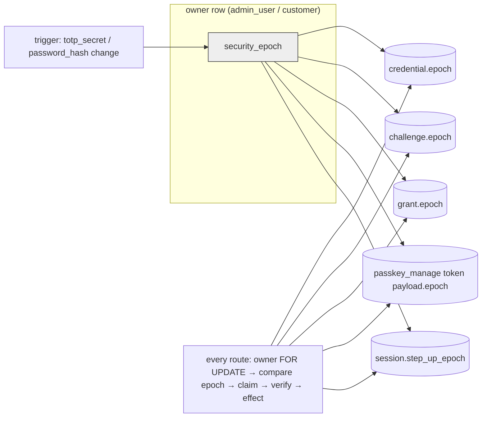

# Passkeys + federated sign-in — implementation plan

**Goal.** Ship the design in `2026-10-21-passkeys-and-federated-signin.md` (revision 14) as three reviewed PRs before
the Damned cutover: engine (PR A), admin SPA (PR B), storefront (PR C).

**Architecture.** `@simplewebauthn/server` 14.0.3 behind one module `auth/passkeys.ts` that implements the five
contract branches over a per-owner `security_epoch` (triggers, migration `0108_passkeys.sql`); routers
`routes/admin-passkeys.ts` and `routes/shop-passkeys.ts`; existing paths restructured per design §5; matrix
contracts and controls per design §8. UIs use `@simplewebauthn/browser` 14.0.0.

**Tech stack.** Hono + zod-openapi, Drizzle, PostgreSQL 17 triggers, Vitest, React (admin), Qwik (storefront).

## Visual plan

## API contract (shared by PR A, B, C)

Common error envelope: `{ error: { code, message, requestId } }`. Generic failures: login/step-up → 401
`PASSKEY_INVALID`; register/manage/grant → 409 `CEREMONY_INVALID`; disabled → 404 `FEATURE_DISABLED`.

Admin (`x-store-slug` not required; cookie session + `x-csrf-token` for authenticated routes):

| Method/path | Request | Response |
|---|---|---|
| `GET /v1/admin/capabilities` | — | `{ passkeys: boolean }` |
| `POST /v1/admin/passkeys/login/options` | `{}` | `{ options: PublicKeyCredentialRequestOptionsJSON }` + `Set-Cookie: sr_pk_nonce` |
| `POST /v1/admin/passkeys/login/verify` | `{ response: AuthenticationResponseJSON, returnToken?: boolean }` | same body as `POST /v1/admin/login` (`csrfToken`, `admin`, `stores`, `totpEnrollmentRequired?`, `token?`) + auth cookies |
| `POST /v1/admin/passkeys/register/options` | `{}` | `{ options: PublicKeyCredentialCreationOptionsJSON }` + nonce cookie; 409 `TOTP_REQUIRED_FIRST`, 403 `step_up_required`, 409 `TOO_MANY_PASSKEYS` |
| `POST /v1/admin/passkeys/register/verify` | `{ response: RegistrationResponseJSON, label: string(1..64) }` | `{ id, label, deviceType, backedUp, createdAt }`; 409 `CREDENTIAL_EXISTS` |
| `GET /v1/admin/passkeys` | — | `{ items: [{ id, label, deviceType, backedUp, createdAt, lastUsedAt }] }` |
| `DELETE /v1/admin/passkeys/{id}` | — | `{ ok: true }` (clears step-up on all sessions) |
| `POST /v1/admin/step-up/passkey/options` | `{}` | `{ options }` + nonce cookie |
| `POST /v1/admin/step-up/passkey/verify` | `{ response }` | `{ ok: true }` |

Storefront (store resolved by host / `x-store-slug`; customer cookie + `x-csrf-token` or bearer):

| Method/path | Request | Response |
|---|---|---|
| `GET /v1/shop/config` | — | adds `auth.passkeys: boolean` |
| `POST /v1/shop/auth/passkey/login/options` | `{}` | `{ options }` + nonce cookie |
| `POST /v1/shop/auth/passkey/login/verify` | `{ response }` | `{ token, customer }` + customer cookies |
| `POST /v1/shop/auth/passkey/grant/password` | `{ password }` | `{ grant }` (opaque, 5 min) |
| `POST /v1/shop/auth/passkey/manage/options` | `{}` | `{ options }` + nonce cookie |
| `POST /v1/shop/auth/passkey/manage/verify` | `{ response }` | `{ grant }` |
| `POST /v1/shop/auth/passkey/grant/request` | `{}` | 202 `{ ok: true }` (mail sent when eligible) + nonce cookie |
| `POST /v1/shop/auth/passkey/grant/confirm` | `{ token }` | `{ grant }` |
| `POST /v1/shop/auth/passkey/register/options` | `{ grant }` | `{ options }` + nonce cookie |
| `POST /v1/shop/auth/passkey/register/verify` | `{ response, label }` | `{ id, label, deviceType, backedUp, createdAt }` |
| `GET /v1/shop/account/passkeys` | — | `{ items: [...] }` |
| `DELETE /v1/shop/account/passkeys/{id}` | `{ grant }` | `{ ok: true }`; 409 `NO_RECOVERY_PATH` |

## File map (PR A, engine)

| File | Responsibility |
|---|---|
| `packages/api/drizzle/0108_passkeys.sql` + `meta/_journal.json` + `src/db/assert-hand-written-migrations.ts` | design §6 schema, §4 triggers |
| `src/db/schema-core.ts`, `src/db/schema-content.ts` | new tables, `securityEpoch`, `stepUpEpoch`, `passkey_manage` kind |
| `src/db/assert-force-rls.ts`, `src/db/rls-tables.test.ts` | exempt the two global tables |
| `src/env.ts` | `PASSKEYS_ENABLED` |
| `src/auth/passkeys.ts` | rpID/origins, challenge rows, the five branches, epoch checks, counter, invalidations |
| `src/auth/passkeys-ratelimit.ts` | the nine buckets |
| `src/auth/cookies.ts` | `PASSKEY_NONCE_COOKIE` helpers |
| `src/auth/admin-session.ts` | `createAdminSessionForPasskey`, `markStepUpVerified(token, epoch)`, principal `stepUpEpoch`, snapshot-checked `createAdminSessionIfCredential`, `changeAdminPassword` |
| `src/auth/admin-staff.ts`, `src/auth/second-factor.ts` | captured-epoch snapshot through factor mutations; recovery-code receipt; `verifyTotpOnce` owner `FOR SHARE`; `PASSKEYS_ENROLLED` |
| `src/routes/admin-passkeys.ts`, `src/routes/shop-passkeys.ts` | routers |
| `src/routes/admin-helpers.ts` | `requireStepUpEpoch(admin, epoch)` |
| `src/routes/admin.ts`, `admin-system.ts`, `admin-security.ts`, `admin-settings-advanced.ts`, `admin-push.ts` | login snapshot + in-tx rehash; native step-up restructure; epoch-aware step-up consumers; invite acceptance snapshot; bulk revoke owner lock; device registration owner `FOR SHARE` |
| `src/routes/auth.ts`, `customer-tokens.ts`, `account.ts` | rehash flag; magic-link / verify-email owner-first; reset burns `passkey_manage` + deletes C/P/G; password change restructure; `me(tx, token, { renew: false })` |
| `src/auth/session.ts` | non-renewing `resolveCustomer` option |
| `src/routes/shop-config.ts` | `auth.passkeys` |
| `src/app.ts`, `src/routes/admin-agent-guard.ts`, `src/auth/agent-policy.ts` | allowlists, `PUBLIC`, `AGENT_DENIED`, `AGENT_DENY_EXCEPTIONS`, `IRREVERSIBLE_PATH` |
| `src/jobs/scheduler.ts` | prune expired challenges |
| `src/sdk/webauthn.testkit.ts` | software authenticator |
| `src/sdk/authorization-matrix.passkey-cases.testkit.ts` (+ wiring in corpus/public-auth/customer) | contracts and controls |
| `src/auth/passkeys.db.test.ts`, `src/routes/*passkeys*.db.test.ts` | §4 matrix cells, §5 concurrency rows, branch bindings |
| `src/sdk/route-inventory.golden.json` | new routes (regenerate with `UPDATE_ROUTE_GOLDEN=1`) |

## Tasks (TDD, each = failing test → minimal code → suite)

1. Migration + schema + inventories; test: `db/rls-tables.test.ts` and `pnpm db:assert-hand-written` green; migrate a
   throwaway DB and assert the two triggers bump/clear as §4 states (SQL-level test `auth/passkeys-triggers.db.test.ts`).
2. Software authenticator testkit (parallel workstream): registration + authentication responses for a given
   rpId/origin/challenge/userHandle, flags UP/UV/BE/BS, counter; unit test round-trips through `@simplewebauthn/server`.
3. `auth/passkeys.ts` core: rp identity, challenge issue/claim, branch A (assertion) + B (registration) + epoch checks +
   counter; db tests for every binding negated.
4. Admin routes + admission + agent policy + `capabilities`; db tests; matrix cases; boundary script green.
5. Customer branches C/D/E + shop routes + `auth.passkeys`; db tests; customer cases/controls.
6. Existing-path restructurings (§5 table + §4 matrix deletions): login snapshot/in-tx rehash, native step-up, factor
   mutations + receipts, password change, invite acceptance, bulk revoke, device registration, magic-link/verify-email
   owner-first, reset burns `passkey_manage`, `resolveCustomer` non-renewing; concurrency tests per §5 row.
7. Rate limits + pruning job; tests.
8. Route golden, storefront client regeneration, docs; both matrix lanes green in CI.

PR B (admin SPA): `pages/Login.tsx` passkey button + autofill; step-up modal; `pages/Settings.tsx` passkeys section;
`api.ts` helpers; component tests. PR C (storefront): sign-in passkey button + autofill (gated by `/v1/shop/config`),
account security section (add/remove with grant flows), Apple button + gating + CSP, regenerated client, tests.

### Critical Files for Implementation
- packages/api/src/auth/passkeys.ts
- packages/api/drizzle/0108_passkeys.sql
- packages/api/src/routes/admin-passkeys.ts
- packages/api/src/routes/shop-passkeys.ts
- packages/api/src/sdk/webauthn.testkit.ts
